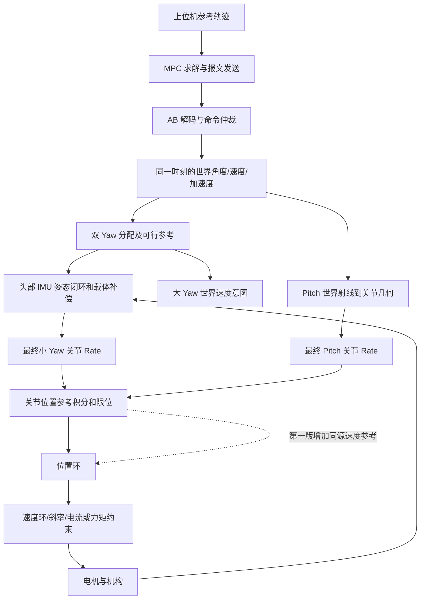

# 云台 MPC 轨迹跟踪响应优化实施指南

日期：2026-11-14。

状态：已按当前工作区源码和现存 CSV 修订可行性分析，尚未按本文修改控制实现。本次仅修改本文并只读分析数据，没有执行编译、测试、固件运行、刷机或模拟。

## 0. 可行性结论与本次修订

**总体路线有条件可行，原稿不能直接作为完整实施合同。** Pitch 死区单项实验、保留现有姿态闭环、通过已有位置接口传入关节速度、最后重新辨识 MPC 模型，这些方向与当前实现兼容；但“接通两轴参考速度后逐步加 gain”必须先补齐会话恢复、参考连续性和诊断能力。提高跟踪带宽的幅度仍须实机确认。

| 原稿问题 | 当前证据 | 修订后的实施要求 |
| --- | --- | --- |
| 把有效视觉分支视为前馈可用的充分条件 | `vision_active` 不代表轴已 Active、本周期实际执行、参考没有重播种；执行器漏周期会直接返回 | 第7节区分请求、接受和实际生效；切换/重播种/无效输出后重建参考，不携带旧目标债 |
| 从实际位置增量求速度后，默认可直接启用 Pitch 前馈 | Pitch 当前用几何目标与旧目标的差除以 dt，仅限制速度；没有关节参考加速度整形 | 先以 gain=0 记录最终参考；平稳段才逐轴试验。跳变、追赶或斜率频繁饱和时先补受限关节参考，不能单独滤波前馈速度 |
| 只追加诊断量，未核算通道和带宽 | 49 float 的 VOFA 帧为200字节，20 ms周期，UART7为115200、8N1，包缓冲仅208字节 | 按用户要求精简为32通道，保留闭环必要量；第11节给出固定布局及周期内事件汇总，不直接追加全量200 Hz串口输出 |
| 上位机发送“执行时刻”节点，但 MCU 又按年龄外推 | AB无节点时间戳，`main.cpp` 总会加本地接收年龄和配置延迟 | 第5节固定报文节点时间语义；避免上位机提前预测与MCU补偿重复 |
| 易把世界规划约束当作最终关节约束 | 姿态校正位于分配后；正式调用没有填写载体加速度有效标志；Pitch只有限速 | 第3、7节明确哪些层有限速/限加速度，哪些没有；不宣称最终关节p/v/a已全程可行 |
| 默认所有参数候选和采集背景都有证据 | CSV存在，截图及上位机源码不在本次输入中，采集固件身份未知 | 保留已复算的CSV指标；截图和原稿中的采集背景标为历史记录，参数值标为实验候选 |

本次复算确认：5997行、约29.997 s；Yaw/Pitch执行RMSE分别为1.9394°/1.0122°，1 Hz幅值比分别为1.2617/0.6553，等效滞后为105.49/133.71 ms。数据支持“规划字段与实测之间存在明显差异”，不能单凭这些量把原因唯一归结为位置死区、D或电机带宽。

## 1. 目标、范围与实施结论

目标是提高正式云台在视觉轨迹下的跟踪带宽：目标变化时更早开始动作、减少持续跟踪的相位差、缩小平台段残差，同时控制过冲和换向拖尾。

本次证据支持的实施顺序是：

1. 上位机生成满足约束的轨迹，并处理 MPC 未收敛；先恢复可比较的 1 Hz 基线。
2. 补齐控制链观测，把规划误差、实际执行误差、大小 Yaw 分配和限幅分开记录。
3. 单项缩小 Pitch 位置死区，再根据结果调整位置 D；每轮参数有独立记录。
4. 保留现有头部姿态闭环，完成会话恢复与合成限幅后，将实际积分到关节位置目标中的速度传给位置控制层；先以gain=0观测，确认参考连续性后逐轴启用。
5. 在记录完整后优化大小 Yaw 协同，再重新辨识下游闭环并调整 MPC 模型。

第一版不重写双 Yaw 分配器，不更换电机控制后端，不直接增加加速度力矩前馈，不改变 AB 帧格式，不通过放宽机械限位或增加力矩上限改善曲线。

与已有[双 Yaw 速度、加速度分配与视觉轨迹控制方案](双Yaw速度加速度分配与视觉轨迹控制方案.md)的关系：该文描述总体架构；本文根据实测记录细化响应优化和第一版接入方式。已有文档中的阶段、接口设想不作为“当前已经接通”的证据，以本次读取的实现为准。

## 2. 证据来源与不能混用的两组工况

### 2.1 工况 A：现有 CSV，1 Hz

原始文件：[tmp/response_1794665676239.csv](../../tmp/response_1794665676239.csv)。该文件位于临时目录，长期保存实验记录时需另外归档；本文已保存关键统计和计算口径，不依赖会话中的临时图片。

原稿记载的采集背景是：Pitch 方向修正并重新刷机后采集，底盘固定，大 Yaw 仍参与运动。本次可直接核实的是CSV内容；文件本身不记录刷机、底盘固定状态和大Yaw参与情况，这些背景沿用原稿、待实验记录确认。这里的“底盘固定”不等于“枪头载体的大 Yaw 不转”。

| 项目 | CSV 中的结果 |
| --- | --- |
| 数据量 | 5997 行，约 29.997 s |
| 时间范围 | `t_s = 33.977887460 .. 63.974710795` |
| 参考尺寸、频率 | Yaw 宽 6°，Pitch 高 3°，1 Hz，`corner_fraction=0.4` |
| 请求频率 | 约 200 Hz |
| 反馈频率 | 约 95 Hz；按角度更新次数估计约 95.28 Hz |
| 反馈、计划、控制字段 | `feedback_valid / plan_valid / control / mode` 全部为 1 |
| MPC 状态 | 两轴 `converged` 全为 1，`limited` 全为 0 |
| MPC 求解耗时 | 中位数 0.234 ms，P95 0.516 ms，最大 4.906 ms |
| 循环间隔 | 中位数约 5.000 ms，最大 10.676 ms |
| `rx_age_ms` | 中位数 5.255 ms，P95 10.000 ms |
| `overruns` | 字段从 5 增至 8；字段具体计数语义需上位机源码确认 |

`limited=0` 是上位机记录的状态，不代表 MCU 下游的速度斜率、制动包络、位置限位和电流/力矩限幅都未触发。`control=1` 也不能替代 MCU 执行许可和来源状态的确认。

| 1 Hz 指标 | Yaw | Pitch |
| --- | ---: | ---: |
| 参考角度与 MPC 角度的 RMSE | 0.0357° | 0.0391° |
| MPC 角度与实测角度的 RMSE | 1.9394° | 1.0122° |
| 平均 `MPC - RX` | +0.9170° | -0.0243° |
| 实测/指令的 1 Hz 基波振幅比 | 1.2617 | 0.6553 |
| 实测相对指令的 1 Hz 相位滞后 | 37.98° | 48.13° |
| 相位换算的等效滞后 | 105.49 ms | 133.71 ms |
| MPC 速度绝对峰值 | 17.43°/s | 17.81°/s |
| MPC 加速度绝对峰值 | 239.51°/s²，即 4.18 rad/s² | 242.10°/s²，即 4.23 rad/s² |

对 29 个完整周期分别拟合，Yaw 振幅比中位数约 1.257、等效滞后中位数约 105 ms；Pitch 振幅比中位数约 0.654、等效滞后中位数约 132 ms。主要现象不是某个孤立周期造成的。

Pitch 平台段进一步统计：取参考速度为零、持续至少 60 ms 的平台，计算每个平台最后 40 ms 的平均误差。低平台误差中位数约 -0.531°，高平台约 +0.472°。这两个量与当前位置死区 0.573° 接近，是优先处理小误差响应的依据。

这些平台仍可能有余速，不能当作严格静态标定结果。CSV 是世界姿态，位置死区作用于关节编码器误差，两者量级接近支持排查方向，但尚不能单凭此记录证明死区是全部原因。

### 2.2 工况 B：用户截图，2.3 Hz

以下设置和状态转录自原稿。本次没有原始截图或对应CSV，不能独立核实读数；速度下界计算以这些读数及“宽度为峰峰值、频率为完整往返周期频率”为条件：

| 项目 | 截图读数 |
| --- | --- |
| Yaw 宽度 | 10.9° |
| Pitch 高度 | 7.0° |
| 周期频率 | 2.3 Hz |
| MPC 最大速度 | 43.0°/s |
| 请求/反馈频率 | 约 200/95 Hz |
| MPC 迭代 | Yaw/Pitch 为 10/10 |
| MPC 收敛 | `N/N` |
| 限幅状态 | `N/Y` |
| 加速度上限显示单位 | rad/s²，Yaw/Pitch 为 50/100 |

此工况没有对应原始 CSV。截图中的误差、幅值和相位不能套用工况 A 的精确数值。截图 `overruns=77` 是一个显示值，不能解释为可见 6 s 内发生了 77 次超时。

在一个周期中，Yaw 至少要从左端走到右端，再返回。设峰峰宽度为 `W`、周期频率为 `f`，速度绝对上限至少满足：

```text
v_min = 2 * W * f
      = 2 * 10.9 * 2.3
      = 50.14 deg/s
```

这已经超过 43°/s，并且还是不计加速、减速、停留和圆角形状的必要下界。43°/s 下，该宽度的理论频率上界只有约 1.97 Hz，实际可用值还应更低。因此应优先降频或缩小尺寸，不能只增加 MPC 迭代次数。

图中参考速度峰值粗读约为 75～80°/s，具体值应从同工况 CSV 计算，不能据此直接提高实机速度上限。截图中“角度接近参考、速度却截顶”的现象，也要求核对角度、速度、加速度是否来自同一时刻的可行预测状态。

### 2.3 证据边界

- 原稿记录了 CSV 的采集背景，但记录中没有固件构建标识、完整参数快照和 MCU 内部执行轨迹，无法逐项证明采集镜像等同于当前全部源码配置。
- `tmp` 中没有 MPC 实现、模型、预测步长、权重和求解器接口；本文不虚构对应源文件名，也不指定没有依据的 Q/R 或预测时域数值。
- MPC 角度接近参考只说明这两个字段接近，不证明 MPC 的内部模型准确，更不证明真正发送的报文和执行器轨迹始终可行。
- `rx_age_ms` 通常描述收到反馈后的年龄，具体定义仍需上位机实现确认；AB 反馈帧不带完整采样时间戳，不能据此测出整链观测延迟。
- CSV的约95 Hz是上位机反馈接收/数值更新频率，不是MCU电机反馈或头部IMU的采样频率；不能用它推断位置D在MCU内的差分周期。

## 3. 当前代码路径与实际生效的控制层

行号来自本文编写时工作区，仅作定位；后续实施后可能移动。

| 文件与位置 | 当前行为 | 对优化的意义 |
| --- | --- | --- |
| [vision_ab_protocol.cpp](../../lib/communication/vision_ab_protocol.cpp)，第67～72行 | 直接解码世界 Yaw/Pitch 角、速度、加速度 | 接收端不自动替发送端修复轨迹一致性 |
| [command.cpp](../../lib/robotics/command.cpp)，第378～400行 | 保存被仲裁选中的视觉目标，限制速度和加速度字段 | 单独截取导数字段不等于完整轨迹重新可行化 |
| [main.cpp](../../applications/sentry_gimbal/src/main.cpp)，第360～374行 | 使用本地接收年龄及已配置延迟外推目标 | 不应把机械相位滞后填入采集延迟 |
| [dual_yaw_motion_allocator.cpp](../../lib/robotics/dual_yaw_motion_allocator.cpp)，第202行起 | 视觉角度修正与速度前馈进入受限头部计划 | 已存在一层规划/约束，不宜再叠加无状态角度限幅 |
| 同文件，第299～323行 | 持续分量低通，加回中速度，生成大 Yaw 意图 | 大 Yaw 不是按低加速度阈值开关 |
| [inertial_gimbal.cpp](../../lib/robotics/inertial_gimbal.cpp)，`InertialGimbalAdapter::update` | 用头部姿态/gyro闭环，并以头部世界速率减关节编码器速率估计载体速率 | 此补偿量不是分配器使用的BMI088载体速率；应分别记录 |
| [main.cpp](../../applications/sentry_gimbal/src/main.cpp)，第433～469行 | 视觉 Pitch 由世界射线及头部姿态转换为关节目标，再换成受限 Rate 指令 | 不能直接把世界 Pitch 角速度当电机关节速度 |
| [gimbal_executor.cpp](../../lib/robotics/gimbal_executor.cpp)，第86～109行 | 有效 `yaw_trajectory` 优先于 Yaw Rate 路径；Pitch 仍走普通轴更新 | 直接填入分配器原始轨迹会改变当前反馈执行路径 |
| [gimbal_axis.cpp](../../lib/robotics/gimbal_axis.cpp)，第174～222行 | Rate 积分为位置目标，最终调用两参数 `PositionMotor::update` | 当前 Rate 路径未把参考速度传给位置控制层 |
| 同文件，第227～304行 | 轨迹接口可将位置、速度、加速度传给四参数位置控制接口 | 接口可复用，但不能不处理控制所有权就直接切换 |
| [motor_position.c](../../lib/control/motor_position.c)，第79～99行 | 位置环积分冻结，支持可选参考速度前馈 | 增加位置 Ki 无法解决本路径的残差 |
| [pid.c](../../lib/control/pid.c)，第107～132行 | 死区内 P 为零；D 为负的测量变化率乘 Kd | 当前位置 D 只阻尼运动，没有目标速度补偿项 |

### 3.1 不可省略的执行边界

- **限位保护不等于完整动态可行性。** 当前小Yaw/Pitch的`max_lead_rad`均使用默认0，关节Rate目标没有启用通用超前角保护。Yaw另有分配器制动预算和重播种，不能把它当作Pitch也具有的保护。
- 分配器配置的头部加速度上限为10 rad/s²；小Yaw的20 rad/s²相对加速度窗口仅在`carrier_acceleration_valid`为真时参与计算，正式应用当前没有填写这个输入。姿态适配器之后的最终Yaw校正速度也未再次经过同一加速度窗口。
- Pitch在`main.cpp`中仅把`(q_geometric - seed) / dt`限到±3 rad/s；轴层限速为10 rad/s。位置控制层合成速度上限为6 rad/s，内环参考斜率为10 rad/s²，控制努力上限为5 N·m。这些值属于不同层，不保证几何目标的实际差分加速度小于10 rad/s²。
- 小Yaw位置环输出限幅为±4 rad/s，合成速度允许上限为15 rad/s，而轴Rate限速为10 rad/s；第7.5节的合成限幅只防止内环拒绝请求，不可解释为新增的机械制动包络。
- `GimbalExecutor`只要任一轴输出有效就可能报告`RunState::Active`，因此两轴前馈必须分别判断；不能以总状态代替本轴`output_valid`。
- `PositionMotor`实现位于[lib/control/motor_control.cpp](../../lib/control/motor_control.cpp)。它要求新鲜位置及速度反馈、有效参考、Active状态，以及位置/速度PID共同允许的dt（当前1～20 ms）；首次控制历史初始化只提交零努力，不运行控制步进。返回0既可能成功，也可能是`wait()`，必须联合`Telemetry.output_valid/issue`判断。

正式应用在`main.cpp`中重写了`allow_auto`，不能仅凭`calibration.hpp`里的`vision_execute_confirmed=false`断言视觉没有运行。本次读取的`build/sentry-gimbal`与`applications/sentry_gimbal/build/dm_mc02/stm32h723xx`两份配置均启用了视觉接收和新USB栈；它们仍不能证明实机正在运行哪个镜像。



## 4. 坐标、单位和已有方向修正

### 4.1 方向约定

- 世界坐标采用 X 前、Y 左、Z 上；视觉 Pitch 正值表示向下的射线，即低头。
- 视觉角为世界绝对角，正 Pitch 目标不等于任何当前位置下都要向下转，实际运动由目标与当前位置的差决定。
- 当前安装实测关系是 Pitch 编码器增大抬头；`pitch.direction=-1`。
- 手动 Pitch 在正式应用中已先取反，再乘安装方向，以保持原来的摇杆和鼠标响应。

来源：[calibration.hpp](../../include/robotics/vehicle/calibration.hpp)，第66～68行；[main.cpp](../../applications/sentry_gimbal/src/main.cpp)，第480～482行。

| 情况 | 世界/操作者意图 | 当前关节编码器应如何变化 |
| --- | --- | --- |
| 水平且坐标对齐，视觉 Pitch 从0增加到+0.1 rad | 低头 | 约从3.00降到2.90 rad |
| 视觉 Pitch 从0降到-0.1 rad | 抬头 | 约从3.00升到3.10 rad |
| 遥控器下拨且原始 `right_y<0` | 低头 | 负关节速度 |
| 遥控器上拨且原始 `right_y>0` | 抬头 | 正关节速度 |

上述数值示例要求 Yaw 级水平、参考对齐、水平零位正确。`vision_pitch_horizontal_rad=3.00` 仍标注为待实测初值，不能通过改零位掩盖动态滞后。

### 4.2 单位与时间

| 所在层 | 角度 | 速度 | 加速度 |
| --- | --- | --- | --- |
| 图表/CSV | deg | deg/s | deg/s² |
| AB 线协议与 MCU | rad | rad/s | rad/s² |
| DJI 努力输出 | — | — | 电流 A |
| DM MIT 努力输出 | — | — | 力矩 N·m |

```text
rad = deg * pi / 180
43 deg/s ≈ 0.7505 rad/s
0.005 rad ≈ 0.2865 deg
0.01 rad ≈ 0.5730 deg
50 rad/s² ≈ 2864.8 deg/s²
```

AB 的29字节下行与43字节上行没有完整的轨迹采样时间、远端序号和会话标识。第一版保留协议，内部使用单调时钟和来源 stamp；不伪造远端采样时间。

## 5. 优化一：让上位机持续产生可执行轨迹

本节修改位置在外部上位机工程，当前仓库没有其实现。以下是待实现的行为合同和伪代码，不是已经存在的函数。

### 5.1 从实际参考曲线计算需求

对参考生成器输出的一个完整周期计算两轴的 `max(abs(v))`、`max(abs(a))`。有解析导数就使用解析结果；否则用生成器内部时间轴的差分，不能对不均匀主机显示帧简单使用固定 dt。

尺寸和形状不变、只调整频率时，速度随频率一次变化，加速度随频率平方变化。因此可先算：

```text
s_v = min(v_limit_yaw / v_peak_yaw,
          v_limit_pitch / v_peak_pitch)
s_a = min(sqrt(a_limit_yaw / a_peak_yaw),
          sqrt(a_limit_pitch / a_peak_pitch))
s = min(1, s_v, s_a)
f_feasible = f_requested * s
```

分母为零的项目忽略，不用除零；限值必须为有限正数。若实际需要降频，可在此上界下保留约10%的初始裕量。若几何、相位或约束变化，重新生成完整位置及导数，再次计算需求，不只缩放速度字段。

这里得到的是上位机世界轨迹约束。大小 Yaw 分配、载体运动和 Pitch 几何可能产生更大的关节需求，MCU 仍需要原有约束。

### 5.2 一致的计划与同一预测时刻

每次下发的角、速、加速度应对应同一计划、同一参考身份、同一个执行时刻。不能取当前角度、下一节点速度和截幅后的加速度拼成报文。

这里的“同一时刻”还必须与MCU外推合同一致。第一版建议上位机在**本次发送时刻**采样计划的p/v/a，MCU仅补偿接收后的本地年龄；发送到接收的单程延迟确有独立测量时，再作为固定补偿加入。此时`vision_capture_latency_s`的标定依据应是“报文节点时刻到接收时刻”，不能再把上位机已经补偿过的相机采集延迟重复加进去。该字段未知时保持0。

如果现有上位机必须发送未来执行节点，应先明确并实现另一套固定超前量合同，再修改MCU外推；AB本身不能让MCU识别任意未来时刻。不能一边发送未来节点，一边继续原样加`local_age + capture_latency`。协议未扩展前，也无法证明远端旧帧属于哪个新会话；本地stamp仅证明接收时间，新参考切换必须依赖发送端清理旧计划和现有仲裁门控。

采用恒加速度离散模型时，计划内部应满足：

```text
q[k+1] = q[k] + v[k] * dt + 0.5 * a[k] * dt²
v[k+1] = v[k] + a[k] * dt
```

若实际 MPC 采用其他离散化，应使用其真实模型；上述式子不是对未知上位机模型的认定。Yaw 差分应先处理 ±pi 边界，不把角度环绕当成高速转动。

`plan_valid` 应包含数值有限、求解状态可接受、约束残差可接受以及计划时效等条件，不能只代表函数返回了数组。

### 5.3 求解与失败回退

建议的应用层状态为 `TRACKING / REUSING_VALID_PLAN / STOPPING / HOLD`：

| 状态 | 输出行为 | 退出条件 |
| --- | --- | --- |
| TRACKING | 使用新收敛、可行且连续的计划 | 本轮求解失败或输入/许可无效 |
| REUSING_VALID_PLAN | 仅沿上一条仍在有效时域内的计划向前执行 | 新计划可用，或旧计划即将到期 |
| STOPPING | 用已确认的减速度从当前参考速度平滑降到零 | 停止完成，或许可撤销/硬件异常 |
| HOLD | 在仍获授权且反馈有效时保持位置 | 新的有效会话/计划到来 |

状态属于上位机计划管理，不替代 MCU 的安全、来源和超时门控。许可丢失、急停和反馈无效应服从现有撤权路径，不能为了平滑减速延长控制许可。

失败回退的关键规则：

- 复用旧计划时按旧计划的时间推进，不重复发送同一个非零速度节点，也不延长旧计划寿命。
- 新目标、重置中心或参考代次变化后，不继续使用旧参考的计划。
- 新计划的首个执行节点应与上一条实际发出的参考状态衔接；仅“求解收敛且各自满足约束”不能排除换计划时的位置/速度跳变。测量状态与旧参考偏差过大时走受限接管，不强接两条轨迹。
- 连续失败、旧计划到期或恢复轨迹不可行时，进入受限停止；停止计划也不可行时交由现有停止/失能规则处理。
- 必须在旧计划耗尽前预留停止所需时域。恒减速度粗估为`t_stop=abs(v_ref)/a_stop`、`d_stop=v_ref²/(2*a_stop)`，还需留出时延、载体运动和跟踪误差余量；已经没有制动行程时不能声称仍可平滑停车。这里的参考停止不等于实机已经静止。
- 记录失败原因、连续失败时长、计划年龄、最大约束违反量和实际回退状态。
- 增加迭代预算之前记录最坏耗时；200 Hz 周期只有5 ms，平均耗时小不代表最坏耗时有余量。

阶段完成后的操作检查点：1 Hz 基线下计划稳定有效；受约束时主动降频或缩尺寸；图中的角、速、加速度相互一致；未收敛输出不再直接执行。

## 6. 优化二：先做可归因的 Pitch 参数调整

位置：[include/robotics/vehicle/gimbal_profile.hpp](../../include/robotics/vehicle/gimbal_profile.hpp)，`pitchMotorConfig()`。

| 项目 | 当前值 | 第一项候选 | 后续候选与限制 |
| --- | ---: | ---: | --- |
| 位置 deadband | 0.01 rad | 0.005 rad | 静止噪声和机构允许时再评估0.003；不直接归零 |
| 位置 Kp | 30 | 保持 | 内环速度和努力输出未饱和、阻尼已明确后再讨论 |
| 位置 Kd | 2.0 | 死区实验后单独试1.2 | 降低后可能增大过冲，不与Kp同时变更 |
| 位置 Ki | 0.6 | 保持 | 当前积分冻结，增大无助于该路径 |
| 速度反馈滤波 tau | 0.02 s | 前两轮后单独试0.01 s | 查看速度噪声与努力输出抖动 |
| 速度参考升降斜率 | 10 rad/s² | 保持 | 1 Hz名义MPC峰值仅约4.23；仍需观察校正量是否触限 |
| 努力上限 | 5 N·m | 保持 | 未确认饱和原因前不提高 |

第一轮只改死区，保持其余参数和轨迹一致。第二轮以已经记录的参数为基线，只改 D。第三轮才讨论反馈滤波。参数应有明确的“保留/恢复”结论，不把三轮候选一次性写入配置。

这些参数工厂也供其他模式/样例使用；缩小死区或改变 D 可能改变手动细调、静止保持和其他引用者的响应。方向映射仍保持本次已经修正的关系。后续如需视觉专用参数，应显式选择配置或模式，不能假称共享参数只影响视觉。

表中的0.005、1.2和0.01均为实验候选，不是从CSV辨识出的最优值。`pid.c`的死区是硬门限：门限外P使用完整误差，不减去死区宽度；Pitch门限附近的P跳变量约由`30×0.01=0.30 rad/s`降至`30×0.005=0.15 rad/s`。缩死区可能改善平台小误差，也可能暴露噪声，不能承诺平台误差必然减半。

位置D取编码器位置按控制dt差分，`position.derivative_tau_s`当前为0；它不使用速度内环的`measurement_filter_tau_s=0.02`。因此将速度反馈tau改为0.01不会平滑位置D的尖峰。先记录编码器更新时刻、位置D和内环滤波速度，区分这两条通路，再决定候选参数是否值得尝试。

## 7. 优化三：第一版采用 Rate 路径的速度参考桥接

### 7.1 为什么不直接启用现有 Yaw 绝对轨迹入口

`GimbalExecutor` 发现有效 `yaw_trajectory` 后会优先调用 `updateTrajectory()`，不再执行该周期的 Yaw Rate 命令。当前正式应用的 Rate 命令包含头部 IMU 姿态误差、载体补偿和实时行程预算。

因此，不能把 `allocation.joint_position_rad/rate/acceleration` 原样塞进 `input.yaw_trajectory` 就宣称接通前馈：这会绕开当前最终关节速度中的部分反馈作用。完整绝对轨迹接管需要重新定义唯一的世界姿态反馈所有者，属于后续架构阶段。

第一版保留当前闭环和 Rate 命令，由 `GimbalAxis` 同时输出它实际积分得到的 `q_ref` 与同源 `v_ref`，使下层能跟踪移动参考。这是对关节参考的速度前馈，不等于未经变换的 MPC 世界速度直通。

### 7.2 建议的接口变更

下列字段/接口是建议新增项，尚未实现：

```cpp
// include/robotics/gimbal/gimbal_axis.hpp
struct AxisCommand {
    GimbalMode mode = GimbalMode::Disabled;
    float target_rad = 0;
    float rate_rad_s = 0;
    bool use_rate_reference = false; // 仅允许有效的 Active + Rate 路径使用
    bool restart_rate_session = false; // 请求丢弃旧Rate目标，本有效周期只播种
};

// include/robotics/gimbal/gimbal_executor.hpp
// 在 GimbalExecutionInputs 末尾追加，默认false以保留既有调用者行为。
bool yaw_use_rate_reference = false;
bool pitch_use_rate_reference = false;
bool yaw_restart_rate_session = false;
bool pitch_restart_rate_session = false;
```

本轮只在正式应用的有效视觉 Rate 路径启用；手动、Hold、Disabled 和参考恢复阶段保持关闭。现有其他样例的三字段 `AxisCommand` 聚合初始化仍使用默认 false。

`use_rate_reference`是本周期的**使用请求**，不是前馈已经生效的状态。恢复周期即便保留该请求也必须输出零前馈；正常实验先保持`velocity_feedforward_gain=0`。`restart_rate_session`是本地事件，不是AB远端会话号，不得根据每一帧递增的`source_stamp.sequence`反复置位。

| 项目 | 合同 |
| --- | --- |
| 输入坐标 | 关节编码器坐标；Yaw已完成分配/载体补偿，Pitch已完成几何变换 |
| 输入单位 | `rate_rad_s` 为rad/s，`dt_s` 为s |
| 时刻 | 与本周期最终位置积分同一控制时刻 |
| 调用线程 | 现有单一执行线程；不在USB/IMU中断中运行控制 |
| 状态 | 保留本轴目标和代次；增加参考请求的前态及一次性恢复标志，处理主动重播种与漏周期 |
| 输出 | 已限位位置参考、有效参考速度及有效标志；边界投影时输出零前馈，但标明其不再是位置差分导数 |
| 不兼容组合 | 本方案统一清零：非Active/非Rate/本轴输出无效时不使用速度参考；不得用残留值。数值输入非法仍走既有错误路径 |
| 异常 | 保留`-EACCES/-EINVAL`、反馈错误和下层等待/故障语义；不新增隐式使能 |

### 7.3 参考速度必须对应实际积分结果

在 `GimbalAxis::update()` 中保留原有校验、反馈恢复、模式处理、目标积分和位置约束。**必须同时修改恢复处理，不能只在现有函数末尾换成四参数调用。** 下列是逻辑顺序伪代码，`restart_pending`、`reference_accepted`等是本次待增加的状态/诊断，不是现有变量：

```cpp
// 前置：反馈、许可、参考和PositionMotor允许的dt都有效。
// 失效周期按现有撤回/等待规则处理，同时使下一参考周期需要恢复。
const bool restart = restart_pending || command.restart_rate_session ||
                     reference_request_changed || reference_generation_changed;
if (restart) {
    // 丢弃旧目标及控制历史，用本参考的新鲜测量播种；检查播种返回值。
    // 本次不积分。不得把测量跳变除以dt形成前馈。
}
const double q_before = target_angle_rad_; // 本次必要播种之后
const float integration_dt = restart ? 0.0f : valid_integration_dt;

// 保留原Rate限速、积分、机械/lead投影；Continuous在wrap前保存增量。
// 得到q_candidate、actual_delta和projected，不跨恢复周期取差分。
const bool reference_accepted = command.use_rate_reference &&
                                command.mode == GimbalMode::Rate &&
                                action == SafetyAction::Active &&
                                integration_dt > 0.0f && !projected;
const float v_ref = reference_accepted ? float(actual_delta / integration_dt) : 0.0f;
// v_ref还需检查有限性与轴限速，不用任意clamp掩盖错误的差分。
const int ret = reference_accepted
    ? position_.update(q_candidate, v_ref, 0.0f, dt)
    : position_.update(q_candidate, dt);
const auto telemetry = position_.telemetry();
if (ret < 0 || !telemetry.output_valid) {
    // 丢弃本周期新增目标/前馈；撤回或标记待重播种。
    // 保留错误或等待原因，不把返回0一律当执行成功。
} else {
    // 提交目标与本周期诊断；只在恢复被消费后清除restart_pending。
}
return ret;
```

实现时必须处理：

- `q_before` 不能取恢复前、Hold重播种前或跨参考代次的旧目标。
- 首次恢复/无有效积分间隔时速度为零；不使用本次测量跳变反推速度。
- Hold、Disable、反馈失效和超时不带前一周期的非零参考速度。
- 连续轴需在wrap之前保存积分增量，不能对 `+pi → -pi` 的存储值直接求差。
- 机械限位、lead投影或外向制动使目标失去原轨迹含义时，清除不一致前馈并记录状态；下一周期从可执行参考继续，不积攒未执行运动。
- 后续完整轨迹规划应提前制动；边界投影后的清零是保护动作，不证明该过渡仍满足原来的加速度/jerk承诺。
- 当前`reseedTargetFromFeedback()`仅调用`seed()`，会把轴置为已初始化，不会自动使下一次`integration_dt`归零。应补充一次性抑制积分/前馈标志；在未处理它前，不能声称“重播种后首周期天然为零”。
- 当前`GimbalAxis`在调用下层前已修改目标，而`PositionMotor`可能因速度反馈缺失、dt无效等等待。新参考路径应在本轴未实际输出时丢弃本次新增目标，并在恢复时重新播种；C控制器的临时状态提交合同不自动覆盖C++轴目标。

建议在`TargetStatus`追加`reference_requested`、`reference_accepted`、`reference_velocity_rad_s`和`restart_reason`；保留现有`limited_rate_rad_s`的“积分前限速命令”含义。合成速度触限、gain=0、位置D抵消等仍可能使真实输出不同，诊断应能区分“数据已传入”和“有效前馈已产生”。

这样传下去的速度可能包含上层姿态误差校正，这是分层控制中的关节参考。不要再在本层叠加一次同样的世界姿态误差，也不要把它误记为纯MPC速度。

### 7.4 在执行器与正式应用中连接

实施位置：

1. `GimbalExecutor::update()`在构造两轴`AxisCommand`时传递对应开关和恢复事件，并与`mode==Rate`、本轴输入有效、`yaw_output_valid/pitch_output_valid`联合处理。有效`yaw_trajectory`仍优先且不混入Rate前馈。
2. `sentry_gimbal/main.cpp`在姿态适配、Yaw预算限幅、Pitch几何计算全部完成后设置开关；请求条件包括有效视觉、最终命令为Rate和本轴有效。轴层再检查真正的电机状态、位置/速度反馈及dt，不能只检查`vision_active`。
3. 手动分支保持现有方向转换；不把新的视觉开关留给下一周期。当前 `GimbalExecutionInputs input{}` 每周期重建，有利于默认清零。
4. 保留头部世界参考、参考代次失配处理、Yaw实时制动预算和Pitch几何转换，保持唯一的每总线提交点。

恢复事件必须覆盖以下入口：

| 事件 | 最小处理 |
| --- | --- |
| 手动/Hold进入视觉或退出已启用桥接的视觉 | 标记两轴新Rate会话；不要只重置`dual_yaw/head_control`。轴层也记录桥接请求的变化，避免旧目标债进入新来源 |
| 世界frame/epoch、编码器参考代次或使能代次变化 | 目标与前馈重播种；现有撤权判定仍保留 |
| `allocation.joint_reseed_requested` | Yaw播种后下一有效周期不积分、不前馈；Pitch不受此事件误重置 |
| 执行器周期无效并提前返回 | 对正在使用桥接的轴保留恢复标志，下一有效周期从测量重建；当前代码仅跳过输出，不自动撤销旧目标 |
| 本轴`output_valid=false`或下层等待/失败 | 清除本轴参考接受状态，保留恢复标志直至有效播种；不能因另一轴Active而跳过 |

Pitch还有一个必须共同修正的接缝：`vision_pitch_was_active`目前只记录视觉是否选中，不能证明上周期Pitch执行成功。恢复后的首周期将Pitch Rate置零；下一周期用已经播种并成功执行的`gimbal.pitchTargetRad()`计算几何追踪速度。不要一边轴层换了种子，一边仍把旧种子算出的追赶Rate积分到新目标。

### 7.5 最终速度请求也必须有界

位置控制层的候选速度是：

```text
v_request_raw = position_feedback_output + k_v * v_reference
```

现有速度控制器会拒绝超过 `requested_velocity_abs_max_rad_s` 的请求；不是所有越界都会自动饱和。因此接前馈时必须同时处理合成速度限幅，并给出独立诊断：

```text
v_request = clamp(v_request_raw, -requested_velocity_abs_max_rad_s,
                                 requested_velocity_abs_max_rad_s)
velocity_request_limited = (v_request != v_request_raw)
```

这应放在 `motor_position.c` 中构造速度输入的位置，不能指望下层把异常请求静默接受。新增诊断字段可追加到 `control_motor_position_output`，明确它表示位置反馈与速度前馈合成后的限幅。对零前馈的既有合法调用，行为应保持一致。

建议字段为`velocity_request_raw_rad_s`、`velocity_request_rad_s`、`velocity_request_limited`，以及实际加入的`velocity_feedforward_rad_s`。先检查乘积和加法结果有限，再clamp；仅检查clamp之后会把溢出无穷掩盖成一个合法最大速度。现有`PositionMotor::Telemetry.output`可承载这些C输出字段，无需另建一条控制链。这个上限防止接口`-ERANGE`，仍须观察内环斜率、努力饱和和机械保护。

数值溢出、非有限值仍返回错误，不能把NaN当成限幅值。保持“计算到临时状态、成功后提交”的现有语义。现有位置积分仍冻结，速度环及努力输出的抗饱和处理仍保留。

### 7.6 何时允许把gain调到非零

Rate桥接复用现有结构的代价是：参考中包含反馈校正、几何参考更新及追赶旧目标的速度，不能直接继承MPC世界轨迹的平滑性。每轴单独满足以下条件后才试0.25；另一轴保持gain=0：

1. 新会话、周期恢复和投影事件已被识别，前馈只在参考有效段产生。
2. 记录实际`q_ref/v_ref`及`Δv_ref/Δt`，确认所选低频、小幅工况没有反复的参考跳变、追赶限速或内环斜率触限；95 Hz上位机反馈不能替代这些MCU记录。
3. 每个gain使用独立固件参数快照。参数对象在构造时复制，当前没有运行期调gain接口；不要把“分轮增加”写成已有在线调参功能。

如果Pitch接收新帧或几何姿态更新时`v_ref`频繁跳变，**暂不启用Pitch前馈**，先按第9节补关节参考生成器。这可以只替换Pitch几何角到Rate的转换，继续由现有轴积分执行，不必同时改为绝对轨迹入口。生成器应有唯一连续状态，限速/限加速度后重新积分得到同源q/v，并与轴的播种、投影和实际接受目标同步；不能只把v_ref低通而保持q_ref原样，也不能让两个积分器各自积累不同目标。

受限参考会引入额外跟踪差异，因此“加平滑”本身也不是响应改善保证。先把记录中的参考跳变与物理执行落后分开，再决定是否需要该分支。

## 8. 速度前馈必须与位置 D 的定义协调

### 8.1 当前结构的含义

忽略限幅、死区和滤波时，现有位置层近似为：

```text
v_request = Kp * (q_ref - q_meas) - Kd * v_meas + k_v * v_ref
```

当前 `k_v=0`，且 Rate 路径未提供 `v_ref`。`-Kd*v_meas` 是运动阻尼，不包含目标运动速度。因此接通参考后直接把 `k_v` 设为1，并不能保证目标运动时无误差。

在“速度内环理想、参考恒速、无积分和限幅”的简化条件下，要在零位置误差处维持 `v_meas=v_ref`，需要 `k_v=1+Kd`。这个推导只说明现有 D 与前馈的关系，**不是把当前Yaw系数直接设为4.6、Pitch设为3.0的调参建议**；实际机构、上层反馈和饱和都必须考虑。

### 8.2 第一版与后续结构的边界

第一版先用已有 `velocity_feedforward_gain`，初值0，完成桥接和限幅后，再按0.25、0.5等小步增加，记录每个值的幅值、相位、努力饱和和停止拖尾。增加到1不是必须完成的目标，不能以系数大小代替实际响应。

这里必须先满足第7.6节；Yaw先做、Pitch先做均由本轴参考质量决定，不默认同时开启。上述简化推导中的`v_meas`是位置D使用的差分速度；真实代码中它与电机上报速度、内环滤波速度可能不同，所以`1+Kd`连同采样、滤波和上层闭环一起被忽略时才是理想关系。

若现有强阻尼持续妨碍跟踪，再在显式的轨迹模式下考虑：

```text
v_request = v_ref + Kp * (q_ref - q_meas)
                    + Kd_track * (v_ref - v_meas)
```

这种结构保留速度误差阻尼，同时补偿参考运动；`Kd_track` 为重新确定的系数，不直接复制旧位置 D 数值。它是后续可选改造，不应全局修改 `pid.c` 的通用 D 定义而影响其他电机和底盘控制器。

可选实现应在 `motor_position` 的显式轨迹分支或专用配置中表达，并在同一最终速度请求上限幅。没有有效参考时使用明确的既有行为，不混入旧轨迹速度。

第一版继续保持 `acceleration_effort_gain=0`。力矩/电流加速度前馈需辨识惯量、方向和可用努力裕量；不能把 `rad/s²` 直接作为 `A` 或 `N·m` 相加。

## 9. Pitch 几何与后续完整关节轨迹

现有几何计算可继续复用：

```text
Q_stage = Q_head * Ry(-direction * (q_measured - q_horizontal))
r_world = [cos(p)*cos(y), cos(p)*sin(y), -sin(p)]
r_joint = R(Q_stage)^T * r_world
theta = atan2(-r_joint.z, hypot(r_joint.x, r_joint.y))
q_geometric = q_horizontal + direction * theta
```

这里的 `q_geometric` 是期望的关节角，不是每周期都能无条件达到的执行参考。第一版继续由Rate积分及既有约束推进它。

后续完整轨迹版本应以 `q_geometric` 为追踪目标，生成有速度、加速度与行程约束的 `q_ref/v_ref/a_ref`，再复用 `GimbalJointTrajectory` 的数据约定。先将现有“small Yaw专用”注释和执行器入口明确推广到Pitch，不能只增加一个字段就假定两轴都已按轨迹执行。

几何导数必须考虑世界目标运动和Yaw级本身的运动。可用解析Jacobian，也可从连续、有时间定义的几何参考生成受限轨迹；上位机不能只对95 Hz重复反馈帧按200 Hz逐行差分，得到交替为零和尖峰的伪速度。MCU应使用自身各传感器的真实更新时间，不假定其等于上位机反馈频率。

世界轨迹的 `pitch_vel` 也不能在任意姿态下直接乘 `direction` 就当关节速度。几何分支接近奇异姿态、输入不新鲜或参考代次变化时，应服从现有停止/恢复规则。

## 10. 大小 Yaw 联合响应优化

### 10.1 当前职责

世界头部速度近似满足：

```text
w_head = w_carrier_measured + direction_small * qdot_small
big_goal = lowpass(active_head_intent) + center_correction
```

大 Yaw 承担持续运动和小 Yaw 回中，小 Yaw 补偿实测载体运动并完成快速修正。底盘固定时大 Yaw 正常参与，不应为了图好看永久关闭分工。

上述速率关系是当前模型的近似，不是任意三维安装姿态下的精确Jacobian。诊断时区分两种载体量：分配器使用板载BMI088的世界速率；视觉Yaw适配器使用“头部Euler Yaw速率 − direction×小Yaw编码器速率”得到的估计。两者坐标、采样时刻和噪声不同，不能合并成一个“载体反馈”通道。

当前主要参数在 [manual_profile.hpp](../../include/robotics/vehicle/manual_profile.hpp)：`vision_slow_tau_s=0.24`、`big_track_gain_s_inv=4.0`、`center_kp_rad_s_per_rad=2.0`。它们分别影响持续分量提取、大 Yaw 意图收敛和回中，不能当作同一个增益。

### 10.2 根据中间信号决定改哪里

| 观测关系 | 更可能需要处理的环节 | 优先动作 |
| --- | --- | --- |
| MPC世界角正确，但分配后头部参考已经明显滞后 | 规划约束、重播种、制动或预算收缩 | 查看分配限制标志与计划角，先不加电机P |
| 分配后参考正确，小Yaw位置参考跟不上最终速率 | 积分/模式切换/限位 | 查看目标状态和有效dt |
| 小Yaw参考正确，编码器明显落后 | 关节位置/速度环和努力输出 | 处理死区、参考速度桥接、内环响应 |
| 大Yaw启停与枪头过冲同步，小Yaw补偿追不上 | 大Yaw实际响应与小Yaw补偿带宽不匹配 | 查看实测载体速率和补偿后的关节速度 |
| 只有靠近端点才变慢 | 制动/机械行程预算 | 保持保护，重新选择中心或轨迹范围 |
| 总体偏差随回中方向变化 | 分配/回中与内环耦合 | 分开看持续项、回中项、实际载体速度 |

原CSV的1.26是1 Hz基波振幅比，不是阶跃超调率，不能据此直接下结论说某个P过大。约0.917°平均动态误差也不等于静态零位偏差，不应直接加固定角度偏置补偿。

只有确认大Yaw滞后贡献明显、小Yaw仍有行程和速度余量时，才单项尝试 `vision_slow_tau_s: 0.24 → 0.35 s`。更大的tau会减弱有限频率下传给大Yaw的快变分量，让小Yaw多承担往复运动；它不会让大Yaw更快，还会增加小Yaw行程需求。不能同时增加回中增益和大Yaw追踪增益。

当前实现还用同一个tau滤波`center_error_rad_`，所以这项修改也改变回中动态；不是只调整持续速度分量。大Yaw加速度命令为`slow_acceleration + big_track_gain*(slow + center_rate - big_rate)`，包含慢分量导数前馈，不能仅用一个4.0的比例增益推断其闭环时常。需要独立调整回中滤波时再显式拆参数，不在首轮隐含改变多处含义。

## 11. 必需的诊断记录

### 11.1 保留现有上位机 CSV

保留参考、MPC、RX的角/速/加速度，以及求解残差、迭代、收敛、限幅、请求与反馈频率。增加计划年龄、求解失败原因、回退状态和实际发送节点标识。

新记录附带：固件构建标识、参数快照、Pitch方向、水平零位、是否有大Yaw参与、轨迹尺寸/频率/方向、是否刚完成重置中心。两组参数变化时另开记录，不把不同工况拼在同一统计中。

### 11.2 MCU内部观测候选

下表是定位问题时可访问的内部量清单，**不是要求把全部量同时放进VOFA**。按用户要求，常驻输出使用第11.3节的32通道；详细P/I/D、各级年龄等仅在需要时切换为单轴专题布局，仍保持同一帧长和明确版本。

| 层 | 至少需要的量 | 单位/说明 |
| --- | --- | --- |
| 来源 | 最终source、mode、视觉参考frame/epoch、来源年龄 | 确认实际使用了哪路命令 |
| 世界参考 | 收到的目标与外推后的目标p/v/a | rad、rad/s、rad/s² |
| 头部测量 | 头部Euler和角速度、姿态/gyro年龄 | 不混用载体姿态 |
| 分配 | 头部可行角/速、大Yaw意图、持续项、回中项 | 判断计划和实际执行的分界 |
| 载体 | 实测世界速率、反馈年龄、有效性 | 小Yaw补偿必须使用实测值 |
| 关节参考 | 最终q_ref、v_ref、参考开关、位置投影/Rate限幅 | 直接定位桥接是否生效 |
| 关节测量 | 编码器位置、速度及更新时刻 | 区分控制目标与测量 |
| 控制器 | 位置P/I/D、合成速度、斜率后的速度、速度误差 | 不只记录进入控制器前的命令 |
| 努力输出 | 控制器请求、最终提交、实测电流/力矩、限幅 | 请求未饱和不代表最终未饱和 |
| 运行状态 | Active、等待原因、参考/使能代次、重播种原因 | 排除恢复和来源切换造成的掉拍 |

现有 [main.cpp](../../applications/sentry_gimbal/src/main.cpp) 第609～651行的旧schema 111中，可复用 I23/I24（载体航向/gyro）、I27/I28（头部角）、I29（头部Yaw误差）、I33/I36（Pitch编码器角/速）、I38（大Yaw意图）、I43（制动余量）、I44（Pitch速度命令）、I47（分配器小Yaw速率）、I48（分配状态）的**数据来源**。下述精简布局重新编号，不沿用旧通道名称。

I47是分配器输出，不一定等于经过头部姿态修正和最终限制后实际执行的Yaw速度。I30是惯性适配器的Pitch观测误差；该分支输出随后被几何Pitch控制覆盖，不能用I30代替实际Pitch位置误差。

### 11.3 精简VOFA：49通道缩为32通道

常驻布局只回答五个问题：用的是哪路命令、目标是否连续、关节有没有跟上、速度/努力有没有触限、大小Yaw是否配合。删除旧布局中的硬件质量枚举、加速度模长、重复年龄、原始输入、旋转档位等常驻输出；启动信息留在既有事件机制或专题布局。

使用一个与旧schema 111不同、实施时明确分配的布局编号。`I0..I31`定义如下，所有角度/速度保持rad、rad/s，努力保持Yaw为A、Pitch为N·m：

| 新通道 | 内容 | 用途 |
| --- | --- | --- |
| I0 | 精简布局编号 | 防止旧VOFA工程按旧语义解释 |
| I1/I2 | 采样序号低16位/高16位 | 识别缺帧，不把显示帧率当采样率 |
| I3/I4 | MCU采样时间ms低16位/高16位 | 同帧对齐、计算实际时间间隔 |
| I5/I6 | 累计丢包数低16位/高16位 | 判断传输是否跟得上 |
| I7 | 来源、mode、本轴输出/参考接受状态位 | 区分请求、执行和前馈有效性 |
| I8 | 本输出窗口最近一次非零控制错误 | 即使瞬时恢复也保留一次错误；轴身份见I31 |
| I9/I10 | 最终送入头部Yaw闭环的世界角 / 实测头部Yaw | 区分分配参考与真实运动 |
| I11/I12 | 外推后的视觉Pitch世界角 / 实测头部Pitch | 观察几何通路总响应 |
| I13/I14 | 小Yaw最终关节位置参考 / 实测位置 | 看位置误差和目标债 |
| I15 | 小Yaw实际接受的参考速度 | 不能用旧I47代替 |
| I16/I17/I18 | 小Yaw合成限幅后速度 / 内环斜率后速度 / 电机上报速度 | 定位速度限幅、斜率和内环落后 |
| I19 | 小Yaw控制器最终努力请求 | 配合限幅事件判断电流余量 |
| I20/I21 | Pitch最终关节位置参考 / 实测位置 | 看几何追踪与平台误差 |
| I22 | Pitch实际接受的参考速度 | 区分参考跳变与真实速度 |
| I23/I24/I25 | Pitch合成限幅后速度 / 内环斜率后速度 / 电机上报速度 | 定位速度限幅、斜率和内环落后 |
| I26 | Pitch控制器最终努力请求 | 配合限幅事件判断力矩余量 |
| I27/I28 | 分配器使用的载体速率 / 视觉适配器估计的载体速率 | 排查两路补偿不一致 |
| I29 | 大Yaw实际下发的世界速度意图 | 取发送门控后的值，不直接使用未授权allocation输出 |
| I30 | 本输出窗口最大控制dt，单位us | 捕获50 Hz抽样可能漏掉的控制超期 |
| I31 | 本输出窗口累计事件位 | 捕获任一5 ms周期的限幅、恢复和错误 |

位图用不超过24位的无符号整数转换成float，避免单精度丢失低位。建议明确分配：I7的bit0..3为source、bit4..6为mode、bit7/8为Yaw/Pitch输出有效、bit9/10为两轴参考请求、bit11/12为两轴参考接受；其余保留。枚举值超出预留宽度应更新布局，不能静默截断。

I31按每20 ms窗口做按位OR：bit0/1合成速度触限，bit2/3内环参考斜率介入，bit4/5位置PID输出触限，bit6/7努力限幅，bit8/9关节机械/lead投影，bit10/11本轴重播种，bit12/13本轴输出无效，bit14/15本轴控制错误，bit16为Yaw制动预算介入，bit17为来源/世界参考变化，bit18为周期无效；每一对都以Yaw在前、Pitch在后。努力限幅位应合并已有控制器限幅及能取得的驱动限幅信息；拿不到最终驱动状态时明确其覆盖层级，不能以控制器未饱和代替硬件未饱和。

参考未接受、测量无效或本周期不是视觉时，对应不适用字段输出NaN，配合I7解释；不要用0假装有效静止。I8记录的错误若两轴同窗口都发生，由I31保留两轴身份，详细错误使用专题记录。时间、序号、丢包采用两段16位，是为了避免直接转float后长时间运行丢精度。

实现位置与约束：

- `diagnostics.hpp`增加显式布局选择，默认保留旧布局；正式云台选择精简布局。其他应用仍使用既有合同，不因本次删通道而被迫换图表。
- `vehicle_diagnostics.cpp`按布局序列化；新布局32个float加4字节JustFloat帧尾，总计132字节，现有208字节包缓冲足够。同步修改正式云台的通道构造和VOFA工程映射，不只删`main.cpp`里的几个数组元素。
- 50 Hz保持不变。115200、8N1按每字节10 bit计算：旧帧`200×50×10=100000 bit/s`，占86.8%；新帧`132×50×10=66000 bit/s`，占57.3%。实际发送受调度影响，仍看丢包数；32通道若升到200 Hz需264000 bit/s，当前串口不支持。
- 控制线程每5 ms更新有界快照、窗口最大dt和事件OR；仅在诊断采样窗口消费后清除窗口统计，不能每次调用`status()`都先清空而让其内部20 ms节流丢事件。串口发送继续在低优先级线程执行，不在控制线程打印。

### 11.4 需要细看时切换专题布局

50 Hz适合比较本次1 Hz低频响应，不能重建所有5 ms尖峰。开启前馈前如需定位某轴，使用另一个明确编号的32通道专题布局：保留I0..I8元数据，其余通道按本轴放入位置P/D、参考增量、前馈项、合成限幅前后速度、滤波速度、努力请求/提交值、反馈时间及窗口最大`abs(Δv_ref/Δt)`。这比把所有量永久追加到常驻布局更合适。

`PositionMotor::Telemetry.output`可以提供已有P/I/D和内环量；最终关节参考诊断从`TargetStatus`取。适配器的载体估计、实际参考接受标志和合成限幅字段需按第7节显式导出，不能重算一个不同步的近似值充当原控制量。若必须完整保留每个控制周期，则另外设计有界内存采集及停止后导出，或在确认物理串口能力后调整带宽；不能只缩短`diagnostic_period_ms`。

MCU和主机时钟目前未同步。MCU内部量按同帧本地时间比较；上位机CSV的命令/RX继续按主机时间比较。需要跨两份记录定量分解延迟时，必须另有共同事件或时钟映射，不能仅按行号或两个独立“秒数”拼接。

## 12. 文件级实施清单与顺序

按仓库 implementation-first 工作流，每个实现批次先理清必要路径、连续完成该批次；不按函数循环“写一点、审一点”。本文中的采集、参数对照和实物验收是后续由操作者安排的独立阶段，本次不执行。

| 批次 | 文件 | 具体工作 |
| --- | --- | --- |
| A：上位机轨迹 | 外部MPC/响应工具，路径待提供 | 峰值需求计算、自动降频、计划节点一致性、非收敛回退、参数快照 |
| B1：观测基线 | `applications/sentry_gimbal/src/main.cpp`、`include/robotics/vehicle/diagnostics.hpp`、`lib/robotics/vehicle_diagnostics.cpp` | 将正式云台VOFA精简为32通道、50 Hz；保留默认旧布局供其他应用使用，补窗口事件汇总和丢包信息。C批次尚未提供的字段标为不可用 |
| B2：Pitch小误差 | `include/robotics/vehicle/gimbal_profile.hpp` | 在B1取得未改参数的基线后，只将Pitch位置deadband改为0.005；其余候选分轮处理 |
| C：显式Rate参考 | `include/robotics/gimbal/gimbal_axis.hpp` | 给AxisCommand追加默认关闭的参考/会话恢复选项；TargetStatus追加实际接受速度与恢复原因 |
| C：执行器传递 | `include/robotics/gimbal/gimbal_executor.hpp`、`lib/robotics/gimbal_executor.cpp` | 两轴参考开关和恢复事件随有效Rate命令传递；漏周期后保留本轴恢复标志 |
| C：同源速度 | `lib/robotics/gimbal_axis.cpp` | 从实际积分增量生成v_ref；处理恢复、Hold、限位、连续角wrap；主动播种抑制一周期；下层未实际输出时不积累目标 |
| C：合成请求限幅 | `include/control/motor_position.h`、`lib/control/motor_position.c` | 合成速度限幅及诊断，保留数值错误和状态提交语义 |
| C：正式应用接入 | `applications/sentry_gimbal/src/main.cpp` | 最终命令构造完成后仅有效视觉路径请求桥接；两轴会话切换重建，Pitch恢复周期与几何计算种子一致 |
| C：惯性诊断导出 | `include/robotics/gimbal/inertial_gimbal.hpp`、`lib/robotics/inertial_gimbal.cpp` | 导出实际使用的载体速率估计及有效性，供精简布局I28使用；不改变控制公式 |
| C：前馈参数 | `include/robotics/vehicle/gimbal_profile.hpp` | 先保持gain=0接通数据，满足第7.6节后逐轴、逐轮增加；加速度努力gain继续为0 |
| C条件分支：Pitch参考整形 | `main.cpp`中的几何角到Rate转换及其状态拥有者 | 若参考频繁跳变，先实现同步于轴恢复/投影的关节速度、加速度受限参考；未完成时Pitch gain保持0 |
| D：D/前馈协调 | `lib/control/motor_position.c`及显式配置 | 有证据后选择轨迹模式速度误差阻尼，不全局更改通用PID语义 |
| E：Yaw分工 | `include/robotics/vehicle/manual_profile.hpp` | 只在记录确认后单项调整持续分量参数 |
| 后续：完整Pitch轨迹 | `main.cpp`、轴/执行器入口与几何参考生成位置 | 明确推广轨迹接口，独立生成受限关节p/v/a |

不要把所有批次一次性合并成首次上机版本。每个可归因的参数实验完成后，再安排下一个实现批次。

外部上位机工程缺失不妨碍先落实B1和B2，但A批次只能作为待实施合同，不能标记完成。C批次的软件接线、恢复处理、限幅和诊断应作为一个完整实现批次；之后才安排非零gain实验，不能把恢复逻辑留到“前馈有效后再补”。本次仅修改这份指南，表内代码文件和VOFA实际输出均未修改。

## 13. 编译与采集操作说明

以下命令仅供后续操作者使用，本文编写时没有执行。没有要求新增自动测试代码或运行测试套件。

业务实现完成后，如需最后一次编译检查，可使用对应正式应用的独立构建目录：

```bash
cd /home/shm-white/skywalker_ws/skywalker_code
/home/shm-white/skywalker_ws/.venv/bin/west build \
  -b dm_mc02/stm32h723xx \
  -d build/sentry-gimbal \
  applications/sentry_gimbal \
  -- -DBOARD_ROOT=/home/shm-white/skywalker_ws/skywalker_code
```

该命令会生成构建文件，仅供操作者在决定构建时运行。记录实际使用的应用源目录、板型、配置、镜像路径和烧录记录，不以目录名字推断已烧录版本。本次只读确认`build/sentry-gimbal`的CMake缓存对应正式应用；两份已打开的`.config`均启用视觉接收和新USB栈，不能沿用“某个目录未启用USB”的历史判断替代当前证据。

本文不提供或执行自动刷机、自动解锁、自动运动命令。已有上位机工具的启动命令未知，不能编造。需要采集时使用现有MPC响应工具，在明确的物理许可下人工操作，并保存原始CSV。

### 13.1 操作者采集顺序

1. 断电确认可动空间、Pitch与小Yaw端点、线束和大Yaw旋转范围；发射相关功能保持禁止。
2. 按现有系统流程上电，先保持停止状态，确认反馈有效、世界参考稳定，未出现参考代次持续变化。
3. 小幅、低速核对方向：下拨仍低头，视觉正Pitch仍指向低头；不要用高速往复判断方向。
4. 先单轴采集，再采集双轴；大Yaw是否参与必须记录。原1 Hz、6°×3°联合工况作为总响应对照。
5. 启动/切换后的过渡单独标记，保留稳定部分至少20个完整周期；不把切换过程混入稳态相位统计。
6. 参数一轮一项。非零前馈前先取得gain=0的关节参考记录，确认来源切换、主动重播种和漏周期的恢复结果；两轴分开增加gain。出现持续振荡、努力长期饱和、行程包络频繁介入或许可反复恢复时停止升频，保存当前记录。
7. 只有可行、收敛且低频响应改善后，再按1.0、1.3、1.6、2.0 Hz等小步升频；2.3 Hz必须重新检查完整参考曲线的速度和加速度需求。

若只改Pitch死区且要保留可比性，轨迹尺寸、频率、方向、大Yaw分工与其他参数均使用原基线。死区和D的比较不要分别使用1 Hz与2.3 Hz记录。

## 14. 指标计算、判定与首轮目标

### 14.1 分开计算三类误差

```text
规划差异：e_plan = reference - MPC
执行差异：e_exec = MPC - RX
总跟踪差异：e_total = reference - RX
```

分别报告RMSE、MAE、平均误差、绝对误差P95；Yaw先处理角度环绕。记录的MPC字段如不等于实际发送字段，增加发送后字段，避免把显示结果当作执行输入。

### 14.2 相位与幅值

对每轴的命令与实测，使用真实时间戳拟合：

```text
x(t) = b + A_cos*cos(2*pi*f*t) + A_sin*sin(2*pi*f*t)
amplitude = hypot(A_cos, A_sin)
phase = atan2(A_sin, A_cos)
gain = amplitude_rx / amplitude_cmd
phase_lag = wrap_pi(phase_rx - phase_cmd)
equivalent_lag_s = phase_lag / (2*pi*f)
```

命令幅值接近零时不报告该频率增益。周期轨迹可按完整周期分别拟合，再报告中位数与分位范围；不能把所有频率折算成一个固定传输延迟。

矩形圆角轨迹有高次谐波，基波结果用于同工况比较，不代表整条波形被一个纯时延和增益完整解释。升频后必须重新拟合，不能从1 Hz的105/134 ms直接预测全频响应。

### 14.3 首轮建议判据

以下是下一轮比较用的工程目标，不是已经达到的性能或硬件保证：

| 阶段 | 建议判据 |
| --- | --- |
| 上位机可行性 | 执行中的计划数值、约束和时效均可接受；失败时进入有记录的回退；不发送明显不一致p/v/a |
| 时间合同 | 明确报文节点对应发送时刻还是未来时刻，上下位机未重复补偿；采样频率与传输频率分别记录 |
| 诊断 | 精简布局映射正确，时间与序号连续、丢包可见；限幅/恢复事件按窗口汇总，未把50 Hz采样当成200 Hz全量记录 |
| 只改Pitch死区 | 同工况平台残差较原约0.5°明显下降，优先争取小于0.3°；静止抖动和努力输出无明显恶化 |
| gain=0桥接 | 实际接受的v_ref与未投影、未恢复段的q_ref增量对应；等待/失败不积累新目标；Pitch参考跳变明确后才决定是否启用 |
| Pitch前馈/阻尼 | 1 Hz振幅比从0.66向1靠近、等效相位滞后相对基线明显下降，RMSE改善且换向不产生持续振荡 |
| Yaw联合响应 | 1 Hz振幅比从1.26向1靠近、相位与平均动态误差改善；小Yaw行程及大Yaw努力输出仍有余量 |
| 频率扩大 | 每个频点重新计算轨迹需求与响应；没有以MPC未收敛、保护频繁触发换取表面速度 |
| 恢复/停止 | 来源退出、参考变化、反馈恢复时无旧速度和旧位置债继续执行 |

“相位降到50 ms以内”“两轴增益都在0.9～1.1”可以作为后续性能愿望，但当前数据不足以保证第一轮达到，不能为达数字而取消约束。

## 15. 回退与常见误调

| 现象 | 优先核对 | 回退方式 |
| --- | --- | --- |
| 开前馈后方向反了 | 世界/关节坐标、Pitch方向是否应用两次、Yaw载体补偿 | 前馈gain回0，保留原方向修正 |
| 开前馈后仍几乎无变化 | 是否进入四参数接口、参考开关是否有效、是否有上层限幅、D是否抵消运动 | 用同一记录定位，不直接继续加gain |
| 一开前馈就报控制错误 | 位置反馈与前馈合成速度是否超过允许范围、字段是否有限 | gain回0，修复合成限幅与诊断 |
| Pitch微调明显但静止抖动 | 死区、位置D及速度噪声 | 只恢复本轮死区或D，不同时改更多参数 |
| Yaw幅度更大、回中摆动 | 大Yaw实测滞后、小Yaw补偿能力、回中项 | 恢复本轮分配参数，保留观测 |
| 到端点后松开仍继续拉 | Rate目标积累、投影后旧前馈、重播种/恢复 | 恢复前馈开关/gain，处理目标状态，不放宽端点 |
| 2.3 Hz明显差于1 Hz | 速度/加速度需求和求解收敛是否满足 | 降频或缩尺寸，不能把差异直接归给P不足 |

不要使用这些方式替代定位：增加当前被冻结的位置Ki；把全部相位滞后填进 `vision_capture_latency_s`；把动态平均误差加到水平零位；同时增大两轴P、缩滤波、增力矩、放行程；把未收敛误差归给电机响应慢。

## 16. 完成清单

- [ ] 工况A与截图工况B分别归档，未混算指标。
- [ ] 明确上位机MPC源码位置、实际离散模型、采样周期、约束单位和输出节点。
- [ ] 实际发送p/v/a来自同一有效计划，非收敛有有界回退。
- [ ] 明确发送节点时刻及上下位机延迟补偿职责，新旧计划连续接管，停止时域和行程有余量。
- [ ] 保留本次Pitch方向修正及正常的手动输入方向。
- [ ] 明确世界参考、关节参考、载体实测速率和最终执行目标的坐标。
- [ ] Pitch死区、D和滤波分轮调整，参数快照完整。
- [ ] 速度参考桥接显式启用，默认关闭，不绕过现有头部姿态闭环。
- [ ] 参考速度来自实际积分/受限轨迹，恢复、Hold、投影后无残留速度。
- [ ] 来源切换、主动播种和漏周期触发本轴恢复；返回0但output_valid为false时不继续积累目标。
- [ ] Pitch几何计算与轴播种同步；gain=0记录确认参考连续性，跳变频繁时先补受限参考。
- [ ] 合成速度请求有界，数值错误和状态提交语义保持明确。
- [ ] 位置D与前馈的定义已协调，未以`k_v=1`直接假定单位增益跟踪。
- [ ] 第一版加速度努力前馈仍关闭，机械限位和努力上限保留。
- [ ] 大Yaw仍承担持续运动与回中，分配调整有中间信号支持。
- [ ] 正式云台VOFA精简为32通道，布局和位图明确；50 Hz带宽、窗口事件和丢包信息保留，其他应用旧布局不受影响。
- [ ] 后续实现完成后才安排所需编译检查；实机采集由操作者另行安排。
- [ ] 未将本文建议当作已上线的性能结论。

最先可独立落地的是精简诊断与未改参数的基线，然后开展Pitch死区单项实验；上位机可行性/回退需取得外部工程后实施。Rate桥接须连同会话恢复和合成限幅完成，并以gain=0确认参考质量后再逐轴开启。Pitch如已有明显参考跳变，关节参考整形应前移，不能作为启用前馈之后的补丁；Yaw绝对轨迹接管和加速度努力前馈仍留到后续阶段。
