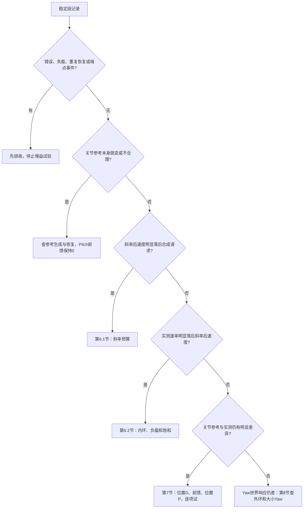

# 云台双轴 MPC 响应逐轮调参手册

日期：2026-11-15。适用于当前 `applications/sentry_gimbal`、schema 113 的32通道 VOFA，以及 `~/RM2026-AutoAim/tests/planning/gimbal_mpc_response_test.cpp`。

这份手册的用法是：**先完成第1～5节，看到哪一种波形再进入对应分支，不要求把所有参数都调一遍。** 第一轮只建立记录并分类；正常情况下先完成 Pitch，再处理大小 Yaw 耦合。附录参数表用来查位置，不是待办清单。

文中的候选数值是逐轮试验起点，不是实机辨识结果，也不保证每一级都应该保留。当前修复和诊断软件已经编译通过，但本手册不假定实机下扎已经消失。本次只编写操作文档，未修改业务代码、运行测试、烧录或驱动设备。

## 1. 今天先做这五件事

1. 在安全行程中部确认手动双向正常，VOFA **I0=113**。若视觉接管仍自行下扎，停止本轮调参，转到[Pitch最低点排查指南](云台MPC测试Pitch最低点排查指南.md)。
2. 按第4节做零幅度保持和小幅 Pitch 运动，确认没有稳定段的错误、失能、重复重播种或端点限制。
3. 保存当前参数记录。当前文件中 Yaw 前馈为0.5、Pitch为0；随后只把 Yaw 前馈改为0，建立两轴零前馈基线。**不要顺手同时改 D、滤波和速度环。**
4. 先用固定的 Pitch 单轴正弦，分别看“关节参考跟踪、速度请求、斜率后速度、实测速度”。用第5节选择唯一一个分支。
5. 对该分支只试第一个候选值，重复同一工况，写下“保留/回退/无法判断”。一天只完成这一轮，也比同时改十个参数更有用。

如果当前已经改成两轴前馈为0，记录实际值即可，不需要再次修改。本文的“改参数”均指后续由操作者在停控状态完成，文档本身没有替你改值。

### 第一阶段只需要认清三个旋钮

| 旋钮 | 所在位置 | 什么时候才轮到它 |
|---|---|---|
| 位置 D | `gimbal_profile.hpp` 中对应轴的 `c.loop.position.kd` | 速度内环跟得上，但移动目标跟踪仍拖后，怀疑运动阻尼过强 |
| 速度前馈增益 | 文件顶部 `yaw_velocity_feedforward_gain` / `pitch_velocity_feedforward_gain` | 参考连续、内环正常、无频繁限制，才增加移动参考的跟随量 |
| 位置 P | 对应轴的 `c.loop.position.kp` | 前两项已评估，参考与实测仍有位置差且输出有余量 |

三者也不是同时调整。若速度内环本身跟不上，先走第6节的修正分支，暂不动这三个旋钮。

## 2. 哪些先锁住，哪些改了也不解决当前问题

主要参数入口：[gimbal_profile.hpp](../../include/robotics/vehicle/gimbal_profile.hpp)。位置环和速度环都有 `kp/ki/kd`，**必须先看外层字段名**。

```cpp
c.loop.position.kd                    // 位置 D：Yaw 当前3.6，Pitch 当前2.0
c.loop.velocity.regulator.feedback.kd // 速度 D：Yaw 当前0，Pitch 当前0.005
```

读取当前工作区时，Pitch **速度环** Kd 已经是 `0.005`，不要照历史版本的0去覆盖；本手册把它作为现状保留，只有第6节明确的噪声分支才讨论它。

| 参数组 | 第一阶段操作 | 原因 |
|---|---|---|
| 编码器零点、方向、机械限位、IMU安装旋转 | 锁住 | 它们定义坐标与保护，不是响应增益 |
| `vision_pitch_horizontal_rad=3.00` | 锁住 | 这是编码器几何参数，不是拿来消除动态误差的偏移量 |
| 位置 Ki：Yaw0.5、Pitch0.6 | 锁住 | 当前 `motor_position.c` 对位置积分使用 `freeze_integrator=true`，加 Ki 不能补当前路径的误差 |
| 努力上限：Yaw3 A、Pitch5 N·m | 锁住 | 先判断是否有持续饱和，不靠增加努力掩盖跟踪问题 |
| 合成速度上限、轴限速、制动/行程预算 | 锁住 | 它们不是同一个限幅，先靠事件区分限制发生在哪层 |
| MPC的 Q/R、最大加速度、最大速度、迭代数 | 先锁住 | 先使下位机能跟踪现有参考，再评估规划本身 |
| 头部 `sentryInertialConfig().pitch_kp` | 本轮不调 | 正式视觉 Pitch 的最终 Rate 被 `main.cpp` 的几何分支覆盖，改这个值不是调最终 Pitch 跟踪位置 P |
| 鼠标灵敏度、巡航扫描幅度/速率 | 本轮不调 | 它们不是视觉 MPC 的目标跟踪增益 |
| `bigYawMotorConfig()` 的软件速度 PID | 当前后端下不调 | 当前大 Yaw 为 `NativeVelocity`，这组 PID 不参与实际原生速度执行路径 |
| 大 Yaw 世界环、分配器快慢滤波、回中参数 | Pitch阶段锁住 | 单独调小电机与大小 Yaw 分工是不同任务 |
| `vision_capture_latency_s` | 保持现值0 | 不把全部机械滞后都填进这里，否则会造成错误预测 |

位置 P/D、内环参数来自共享配置，修改后也可能影响手动和其他使用该配置的样例。保留一个能回退的固件版本。

## 3. 先把 VOFA 界面变简单

完整编号和位图见[云台双轴响应VOFA通道说明](云台双轴响应VOFA通道说明.md)。当前只需要四张图，其他通道保留采集，暂时不显示。

| 图 | 调 Pitch 时显示 | 调 Yaw 时显示 | 用来回答什么 |
|---|---|---|---|
| 世界角 | I11目标、I12实测 | I9参考、I10实测 | 枪头最终有没有跟上 |
| 关节位置 | I20参考、I21实测 | I13参考、I14实测 | 电机关节有没有跟上它收到的位置参考 |
| 速度链 | I22参考速度、I23合成请求、I24斜率后、I25实测 | I15参考速度、I16合成请求、I17斜率后、I18实测 | 慢发生在速度生成、斜率还是电机执行 |
| 努力 | I26，单位N·m | I19，单位A | 是否已长时间贴住输出上限 |

I7、I8、I30、I31用数值或状态指示查看，不要与角度叠在同一坐标轴。Yaw后期再显示 I27/I28/I29，看载体实测、载体估计和大 Yaw 提交意图。

### 3.1 单位要统一

- VOFA角度是 rad；视觉 GUI/CSV角度是度。`rad × 57.2958 = deg`。
- 世界角与电机编码器角属于不同坐标，不能直接相减。例如 Pitch I11约0.1 rad、I20约3 rad可以同时正确。
- Pitch正世界角表示低头，当前编码器增大对应抬头。比较曲线时先比较同一行的目标与实测，不凭上下方向翻转符号。
- I9是经过分配后最终给头部外环的参考；它不是原始 AB Yaw 目标。I11则是本地下位机外推后的视觉 Pitch 目标，两轴入口本来就不同。
- I15/I22是实际接受的关节参考速度，不是原始 MPC 世界速度；前馈增益为0时它们仍可能有效。

### 3.2 先学会看这几种事件

I31是整数位图，一帧可能同时有多种事件。对第n位执行 `((整数值 >> n) & 1)`，1表示该窗口发生过；不要要求 I31 恰好等于某一个数。

| 事件 | Yaw位 | Pitch位 | 稳定段反复出现时怎么处理 |
|---|---:|---:|---|
| 合成速度限幅 | 0 | 1 | 暂不加P或前馈，查请求是否过大 |
| 内环参考斜率介入 | 2 | 3 | 比较合成与斜率后速度，进入第6.1节 |
| 位置PID输出饱和 | 4 | 5 | 暂不加位置P，查位置参考和误差来源 |
| 速度调节器/努力限制 | 6 | 7 | 暂不增益，先降低运动需求并检查负载 |
| 机械/超前角投影 | 8 | 9 | 回行程中部或降低幅度，不放宽端点 |
| 参考重建 | 10 | 11 | 接管时可正常；稳定段反复发生则先排查恢复链路 |
| 无有效输出 | 12 | 13 | 结合I7，检查Disabled、等待、反馈或漏周期 |
| 控制或CAN提交错误 | 14 | 15 | 结束这轮参数对比，保留记录查错误 |

共同事件：bit16为Yaw行程预算介入，bit17为来源/视觉会话/参考变化，bit18为周期无效，bit19为相关姿态不可用，bit20为载体跟踪预算收缩，bit21为大Yaw意图饱和。

正常进入/退出控制时出现恢复与无输出事件，不等于故障。**在稳定段反复发生才是本轮不能继续调增益的信号。** I8保存窗口内非零错误；I30正常应接近5000 us，出现超过20000 us的周期需要先处理。

VOFA约50 Hz，事件按每5 ms控制周期汇总。因此“30%的输出帧有某事件”只能称为**事件窗口占比**，不能解释成控制器有30%的时间在饱和，也不能据此恢复所有5 ms尖峰。

## 4. 固定实验方法，避免每轮换题

### 4.1 上电和模式顺序

1. 空载、无弹，关闭发射机构的其他控制来源；上位机每帧不开火不能替代整机的发射禁止。确认云台、线束和大Yaw有可动空间，并能立即解除使能。
2. 手动移到安全行程中部，确认Pitch和Yaw双向可控、反馈新鲜。
3. 连接VOFA，确认I0=113，开始采集。
4. 启动响应工具，先保持手动模式，等真实反馈稳定，再切到允许视觉的自动模式。不要在巡航扫描中抓测试中心。
5. 零幅度保持正常后才做小幅运动。异常直接解除使能；Space只是释放视觉控制，原有自主行为仍可能接管，不能把它当急停。

测试中心问题：C捕获当前姿态，Enter和暂停恢复保留原中心，R只清历史。切入AUTO也可能重新捕获。每轮从近似相同的机械姿态开始，记录CSV里的 `center_yaw_deg/center_pitch_deg`；中心明显变化时重新做基线。

### 4.2 程序路径只填一次

以下命令供操作者在视觉上位机运行，本次没有执行。先把变量换成你实际正在使用的可执行文件绝对路径，不要求构建目录必须叫build：

```bash
cd "$HOME/RM2026-AutoAim"
MPC_RESPONSE_BIN=/替换为现有构建目录的绝对路径/gimbal_mpc_response_test
```

如需重新构建上位机，已有工程的目标名是 `gimbal_mpc_response_test`，可在现有构建目录执行对应 `cmake --build`，本文不另建上位机工程。

### 4.3 第一轮运动顺序

| 编号 | 参数 | 本轮目的 | 停留建议 |
|---|---|---|---|
| S0 | `--width=0 --height=0 --frequency=0.5` | 捕获中部后保持，确认不会自行追到端点 | 观察约10 s |
| S1 | `--width=0 --height=1 --frequency=0.5` | Pitch小幅确认，完整高度1°即±0.5° | 稳定后观察数周期 |
| P0 | `--width=0 --height=3 --frequency=0.5` | Pitch低频基线，完整高度3°即±1.5° | 排除过渡后取10周期，约20 s |
| P1 | `--width=0 --height=3 --frequency=1` | Pitch参数比较的标准工况 | 排除过渡后取20周期，约20 s |
| Y0 | `--width=2 --height=0 --frequency=0.5` | Yaw小幅确认 | 稳定后观察数周期 |
| Y1 | `--width=6 --height=0 --frequency=1` | Yaw参数比较的标准工况 | 排除过渡后取20周期，约20 s |
| XY1 | `--width=6 --height=3 --frequency=1 --rounding=40` | 单轴调完后的联动验收 | 排除过渡后取20周期 |

有一维为0时，当前工具生成正弦，不是矩形。所谓“单轴”指只有一个轴的参考位置在周期变化，另一轴仍保持中心目标；Yaw测试中大Yaw仍可参与，不能当作已经物理隔离的小Yaw电机测试。

不要直接从Y0跳到Y1：先保持0.5 Hz把宽度从2改到6，确认正常后再单独升到1 Hz。其他幅度和频率变化也采用同样顺序。

S0完整例子：

```bash
"$MPC_RESPONSE_BIN" configs/sentry.yaml \
  --enable-control=true --width=0 --height=0 --frequency=0.5 \
  --rate=200 --ramp=1 --iterations=10 --max-velocity=180 --history=6 \
  --output-folder=out/gimbal_tuning/S0_hold
```

完成S0、S1、P0后，P1完整例子：

```bash
"$MPC_RESPONSE_BIN" configs/sentry.yaml \
  --enable-control=true --width=0 --height=3 --frequency=1 \
  --rate=200 --ramp=1 --iterations=10 --max-velocity=180 --history=6 \
  --output-folder=out/gimbal_tuning/P1_baseline
```

每轮只换输出目录名和本轮明确要求的参数。不要同时拖幅度、频率、圆角再判断某个PID值是否更好。

### 4.4 保存多久、按哪个键

- 从启动/改参数/恢复运行后先留约3 s过渡，参数比较只用随后稳定段；若3 s后还没稳定，延长等待并确认原因，不能硬截成“稳态”。
- 0.5 Hz建议取10个完整稳定周期；1 Hz建议取20个完整稳定周期。
- **工具内存最多保留最近30 s历史。** 0.5 Hz的20周期需要40 s，不能靠最后按一次S完整保存。低频采用更少周期，或分段保存并记录各段，不能把重叠段当成独立重复。
- GUI默认只显示最近6 s，右侧RMSE/bias也按显示窗口统计；按S保存的CSV可以包含最近30 s，不能把两者混为同一统计区间。
- 按S保存CSV，按P保存截图，另在VOFA保存原始记录。C、Enter等操作会改变中心或重启历史；先保存，再切换。
- CSV必须筛选 `feedback_valid=1 && plan_valid=1 && control=1`，并排除过渡。GUI统计没有以 `control=1` 作为筛选条件，预览或停控混入时不要直接拿它当正式执行指标。
- 取同样数量的完整周期比较；Yaw角度差先处理±180°环绕。不能用“今天GUI刚好显示的6 s”与“昨天包含启动的30 s”直接对比。

一次只改一个属性或一组对称约束。例如 `reference_slew={10,10}` 对称改成 `{12,12}` 算同一个斜率预算实验；它不能再和P、D、滤波同时变化。

### 4.5 一次改参的完整动作

1. 保存上一轮CSV和VOFA，写下参数及中心，退出运动控制。
2. 在表中指定的函数和字段只改一个值；保持其他文件、轨迹条件和机械负载一致。
3. 完成修改后统一编译一次正式云台应用：

   ```bash
   cd /home/shm-white/skywalker_ws/skywalker_code
   /home/shm-white/skywalker_ws/.venv/bin/west build -d build/sentry-gimbal
   ```

4. 使用该目录实际生成的镜像烧录云台板，记录镜像身份；不要把 `build/sentry_gimbal` 的旧文件当成本轮产物。
5. 按相同上电、同一姿态和同一轨迹重新采集，填第11节记录表，再决定保留或回退。

这些配置在对象构造时复制，目前没有在线调参接口。仅改头文件而不重新烧录，不会改变正在运行的增益。

## 5. 一张决策图：先定位，再改值



这里的“先出现问题”是从参考到执行逐层观察，不是简单看哪条曲线峰值更低。允许几个环节同时受限；此时先降运动需求，找不受限工况，再做单项比较。

### 5.1 用Pitch举例，看四条速度线

| 看到的现象 | 初步解释 | 第一动作 |
|---|---|---|
| I20自己大跳，I21来不及跟 | 问题可能在参考，不是电机P太小 | 保持前馈0，保存恢复事件和目标记录 |
| I23已经变化，I24变得慢且反复出现bit3 | 内环斜率在限制速度变化 | 进入6.1，不先加P |
| I24形状正常，I25滞后、偏小；I26没有贴5 | 内环跟随或滤波可能是瓶颈 | 进入6.2；先分清传感器滤波和调节器 |
| I24正常，I25跟不上，I26长期贴±5 | 努力已受限或负载有问题 | 降低幅度/频率、查机械负载，不加增益 |
| I25能跟I24，但I20/I21持续有移动误差 | 内环基本可用，位置D/前馈可能值得试 | 进入7.1 |
| I20/I21贴合，但I11/I12仍明显不对 | 当前几何参考或坐标/观测关系需要解释 | 不继续增加电机P，转参考/安装关系检查 |

I22与I25不同不一定表示内环失败：I22是参考目标移动速度，I24才是内环实际要执行的速度，包含位置反馈和斜率处理。

## 6. 只有出现瓶颈才走的修正分支

下表每个箭头是**单独一轮**，达到一个更好值便可停，不是要求走到末尾。没有对应证据时，跳过该节。

### 6.1 参考斜率确实是瓶颈

入口：Pitch I23/I24或Yaw I16/I17明显分离，对应I31的斜率事件反复出现；实测速率能较好跟随斜率后速度，且努力有余量。

位置：`gimbal_profile.hpp` 对应轴的 `c.loop.velocity.reference_slew`。

| 轴 | 当前值，rad/s² | 第一候选 | 第二候选 |
|---|---|---|---|
| Pitch | `{10,10}` | `{12,12}` | `{15,15}` |
| 小Yaw | `{40,40}` | `{45,45}` | `{50,50}` |

第一项限制速度值向正方向变化，第二项限制向负方向变化，不能简单当成电机正转和反转的两套增益。

保留条件：斜率后速度更贴合请求、实测速率也跟着改善，世界误差或相位改善，努力没有变成持续饱和。若只让I24更快、I25仍不动，或换向更冲，回退并转6.2，不继续提高斜率。

如果只有提高到很大值才“看起来有效”，先检查请求本身是否有跳变，而不是取消斜率。世界MPC加速度小不代表最终关节追赶速度的加速度也小。

### 6.2 实测速率跟不上斜率后速度，且未持续饱和

先保持位置P/D和前馈不变。速度环字段是：

```cpp
c.loop.velocity.regulator.feedback.kp
c.loop.velocity.regulator.feedback.ki
c.loop.velocity.regulator.feedback.kd
```

**优先只试速度Kp增加约10%：**

| 轴 | 当前速度Kp | 第一候选 | 再下一轮候选 |
|---|---:|---:|---:|
| 小Yaw | 0.35 | 0.385 | 0.42 |
| Pitch | 0.60 | 0.66 | 0.72 |

比较I17/I18或I24/I25，而不只看世界RMSE。保留条件是实际速度的幅值/相位更接近内环参考，努力抖动与换向过冲没有明显恶化。

若出现持续高频振荡、控制器努力抖动明显增大或错误增多，恢复上一值。不能只因“电机声音更响、动作更猛”认定带宽提高。

速度Ki暂时固定：Yaw0.4、Pitch0.8。只有速度参考长期近似恒定、存在可重复静差、P已合适且无饱和时，才额外单轮试约10%的Ki增加；不要用速度Ki处理世界角中心错误或大Yaw分配偏置。

### 6.3 只有Pitch滤波拖后，或速度反馈抖动明显

Pitch当前 `c.loop.velocity.measurement_filter_tau_s=0.02`。若内环参考平滑、速度反馈较干净，但存在可重复的滤波/内环滞后，可单轮试 `0.02 → 0.015 → 0.01` s。每次观察I25与I26，噪声或努力抖动明显增加则回退，不要求减到0。

当前32通道没有单独输出内环滤波速度或位置P/D项，**仅凭I24/I25不能唯一证明是滤波造成滞后**。无法区分时保留现值，下一步应取得单轴专题观测，而不是同时改滤波和增益。

Pitch速度Kd当前0.005。只有在速度反馈噪声与努力抖动的关联明确后，才考虑单独比较 `0.005 → 0.0025 → 0`；这不是主线必做项。Yaw速度Kd保持0。

**速度反馈滤波与位置D滤波是两件事。** 位置D来自编码器位置按控制周期差分，当前 `position.derivative_tau_s=0`。把速度滤波从0.02改成0.01，不会替位置D滤除差分尖峰。

### 6.4 努力已经贴住上限

若Pitch I26长期接近±5 N·m或Yaw I19长期接近±3 A，且跟踪误差继续扩大：结束这一轮，降低一个运动需求参数，再查负载、线束、摩擦、供电与电机使能。不能把“提高Kp无改善”继续解释为Kp还不够。

I31 bit6/7包括速度调节器饱和和控制器努力限制，不能只凭该位认定驱动器实际力矩已达到请求。当前记录的是请求，不是驱动内部最终输出或实测力矩。

## 7. 主线：先调Pitch，再把方法用于小Yaw

进入条件：参考和反馈有效、稳定段无重复恢复或端点问题，速度内环能跟踪自己的参考，未持续饱和。另一轴前馈保持0，其他参数固定。

### 7.1 第一轮：位置D是否过强

当前位置层忽略死区和限幅时近似为：

```text
速度请求 ≈ 位置P × (关节参考 - 实测)
           - 位置D × 编码器差分速度
           + 前馈增益 × 关节参考速度
```

位置D会反对实际运动，能抑制过冲，也会增加追踪移动目标所需的误差。它目前不是“参考速度减实测速度”的轨迹阻尼，所以不能把前馈设成1就默认零误差。

先在P1工况试Pitch位置D；小Yaw只在其关节跟踪是瓶颈且世界偏置已解释后再试：

| 轴 | 字段 | 当前值 | 第一候选 | 第二候选 |
|---|---|---:|---:|---:|
| Pitch | `pitchMotorConfig(): c.loop.position.kd` | 2.0 | 1.6 | 1.2 |
| 小Yaw | `yawMotorConfig(): c.loop.position.kd` | 3.6 | 3.0 | 2.4 |

只改一个轴。先比较基线和第一候选；若第一候选已变差，回退，不继续试更小值。

保留条件：移动段误差、相位或幅值改善，换向后的回摆没有明显扩大，保持时无持续振荡。如果曲线开始过冲、速度反复过零或停下后回摆明显，恢复上一D值。

若只在50 Hz图上看到尖峰，不能直接认定D需要更小；位置采样、重复反馈和参考跳变都可能贡献尖峰，必要时补专题观测。

### 7.2 第二轮：确认参考质量，再开速度前馈

先保留上一轮选定的D，不再改D；修改文件顶部对应的 `*_velocity_feedforward_gain`。

| 轴 | 试验序列 |
|---|---|
| Pitch | `0 → 0.10 → 0.25` |
| 小Yaw | 从零基线比较 `0 → 0.25 → 0.50` |

必须先满足：

1. I13/I20连续，没有反复被重播种或机械投影。
2. I15/I22在稳定段有效，没有观察到反复大跳或追赶限速；实际位置参考与接受速度属于同一参考链。
3. 内环斜率、合成速度和努力限制没有反复成为瓶颈。
4. 启停和恢复时没有旧参考继续拉动。

50 Hz没看见跳变，并不证明200 Hz完全平滑。Pitch参考仍无法解释时，保持增益0，先获取高时间分辨率的参考增量或窗口峰值专题数据；若证实几何参考产生尖峰，先实现同源、受速度/加速度约束的关节参考，再讨论前馈。不能只给速度做低通而让位置沿另一套积分继续走。

保留条件：相位滞后或移动段位置误差减少，幅值更接近1，静止和停止拖尾没有恶化。若幅值更大、换向更冲、饱和窗口明显增加或位置偏置变大，回到上一增益。

**前馈0.5不是必须恢复的终点，1.0也不是目标。** 当前工作区Yaw0.5只是现状；即使过去用过，也需要在这次参考恢复和诊断版本上有可比较记录。

### 7.3 第三轮：仍有位置误差且有余量，才加位置P

位置：对应轴的 `c.loop.position.kp`。保持已选D和前馈不变。

| 轴 | 当前值 | 第一候选 | 第二候选 |
|---|---:|---:|---:|
| Pitch | 30 | 33 | 36 |
| 小Yaw | 35 | 38.5 | 42 |

这是小步增加约10%的候选，不是推荐最终值。保留条件是关节位置差减小、世界响应也改善，没有明显新增过冲和饱和。

位置PID已饱和时，不走这一步。Yaw和Pitch位置输出上限分别是±4与±5 rad/s；它们不同于合成速度上限15与6 rad/s。I31 bit4/5与bit0/1因此也不是同一件事。

若加P只让努力更大，而世界响应没改善，恢复上一值，重新定位，不能继续翻倍。

### 7.4 最后才处理小误差死区

只有低频、近静止时存在稳定的小残差，且噪声允许时才改 `c.loop.position.deadband`：

| 轴 | 当前值 | 分轮候选 |
|---|---|---|
| Pitch | 0.005 rad，约0.286° | 0.004，再视记录考虑0.003 |
| 小Yaw | 0.012 rad，约0.688° | 0.009，再视记录考虑0.006 |

当前死区是硬门限：区间内P误差置零，区间外使用完整误差，不会先减去死区宽度。因此缩死区可能改善小残差，也可能使门限附近噪声更明显，不能承诺残差按比例缩小。

用S0保持和很低频小幅工况比较，不能用1.7 Hz动态误差来判断死区。静止抖动、频繁小动作或努力噪声明显增加则回退；不要直接改成0。

## 8. Yaw额外一层：先分清小电机与大小Yaw配合

旧CSV中1.7 Hz的Yaw平均 `MPC-RX` 约为-3.8～-4.0°，已经是完整宽度4.3°量级的问题。该记录缺少内部量，不能直接认定是小Yaw P不足，也不能通过改编码器中心来补这个动态偏置。

### 8.1 先看这三组对照

| 对照 | 看什么 | 能做的判断 |
|---|---|---|
| I13/I14 | 小Yaw参考与实测 | 差异大才优先走电机关节的第6～7节 |
| I9/I10 | 头部可行世界参考与实测 | 关节已跟上而世界仍差，需要看外环、载体与参考坐标 |
| I27/I28/I29 | 载体实测、估计和大Yaw意图 | 确认大Yaw运动、补偿和预算是否参与问题 |

I27是分配器使用的载体测量，I28是头部姿态与关节速率构成的估计，不要求它们每个点完全相等；持续明显不一致才需要解释时效、噪声和安装关系。

I29是最近已提交的大Yaw请求，I27是本机载体实际世界速率，两者也不要求瞬时相等；大Yaw的动态、回中和世界环会参与。当前32通道不能替代远端大Yaw执行器的内部诊断。

### 8.2 只有小Yaw已经能跟上时，才讨论这些参数

文件：[manual_profile.hpp](../../include/robotics/vehicle/manual_profile.hpp)。

| 参数 | 当前值 | 用途 | 第一阶段动作 |
|---|---:|---|---|
| `sentryInertialConfig().yaw_kp` | 3.0 | 头部世界Yaw误差转关节修正速度 | 单轴关节好、世界误差仍大且无预算限制时，才单轮试3.3 |
| `dualYawAllocatorConfig().vision_angle_gain_s_inv` | 8.0 | 原视觉目标误差转分配器意图 | 先保持；I9是该层之后的参考，需解释原目标到I9的差异再改 |
| `vision_slow_tau_s` | 0.24 s | 持续意图交给大Yaw的快慢 | 先保持；大Yaw追着高频来回且有证据时才单轮比较0.30；长期小Yaw偏离中心时先查大Yaw实际能力，再考虑减小 |
| `center_kp_rad_s_per_rad` | 2.0 | 小Yaw偏离机械中心时的大Yaw回中强度 | 回中摆动与误差同频、载体跟随正常时，单轮试1.5 |
| `center_rate_max_rad_s` | 0.8 | 回中项速度上限 | 保持，不与center_kp一起改 |
| `big_track_gain_s_inv` | 4.0 | 持续意图向大Yaw请求收敛 | 保持，前面关系不清楚时不碰 |

这些都是条件候选，不能一次应用整表。I31 bit16/20/21反复出现时，先查行程、载体能力和意图约束，不能靠提高头部P与保护竞争。

当前布局没有单独输出原始AB Yaw目标和分配器每个内部状态。仅凭I9/I10贴合不能断言“从PC目标到分配参考一定没有滞后”；若瓶颈在这层，需要单轴专题数据，或在零幅度稳态下对照相同的绝对目标。不要将不同设备时间戳的两条动态曲线直接逐行相减。

### 8.3 大Yaw世界环放到后面

当前后端见 [motion_profile.hpp](../../include/robotics/vehicle/motion_profile.hpp)：`BigYawBackend::NativeVelocity`。

- `bigYawMotorConfig()` 里的软件速度kp=0.02、ki=0.15等不参与这条原生速度路径；改它们不能解决当前大Yaw动态。
- 当前大Yaw世界环取自 [calibration.hpp](../../include/robotics/vehicle/calibration.hpp)：`big_yaw_heading_kp=2.0`、`big_yaw_heading_rate_kp=0.15`、`big_yaw_heading_rate_ki=0`，原生目标加速度为20 rad/s²。
- 先取得底盘侧实际执行与反馈，验证方向和约束，再设计单项实验；不在本轮给这些参数同时开试值序列。
- 大Yaw世界环和原生执行器在底盘板消费。修改相关配置通常需要重新编译、烧录底盘应用；只重烧云台板不会更新远端控制器。云台分配器参数则由云台应用消费，记录两块板的版本。
- 不通过强行禁用大Yaw或取消许可来假装“隔离小Yaw”。若要物理隔离，必须使用已有明确的独立测试路径，并另记工况，不能与正式联合响应混算。

## 9. 最后再调MPC和提高频率

当前上位机 `configs/sentry.yaml` 中两轴 Q 均为 `[9e6,0]`、R均为 `[1]`，最大加速度Yaw50、Pitch100，单位rad/s²；测试程序默认最大速度180°/s、迭代数10、循环200 Hz。它们是现有配置，不是本手册新推荐的最优值。

测试程序使用位置/速度双积分模型，并用参考轨迹的首节点设置 `x0`，不是把实测关节和电机动态实时辨识成MPC模型。因此 REF≈MPC只说明规划结果接近参考，不能说明电机必然跟得上，也不能期待改Q就自动消除下游相位差。

### 9.1 什么时候先处理规划

- 稳定段 `REF-MPC` 已明显，或MPC持续未收敛、输出触约束：先降低幅度/频率，记录残差，再判断迭代预算和权重。
- `REF-MPC` 很小，但 `MPC-RX` 大：先完成下位机调参。
- 当前工具的有效性判断主要检查数值有限，**未收敛不一定自动停止发送**；看到持续N/N时操作者应结束本轮，不能把这一段当作执行器对正常轨迹的测试。

需要讨论迭代数时可在固定同一低需求轨迹下单独比较10与20，同时观察求解时间、请求频率、GUI心跳和overruns；不能只看“收敛变成Y”而忽视计算超时。Q/R和迭代数不与下位机参数同轮变化。

### 9.2 升频前先算需求

单轴正弦，完整幅度为W、频率为f：

```text
单边幅度 A = W / 2
速度峰值 = 2πfA
加速度峰值 = (2πf)²A
```

| 1 Hz正弦 | 速度峰值 | 加速度峰值 |
|---|---|---|
| Yaw完整宽度6° | 约18.85°/s | 约118.44°/s²，2.07 rad/s² |
| Pitch完整高度3° | 约9.42°/s | 约59.22°/s²，1.03 rad/s² |

频率翻倍时速度需求翻倍、加速度需求变4倍。以上是世界正弦轨迹需求，不等于最终关节校正需求；不能直接用它证明Pitch的10 rad/s²斜率永远不会限制。

完成1 Hz后，保持幅度和已选参数，按 `1.0 → 1.3 → 1.6 → 2.0 Hz` 单独采点。每个频点重新看幅值、相位、偏置、限制与恢复事件，出现持续饱和或参考异常就停止升频。

最后恢复XY1的6°×3°、1 Hz、40%圆角联动，保存新的联动基线。矩形圆角与单轴正弦的谐波不同，不能把它们的RMSE直接排成同一张“谁更好”表。

## 10. 每轮怎么判断“更好”

### 10.1 先看同一段数据，再看五个量

| 量 | 含义 | 初期怎么使用 |
|---|---|---|
| 执行RMSE | `MPC-RX`误差的均方根 | 同一轨迹、同一稳定周期数下比较 |
| 平均执行误差bias | `mean(MPC-RX)` | 先排查明显偏置，不能用零位常量抵消动态平均误差 |
| 幅值比 | 实测周期振幅 / 指令周期振幅 | 向1靠近；接近1不代表相位也正确 |
| 相位/等效滞后 | 相同周期特征晚到多少 | 用同一设备时间轴比较，不假设全部是串口延迟 |
| 副作用 | 过冲、回摆、静止噪声、努力及事件窗口 | 改善不能以新增持续饱和和恢复为代价 |

公式：

```text
e_exec[i] = mpc[i] - rx[i]
bias = mean(e_exec)
RMSE = sqrt(mean(e_exec²))
```

Yaw先把角度差包装到[-180°,180°]，再统计。单轴正弦的粗略幅值可按每个完整周期 `(最大值-最小值)/2` 估计并对周期取平均；噪声尖峰明显时应使用正弦拟合，不拿单个最大值下结论。

例：同一1 Hz正弦，实测对应特征晚0.08 s，等效相位差约 `360×1×0.08=28.8°`。这是命令到观测的综合响应，不是已经辨识出的纯传输延迟；不能直接写入 `vision_capture_latency_s=0.08`。

当前无输出或未接受参考时会出现NaN。缺失是状态信息，不能填0后一起算RMSE，否则会把掉线伪装成静止。

### 10.2 简单的保留规则

1. 先录基线A，再录候选B；B有改善时，再恢复A做一次相同工况，确认改善不是负载、中心或温度变化造成。
2. 优先保留超过基线重复波动的改善。暂时不知道波动范围时，“约10%的RMSE改善且相位/副作用不变差”可作为初筛，不是统计保证或必须达到的门槛。
3. 如果RMSE下降，但过冲明显变大、停止回摆增加或努力长期饱和，不能仅凭RMSE保留。
4. 差异很小时写“无法判断，保留原值”，不为完成调参而继续放大变化。
5. 每个分支找到一个更好且稳定的值就停；后续参数以这个新基线单独比较，不把本轮所有候选依次叠上去。

1 Hz单轴中，“幅值比向0.9～1.1靠近、偏置明显小于轨迹半幅、相位比基线改善”可以作为方向。它们不是当前硬件的保证，也不应靠放宽限位或错误预测凑指标。

## 11. 可直接填写的记录页

每个固件参数版本一页；同一次运行连续按S得到的重叠CSV，使用同一个运行编号。

```text
运行编号：
日期/操作者：
云台固件镜像路径与身份：
底盘固件身份：
VOFA I0：113 / 其他：
上位机配置路径：
负载、线束、供电、底盘是否固定、大Yaw参与方式：
center_yaw_deg / center_pitch_deg：

轨迹：S0 / S1 / P0 / P1 / Y0 / Y1 / XY1 / 其他：
width / height / frequency / rounding / ramp：
rate / iterations / max-velocity：
有效稳定段时间范围 / 完整周期数：

本轮只改的属性：
所属文件、函数、完整字段：
旧值 -> 新值：
本轮依据的波形：
预期改善：

Yaw前馈 / Pitch前馈：
Yaw位置Kp / Kd / deadband：
Pitch位置Kp / Kd / deadband：
内环或其他参数是否不同于默认：

执行RMSE：
执行bias：
幅值比：
相位或等效滞后：
关节位置差是否改善：
努力峰值/是否持续饱和：
I8 / I30 / I31稳定段异常：
静止、换向、退出控制的表现：

上位机CSV/截图文件名：
VOFA记录文件名：
结论：保留 / 回退 / 无法判断
下一轮只做的一件事：
```

建议编号：`P_A0_D2p0_FF0`、`P_B1_D1p6_FF0`、`P_A0_repeat`。目录名用来帮助识别，真实参数仍以完整记录和烧录镜像为准。

## 12. 第一阶段结束时，只需完成这些项

- [ ] schema113记录正确，I0恒为113，没有拿旧I33/I28当新通道。
- [ ] 中部接管不会下扎；稳定段没有反复失能、参考恢复或机械限制。
- [ ] 当前参数已留档，两轴零前馈的可比较基线已采集。
- [ ] Pitch已确定瓶颈属于参考、斜率、内环还是位置层。
- [ ] 只对有证据的分支做过至少一次单项比较，记录了保留或回退。
- [ ] Pitch单轴稳定后才做Yaw，Yaw关节与世界误差已分开解释。
- [ ] 联动工况没有复用单轴的统计结论，另存新基线。

这里不要求所有参数都变化，也不要求第一天达到2 Hz。若只是确认“当前斜率已经够用、提高前馈反而变差、保持D原值最好”，同样是一轮有效调参。

## 附录A：当前工作区参数快照

以阅读时源码为准，后续如果操作者已改值，请在第11节记录实际值，不应为了匹配本表把更好的版本覆盖掉。

### A.1 两个小轴的参数

位置：[gimbal_profile.hpp](../../include/robotics/vehicle/gimbal_profile.hpp)。

| 字段 | 小Yaw当前 | Pitch当前 | 手册定位 |
|---|---:|---:|---|
| 顶部 `*_velocity_feedforward_gain` | 0.5 | 0 | 先建立零基线，第7.2节 |
| `loop.position.kp` | 35 | 30 | 第7.3节 |
| `loop.position.ki` | 0.5 | 0.6 | 当前冻结，保持 |
| `loop.position.kd` | 3.6 | 2.0 | 第7.1节 |
| `loop.position.deadband` | 0.012 rad | 0.005 rad | 第7.4节 |
| `loop.position.derivative_tau_s` | 0 | 0 | 保持，先解释差分噪声 |
| `loop.position.output_min/max` | ±4 rad/s | ±5 rad/s | 保持，观察位置饱和 |
| `loop.velocity.regulator.feedback.kp` | 0.35 | 0.6 | 第6.2节条件分支 |
| `loop.velocity.regulator.feedback.ki` | 0.4 | 0.8 | 默认保持 |
| `loop.velocity.regulator.feedback.kd` | 0 | 0.005 | 默认保持；不要和位置D混淆 |
| `loop.velocity.reference_slew` | 40/40 rad/s² | 10/10 rad/s² | 第6.1节条件分支 |
| `loop.velocity.measurement_filter_tau_s` | 0 | 0.02 s | 第6.3节条件分支 |
| `loop.velocity.soft_deadband_rad_s` | 0 | 0.02 | 初期保持 |
| `loop.velocity.requested_velocity_abs_max_rad_s` | 15 | 6 | 保持，不用来掩盖错误 |
| `loop.velocity.effort_abs_max` | 3 A | 5 N·m | 保持 |

### A.2 参考路径上另有的约束

- 视觉Pitch几何追赶Rate上限：±3 rad/s，来自 `manual_max_gimbal_pitch_rate_rad_s`。
- Pitch轴层Rate上限：10 rad/s，来自电机标定；它不是上面±3的同一个限制。
- 机械Pitch目标限位：2.60～3.40 rad；水平几何初值3.00 rad。
- 分配器头部加速度预算：10 rad/s²；大Yaw意图加速度预算：10.5 rad/s²。
- 小Yaw/Pitch控制周期配置5 ms；大于20 ms的周期进入恢复处理。
- 诊断周期20 ms。不要把诊断升到200 Hz来代替调参；当前115200带宽不支持32通道全量200 Hz输出。

这些是定位限制来源用的快照，不是建议统一调大的一组参数。

## 附录B：依据与现有文档的分工

- 本文：逐轮操作、波形判断、候选值、保留与回退。
- [双轴VOFA通道说明](云台双轴响应VOFA通道说明.md)：完整schema113映射、状态与事件位、tmp记录摘要。
- [MPC响应优化实施指南](云台MPC轨迹跟踪响应优化实施指南.md)：控制结构、接口和后续软件改造。
- [Pitch最低点排查指南](云台MPC测试Pitch最低点排查指南.md)：接管或参考异常的故障排查；其中旧49通道编号以文首提示为准。

关键源码依据：`gimbal_profile.hpp` 的两轴配置、`manual_profile.hpp` 的头部与分配器配置、`main.cpp` 的最终视觉Pitch覆盖分支、`motor_position.c` 的位置积分冻结和合成限幅、`pid.c` 的测量微分，以及上位机测试的正弦分支、参考初始化、发送门控和30秒缓存。本手册的数值候选不等于这些源码已经包含自动调参功能。
