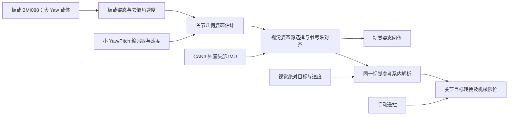

# 云台视觉姿态回传与外置 IMU 接管方案

日期：2026-11-04。目标入口为 `applications/sentry_gimbal`。本文只记录后续接入设计，不代表当前已经实现视觉收发、姿态融合或外置 IMU 接管。用户已明确本次先不启用视觉。

## 当前已落地与本次范围

当前整车云台与 `samples/bringup/gimbal_dual_yaw` 采用编码器手动控制。CAN3 外置 IMU 不实例化、不启动，不阻塞手动小 Yaw/Pitch 和编码器回中。板载 BMI088 跟随大 Yaw 载体，提供参考底盘需要的 `0x0404` 载体航向/去偏角速度，并给本地小 Yaw 提供抵消载体转动的角速度补偿。

大 Yaw 回中误差来自小 Yaw 编码器相对独立机械中心的偏角，不是两个独立 IMU 的绝对 Yaw 之差。参考底盘自身执行大 Yaw 航向保持、速度 PI 和底盘转动补偿，正常授权时即使用 IMU，不仅在小陀螺开启时使用。本次不修改参考底盘或 v4 协议，不需为这些云台侧修改重烧底盘。

注意控制能力发生了明确取舍：不依赖外置 IMU后，手动模式不再具有外置头部实测姿态的完整闭环。小 Yaw 通过载体角速度反向补偿来辅助保持方向，Pitch 锁的是相对编码器角。这不等同于保证枪口世界姿态精度。外置 IMU 以后可以只服务视觉，也可以单独扩展为头部稳向功能；后者不在当前实现和后续视觉接入的默认范围内。

当前 `applications/sentry_gimbal` 未实例化 `VisionReceiver`、`VisionSource` 或 `AbProtocol`，`manualCommandConfig().allow_auto=false`。历史 `vision_*.conf` 的存在不能使固定入口自动获得视觉功能。`gimbal_drive_command` 仍是独立底盘行走命令发送端，本次不把它变成视觉或云台控制入口。

## 目标数据流



板间 `0x0404` 仍只发布大 Yaw 载体数据，不能随视觉姿态源接管而切成小 Yaw 头部 IMU，否则参考底盘会用错被控对象。视觉上行需要的枪口/相机姿态是另一份数据，不应复用板间载体航向直接发送。

## 启动时估计姿态

在外置 IMU 尚未产生有效数据时，使用板载姿态和实测关节角构造头部姿态。设 `q_WC` 是载体坐标到启动世界坐标的四元数，`q_CH` 是根据机械结构和关节编码器计算的头部到载体旋转，则：

```text
q_WH_est = q_WC × q_CH(yaw_joint, pitch_joint)
```

需要相机姿态时，再乘实测的头部到相机安装变换。四元数采用现有 `core::Quaternion` 的 Hamilton wxyz 及 body→world 约定，复用 `core::multiply` / `core::rotate` / `core::normalize`。不能把 roll/pitch/yaw 三个欧拉角直接逐项相加，也不能对已经包含大 Yaw 朝向的板载姿态再重复叠加大 Yaw 编码器。

`yaw_joint` 和 `pitch_joint` 必须使用真实传动比、正方向与独立机械零位。当前 `yaw_center_rad` 是限位中点候选，Pitch 也只有软件限位，不能自动把限位中点视为相机水平零位。接入前必须标定两轴顺序、旋转轴、板载安装和相机外参，明确板载 IMU 确实不随小 Yaw 转动。

角速度也要组合载体角速度与实测关节速度，并转换成头部 body-frame。`vision::Feedback::gyro_rad_s` 不是 Euler 角速度，不能把编码器的 Yaw/Pitch 速度直接塞进 gyro.z/gyro.y；AB codec 会根据头部四元数再转换成 Euler yaw/pitch 速度。

估计姿态和角速度的有效期由所有参与传感器的最旧时间戳约束；检查跨源时间差，超期就不发送。只用新的编码器帧或新的板载采样生产新估计，不得通过循环读取旧快照刷新生产时间。明确记录姿态来源为估计，不能当作外置头部实测数据。

## 外置 IMU 到达与参考系接管

建议先落地以下状态机：

| 状态 | 视觉上行姿态 | 视觉自动执行 | 手动/回中 |
| --- | --- | --- | --- |
| 等待板载或编码器有效 | 不发送无效姿态 | 禁止 | 按现有各自反馈条件运行 |
| Bootstrap：外置 IMU 未就绪 | 板载＋编码器估计 | 第一版暂不执行自动目标 | 正常运行 |
| Aligning：外置数据开始稳定 | 保持一致的旧视觉参考 | 暂停并清除旧目标 | 正常运行 |
| External：外置接管完成 | 对齐后的外置测量 | 新指令、新参考匹配后放行 | 不依赖外置数据 |
| 外置失联/重启/参考改变 | 标记无效，或按明确规则回传估计 | 立即退出自动，不重放旧目标 | 正常运行 |

外置 IMU 的姿态和角速度都须新鲜、有限、四元数可归一化、参考 epoch 合法；要求多个不同生产序号的连续有效采样，不能用重复快照凑稳定次数。具体稳定时长和源间最大时间差待硬件频率实测后确定。外置启动失败不能并入本地手动 `setup_ready` 并禁掉整车手动控制。

两颗 IMU 的启动 Yaw 零点彼此独立。主方案固定已发布的视觉世界参考，接管时用一对时间对齐的头部估计和外置实测求参考旋转：

```text
q_align = q_WH_est × inverse(q_external_H)
q_WH_external_aligned = q_align × q_external_H
```

这样测量主体切到外置 IMU，视觉参考坐标不突然跳变；正确保留 body-frame 角速度及安装变换。每次外置 epoch/启动代次变化都重新对齐，并撤销旧自动目标。机械模型误差和初始外置估计偏差不能靠随意平均绝对欧拉角解决。

如果确实要求直接使用外置 IMU 的原生世界零点，就必须在切换时暂停自动、通知视觉端重建参考/历史状态，并等待新会话的新目标；不能直接切姿态后继续解释原会话下的绝对角指令。AB 协议没有参考系/会话字段，仅在 MCU 内修改 `reference` 不构成与上位机的协商。需要先约定带会话标识的协议扩展或双方明确的重置握手；方案未确定前不开放自动源切换。

## 复用与后续实施顺序

先在 `applications/sentry_gimbal` 接入一个只生产姿态估计/源状态的组件，保留手动和回中原路径，明确输出姿态、gyro、原始时间戳、来源、参考与代次。再接入独立 CAN3 外置接收器及对齐状态机，最后连接视觉上行和自动命令执行；不以全局 IMU 有效标志重新绑住手动。

可复用接口：

| 文件 | 复用内容 |
| --- | --- |
| `include/core/attitude.hpp` | 四元数组合、旋转、归一化和欧拉角转换 |
| `include/drivers/imu/imu_types.hpp` | 带真实时间戳、参考与质量的姿态/角速度快照 |
| `include/communication/vision/vision_types.hpp` | `Feedback` / `AimCommand` 数据契约 |
| `include/communication/vision/vision_receiver.hpp` | 独占视觉串口、`setFeedback` 和 RX worker |
| `include/robotics/command/receiver_sources.hpp` | `VisionSource` 来源注册 |
| `lib/robotics/command.cpp` | 参考匹配、过期拒绝、新自动目标边界与手动接管 |
| `include/robotics/gimbal/inertial_gimbal.hpp` | 未来视觉世界角目标到关节命令的适配，限位仍交给机械层 |

UART7 被诊断独占，不能直接照搬旧样例的视觉串口别名。正式加入视觉前先确定独立 UART/USB 通道、引脚、DMA 与波特率。现有 AB 上行 43 字节要求姿态、gyro、真实弹速和弹数全部有效，缺真实弹速/弹数时 codec 会拒绝发送；不能用伪造有效的零填充。需要接上真实来源，或与视觉端约定支持缺失字段的上行协议后再启用 TX。

第一版建议只回传 Bootstrap/External 姿态，不自动执行；后续显式选择视觉模式，再让同参考、未过期的新目标进入 `InertialGimbalAdapter`。不能把视觉世界绝对角直接写到电机编码器目标，也不能把外置 IMU 的原生 Yaw 与板载启动 Yaw 直接相减。

## 后续验证清单（本次未执行）

- 无外置 IMU时，手动小 Yaw/Pitch 与大 Yaw 回中不受 CAN3 影响。
- 启动板载未就绪、编码器无效时不向视觉伪造有效姿态。
- 大 Yaw 单独转动、两关节单独转动及组合姿态下，估计枪口朝向与实际一致。
- 外置 IMU 首次到达、断流恢复、重启和 epoch 改变时，旧自动目标被撤销，视觉参考不会静默跳变。
- 姿态、gyro、关节速度同坐标、同单位、真实采样年龄；加减速和转弯时不过度依赖不同步样本。
- 板间 `0x0404` 始终是载体姿态，视觉源变化不改变参考底盘的反馈对象。
- 自动退出后手动及时接管，机械限位与遥控撤权仍正常。

以上为后续设计和现场验证要求；本次只完成手动/回中解除外置 IMU 依赖及本文档，不启用视觉收发，也不声称视觉融合已实现。
