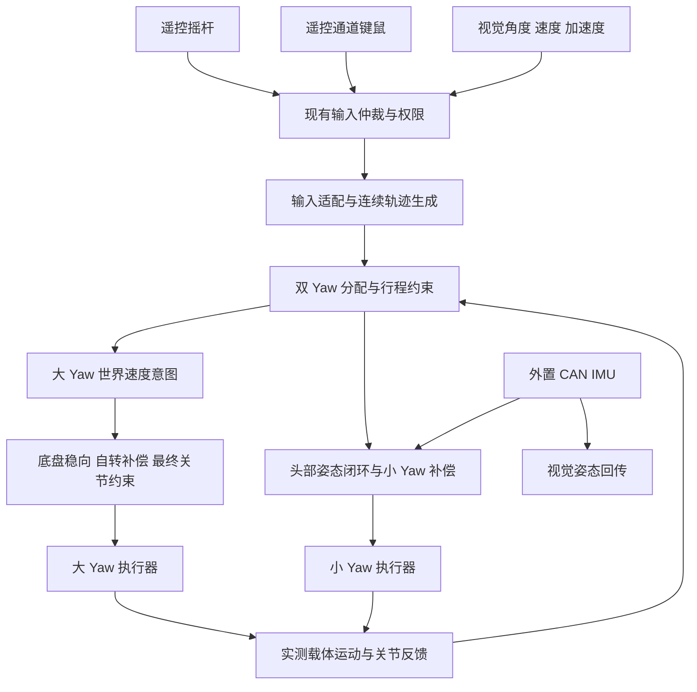

# 双 Yaw 速度、加速度分配与视觉轨迹控制方案

日期：2026-11-13。状态：设计提案，尚未接入正式控制链路。

本文对应当前回滚后的 `sentry_gimbal` / `sentry_chassis`，说明下一版如何实现“大 Yaw 承担持续、较低加速度的运动，小 Yaw 承担快速、小范围瞄准和跟踪误差补偿”。本次仅新增文档，不修改业务代码、不构建、不烧录。

此前的 [双 Yaw 加速度协同控制实施方案](SkyWalker_双Yaw加速度协同控制_实施方案.md) 是 11 月 11 日基线下的历史方案，其中视觉启用状态、参数和接入路径不能直接当作当前状态。回滚背景见 [双 Yaw 回滚与控制分工分析](双Yaw回滚与控制分工分析.md)。本文件作为本轮讨论的设计依据，不覆盖历史记录。

## 1. 目标、边界与预期行为

### 1.1 要实现的行为

1. 视觉瞄准方向和反馈姿态使用同一套 CAN 外置 IMU 参考系。
2. 低加速度、持续转向尽早交给大 Yaw，不等小 Yaw 偏离中心后才启动大 Yaw。
3. 小幅、高频、较高加速度的目标变化优先由小 Yaw 响应。
4. 大 Yaw 能跟随时，小 Yaw 相对角变化接近零；大 Yaw 实际跟不上时，小 Yaw 补偿误差。
5. 大角度目标完整保留，由受约束轨迹逐渐到达；不得把最终目标截成当前位置附近的小角度。
6. 小 Yaw 接近行程边界前提前调整分配，避免靠撞软件限位完成交接。
7. 遥控器、通道键鼠和视觉共用分配与执行约束，但保持各自输入语义。
8. 能分别调整大小 Yaw 响应，并用上位机轨迹定位问题来源。

### 1.2 不能同时无条件满足的要求

“小 Yaw 相对角严格不动”和“瞄准方向完全无误差”不能在大 Yaw 有延迟、摩擦、扰动时同时保证。本方案优先保证可行范围内的瞄准跟踪，小 Yaw 静止是次级目标。

小 Yaw 的高响应不等于无限行程。大 Yaw 追赶期间若需要的小 Yaw 位移超过余量，必须降低整体运动速度或加速度。保留目标并允许暂时跟踪滞后，不能要求小 Yaw 越过机械边界。

“高频”本身也不是充分条件：小幅慢变可交给大 Yaw，大幅高频可能两个轴都无法完成。必须同时看速度、加速度、行程、制动能力和实际跟踪状态。

### 1.3 本轮不扩展的功能

- 不重新设计遥控解锁、裁判权限、底盘导航、发射控制和 UART 通信修复。
- 不把 Pitch 并入双 Yaw 分配器；保持现有几何和限位路径。
- 不引入新的 XYZ 目标或弹道解算协议。当前“目标位置”指 AB 协议中的 yaw/pitch 角度。
- 不在未测量惯量、摩擦和转矩响应前添加加速度到电流的直接前馈。
- 不把原先的大改代码整体重新启用。可复用的数据结构与算法必须按本文职责重新接入。

## 2. 当前代码与目标方案的差别

| 环节 | 当前回滚后的行为 | 下一版需要的行为 |
| --- | --- | --- |
| 云台输入仲裁 | `CommandManager` / `CommandArbiter` 选择遥控、键鼠、视觉等来源 | 保留仲裁，分配器只消费已授权结果 |
| 手动 Yaw | 原始头部速度减实测载体速度，驱动小 Yaw | 先生成连续运动参考，再主动分配给大 Yaw 和小 Yaw |
| 视觉 Yaw | CAN 头部 IMU 姿态误差、速度前馈和载体补偿形成小 Yaw 指令 | 只保留一个头部姿态闭环，与运动规划和分配明确分工 |
| 大 Yaw 意图 | `YawCenteringController` 根据小 Yaw 偏离中心的角度产生速度 | 持续运动前馈 + 缓慢回中 + 行程预测接管 |
| 大 Yaw 执行 | 底盘航向跟随器、底盘自转补偿、执行器限幅和斜率限制 | 约束需覆盖这些环节合成后的最终关节命令 |
| 视觉反馈 | 正式入口使用外置 CAN IMU 姿态/陀螺仪，允许未知弹速弹量填 0 | 保留；不改成板载 IMU 或大小 Yaw 指令的合成姿态 |
| 目标保持 | 视觉完整角目标已保留 | 继续保留，新增可执行中间轨迹，不能混为同一个变量 |

当前 `manualCenteringConfig()` 的回中速度上限为 0.6 rad/s、加速度为 0.8 rad/s²；`big_yaw_native_acceleration_rad_s2` 为 20 rad/s²。它们位于不同层，不能把前者当成最终电机加速度保证，也不能把后者当成实测可用能力。

当前代码中仍存在 `DualYawMotionAllocator` 文件，不代表正式应用正在使用它。实施时以应用调用路径为准。

## 3. 坐标、零点与单位合同

### 3.1 符号

| 符号 | 含义 | 来源/用途 |
| --- | --- | --- |
| `h` | 头部世界 Yaw | 视觉闭环来自 CAN 外置 IMU |
| `b` | 大 Yaw 承载机构的世界 Yaw | 板载载体 IMU；独立零点 |
| `s` | 小 Yaw 相对工作中心的物理偏角 | `direction_s * (encoder_angle - center_angle)` |
| `c` | 底盘车体世界 Yaw | 底盘 IMU；主要使用角速度做补偿 |
| `j` | 大 Yaw 相对底盘的物理关节角 | 大 Yaw 编码器 |
| `h_goal` | 最终视觉目标或手动目标语义 | 不因执行受限而覆盖视觉目标 |
| `h_ref, w_ref, a_ref` | 当前可执行的头部轨迹 | 轨迹生成器输出 |
| `w_b_ref` | 大 Yaw 承载机构世界角速度意图 | 云台发给底盘的控制量 |

统一使用 rad、rad/s、rad/s²，物理正方向约定为从上方看逆时针。电机安装方向、传动比只在指定转换处应用一次。

近似水平、Yaw 轴近似平行时：

```text
w_h = w_b + w_s
w_j = w_b - w_c
s = direction_s * (q_s - q_center)
```

这不是任意姿态下的严格三维关系。大 Pitch、底盘倾斜时，要使用实际关节轴投影和姿态变换。不得把外置 IMU gyro-z 无条件当作 Euler yaw 速度，也不得直接相减两个不同零点的绝对 yaw。

### 3.2 三种零点不能混用

| 参数/参考 | 作用 | 不能替代的量 |
| --- | --- | --- |
| `reference_big_yaw_forward_zero_rad` | 大 Yaw 相对底盘前向换系 | 视觉世界零点、小 Yaw 工作中心 |
| `yaw_center_rad` | 小 Yaw 的工作中心 | 大 Yaw 对底盘前向、IMU 航向零点 |
| 外置 CAN IMU 的参考系 | 视觉绝对方向解释 | 电机编码器零点 |

当前工作区大 Yaw 前向零点为 `0.048638f`。它由机械前向对齐时的 I17=0.048638 rad、旧 I18=-152.901703°计算得到，只表明该次编码器参考下的对齐关系。

DM 原始位置跨 ±12.5 rad 时，软件通过 ±25 rad 展开保持连续。它不是“每机械一圈修正一次”，计数也不跨 MCU 重启保存。重新上电后机械对齐位置的换系角是否稳定仍需实测，双 Yaw 分配器不能修复失去参考的编码器零点。

当前小 Yaw 软件端点来自 5770/7340 ticks，中点取两者平均；这些不是本文新确认的机械安全端点。正式行程预算要扣除机械余量、制动距离和测量误差。

### 3.3 视觉参考不经过载体独立航向零点

发送给视觉的四元数仍来自 CAN 外置 IMU，并保留规定的安装变换、归一化和数据新鲜度判断。四元数顺序是 w/x/y/z。

板载载体 IMU 可以用于大 Yaw 稳向和相对运动补偿，但不替换视觉反馈四元数。若分配器需要载体在视觉世界中的绝对方向，应从头部姿态和实测关节几何重建，或者显式建立参考变换；不能使用两个 IMU yaw 数值直接相减。

第一阶段尽量只向大 Yaw 输出世界角速度意图，以减少绝对航向零点耦合。

## 4. 三类输入的响应合同

### 4.1 先仲裁，后分配



分配器不能直接读取未通过仲裁的视觉缓存，也不能绕过遥控授权。切换来源时根据实测状态重新衔接轨迹，不能继续积分上一来源的状态。

### 4.2 遥控拨杆、摇杆

正式配置下左 Up 为手动，Middle 为导航/视觉所在模式，Down 撤销运动授权。解锁还受已有中立位和状态机约束，不意味着拨到 Up 就无条件解锁。右拨杆的既有功能不由分配器修改。

Yaw 摇杆输入表示期望头部角速度，不是绝对目标角，也不直接指定某一个电机。

| 输入动作 | 头部行为 | 大小 Yaw 分工 |
| --- | --- | --- |
| 缓慢加大摇杆 | 平滑加速转向 | 大 Yaw 主动承担，小 Yaw 补偿跟踪残差 |
| 突然推杆 | 在可行范围内快速响应 | 小 Yaw 短时领先，大 Yaw 受限加速 |
| 持续推杆 | 持续转动 | 大 Yaw 承担持续速度，小 Yaw 回到中心附近 |
| 快速反向 | 受制动能力约束换向 | 先考虑相对速度与余量，不能直接把小 Yaw 目标翻到另一端 |
| 回中 | 受控停止并保持停止后的瞄准方向 | 大 Yaw 可继续接回小 Yaw 偏角，头部不应跟着回中动作漂移 |

手动速度输入不能积累无限位置欠账。饱和期间丢弃无法执行的速度积分；释放时完成有限的制动过程，再保持目标，不能继续追赶此前长时间推杆积累出的虚拟远方位置。

### 4.3 遥控通道键鼠

- 鼠标 X/Y 经现有灵敏度映射为 Yaw/Pitch 速度意图。只有 Yaw 进入双轴分配。
- W/A/S/D 仍控制底盘平移。
- Shift、Q/E 保持小陀螺相关映射，不用于修改零点。
- 当前手动云台鼠标/摇杆按轴比较归一化幅值，取更大的输入；底盘摇杆离开死区时该轴优先摇杆。保持这些规则，不能各自驱动一个 Yaw。
- 鼠标停止时生成受控停止；不能把最后一次鼠标增量永久作为速度锁存。

慢拖鼠标主要由大 Yaw 承担，小幅快速微调主要由小 Yaw 承担，持续拖动由大 Yaw 接管。

### 4.4 自动模式与手动接管

本方案不新增自动接管规则。当前导航模式会清除 `manual_override_`；非导航 Auto 路径才调用相应手动覆盖逻辑。因此不能把某个样例的“摇杆一动即可抢回视觉”承诺为正式 Middle 档的现有行为。

实施时保持现有仲裁策略，只对最终选中的输入分配。若以后改变导航/视觉下的接管体验，应作为独立需求明确处理。

## 5. 视觉协议与零速度语义

### 5.1 当前 AB 接收合同

当前命令帧 29 字节、反馈帧 43 字节。命令字段均按当前代码的小端格式解码：

| 字节偏移 | 内容 | 单位/含义 |
| --- | --- | --- |
| 0..1 | `AB` | 帧头 |
| 2 | 控制请求 | 0 不请求控制；1 请求瞄准；2 还带现有发射请求语义，本方案不改变其权限处理 |
| 3..6 | yaw angle | rad，外置 IMU 参考系的目标角 |
| 7..10 | yaw rate | rad/s，目标角轨迹的一阶导数 |
| 11..14 | yaw acceleration | rad/s²，目标角轨迹的二阶导数 |
| 15..18 | pitch angle | rad |
| 19..22 | pitch rate | rad/s |
| 23..26 | pitch acceleration | rad/s² |
| 27..28 | CRC16 | 沿用现有协议实现 |

速度是目标运动前馈，不是电机速度上限。加速度是目标轨迹信息，不是无条件必须执行的电机加速度。

### 5.2 四种典型指令

| 指令 | 应有解释 | 执行行为 |
| --- | --- | --- |
| 固定 angle=90°，rate=0，acceleration=0 | 到 90°并保持 | 本地生成到达轨迹，角差大时大 Yaw 承担主要转角 |
| angle 持续变化，rate=0，acceleration=0 | 连续位置采样，没有额外速度前馈 | 保持内部轨迹连续并跟踪位置，可能比可靠前馈更滞后 |
| angle、rate、acceleration 是一致轨迹 | 跟踪运动目标 | 前馈提前驱动，位置反馈纠正误差 |
| angle=0，rate=0，acceleration=0，控制有效 | 到外置 IMU 世界零方向 | 不能当作无目标或保持当前方向 |

表格使用角度方便阅读；线上须换成 rad。上述 yaw=0 不意味着“大 Yaw 与底盘前向对齐”。

### 5.3 “速度没提供”和“速度恰好为零”不能靠数值区分

AB 没有速度有效位，所有字段都在固定帧内。第一版统一将收到的 rate/acceleration 当成前馈值，0 就是零前馈；只发位置的上位机将这两项填 0。

不能按 `rate == 0` 切换到位置模式：正弦轨迹的端点、停车和反向时速度自然为 0。若后续需要从位置序列估计速度，应通过明确的本地配置或协议扩展选择模式。

每次新位置帧更新最终目标，但不把规划速度、加速度重置为零。静止目标到达后速度应收敛到零；运动目标则连续跟踪。

### 5.4 轨迹一致性、时间与超时

- angle/rate/acceleration 要描述同一时刻、同一轨迹。长期固定角度却给非零速度是不一致输入。
- 相邻帧可以计算诊断残差：`wrap(angle[k]-angle[k-1]) - rate[k-1]*dt - 0.5*acc[k-1]*dt²`。残差用于观察，不能把目标切换自动判为通信错误。
- 角度跨 ±π 时先按连续分支处理，再计算差分；不能把 +179°到 -179°当作 -358°运动。
- 当前 AB 没有源时间戳。接收时刻只能测本地驻留时间，不能冒充相机曝光时刻；已知固定延迟可以单独标定，抖动部分不能精确补偿。
- 有限外推使用 `angle + rate*t + 0.5*acc*t²`、`rate + acc*t`，`t` 必须有明确上限。不能在应用和分配器各预测一次。
- 超时、控制撤销或参考无效后停止消费该轨迹，不继续无限外推。普通输入失效按现有授权与保持/停止规则处理；紧急撤销不等待平滑轨迹走完。
- AB 不携带 IMU epoch。外置 IMU 若内部归零且不报告参考变更，本地无法仅从协议确认，必须重新建立视觉参考。

### 5.5 大角度和多圈

保留最终目标，默认按最短角差选择旋转方向。+179°到 -179°约为 +2°；540°与180°表示同一方位，不表达额外一圈。

每次接近 ±π 不能因测量噪声来回更换既定转向；需要保存连续角分支并对目标切换做明确衔接。恰好 180°时采用确定的平局规则，例如优先延续当前转向。

若要指定多圈或方向，后续扩展连续角/圈数/方向字段。既有四元数和绝对方位不能恢复该信息。

## 6. 推荐控制结构与职责

### 6.1 唯一的头部姿态闭环

推荐把规划、分配、反馈分开：

1. 输入适配器生成最终目标及前馈语义。
2. 联合轨迹规划器生成可执行的 `h_ref, w_ref, a_ref` 和 `w_b_ref`。
3. 一个头部姿态闭环根据 CAN IMU 纠正 `h_ref - h_meas`。
4. 小 Yaw 根据实测载体运动补偿，大 Yaw 跟踪持续运动并缓慢回中。

说明性关系：

```text
e_h = wrap(h_ref - h_meas)
w_h_cmd = w_ref + Kp_h * e_h - Kd_h * (w_h_meas - w_ref)
w_s_cmd = w_h_cmd - w_b_meas
encoder_rate_s = direction_s * w_s_cmd
```

该式是平面近似下的职责说明，不是直接复制的最终实现。`w_h_cmd` 必须受当前可行域限制，小 Yaw 输出还受剩余行程、关节速度和加速度限制。

现有 `InertialGimbalAdapter` 已包含位置误差增益、陀螺阻尼与载体补偿。不能在新分配器先算一遍相同的闭环，再进入旧适配器重复算一次。推荐规划器输出轨迹，适配器保留唯一头部反馈；若重构为其他接口，则旧反馈路径必须退出。

### 6.2 大 Yaw 主动前馈与回中

概念上：

```text
w_b_candidate = w_sustained + w_center
w_center = bounded(K_center * s_slow)
```

- `w_sustained` 是可由大 Yaw 持续承担的运动，不是等小 Yaw 先产生偏差才生成的量。
- `s_slow` 是小 Yaw 偏角的慢变化部分，避免大 Yaw 跟着高频微调往返。
- 回中正号应使大 Yaw 向小 Yaw 当前偏转方向转动，小 Yaw 相对角因此减小。
- 总和还须经过速度、加速度、制动和行程可行性限制。

低加速度持续运动允许直接送入大 Yaw 前馈，避免所有指令都先过很慢的低通。频繁往返时平滑减小大 Yaw 对快变化的参与；参与系数连续变化，设置进入/退出滞回，避免按单帧加速度阈值硬切模式。

滤波/观察时间、参与系数和回中速度独立调节。不能仅通过把回中 P 调大来替代主动分配。

### 6.3 小 Yaw 补偿使用实测值

例：头部计划速度 +1.0 rad/s，大 Yaw 请求 +0.8 rad/s，但实测载体只有 +0.5 rad/s。忽略姿态反馈修正时，小 Yaw 应补 +0.5 rad/s，而不是 +0.2 rad/s。

回中时头部计划速度为 0，载体实际正转，小 Yaw 应反向相对转动，保持头部瞄准方向。

不能把低频板间电机反馈未经时间处理当作高频载体测量。用于补偿的反馈须有时间戳、新鲜度和坐标语义，优先使用相应高频 IMU 测量；低频电机反馈用于状态和一致性观察。

## 7. 速度、加速度和行程的联合约束

### 7.1 大 Yaw 预算必须是最终关节预算

底盘侧存在：

```text
w_j_command = w_b_reference + heading_correction - w_chassis_measured
```

只限制 `w_b_reference` 的斜率，无法保证加上航向修正和减去底盘自转后仍满足关节加速度上限。

应区分：

- 云台侧规划预算：保守估计大 Yaw 可承担的世界运动，保留反馈修正余量。
- 底盘侧最终约束：航向修正、自转补偿合成后，对物理关节速度和加速度执行约束，再换算电机方向与传动比。

底盘转得越快，维持头部世界方向可能消耗越多大 Yaw 能力。能力不足时应报告限幅，不能承诺小 Yaw 永远补偿。

第一阶段可使用保守静态余量；更精确的动态分配需要底盘回传最终应用速度、限幅状态等信息。若当前板间协议没有字段，须显式扩展并同步版本，不能偷偷改变旧字段含义。

### 7.2 小 Yaw 剩余行程与制动

统一物理坐标下确定 `s_min < s_max`；若安装方向为负，转换端点后必须重新排序。

```text
positive_margin = s_max - s
negative_margin = s - s_min
```

对正在向某端移动的相对速度 `v_out > 0`，保守制动占用可写为：

```text
d_delay = v_out * T_delay + 0.5 * A_out * T_delay²
v_after_delay = v_out + A_out * T_delay
d_brake = v_after_delay² / (2 * A_brake)
d_required = d_delay + d_brake + margin_static
```

`A_brake` 必须是负载下有保证的相对减速度，不是配置中的理想值；`A_out` 还要覆盖载体运动导致的最坏相对变化。上式仅是保守起点，实际限位保护需与整条执行链延迟一致。

此外预测大 Yaw 追赶期间的小 Yaw 位移：

```text
s_pred(t) = s_now + integral(w_h_candidate(t) - w_b_predicted_actual(t)) dt
```

`w_b_predicted_actual` 必须包含大 Yaw 延迟和可用加速度，不能假定指令立即执行。预测占用接近软边界时提前交给大 Yaw；大 Yaw 无法再增加贡献时，缩减头部轨迹的向外速度/加速度。

### 7.3 为什么不能分别限两个输出就结束

若先独立生成头部高速轨迹，再把小 Yaw 输出截断，规划位置仍持续前进，会形成越来越大的位置误差。大 Yaw 追上后可能出现突然追赶。

应先投影到联合可行运动，再更新规划状态：视觉最终目标不丢，`h_ref` 只按可执行运动前进；手动不可执行的速度积分不积累。闭环修正也受余量限制，并设置积分抗饱和。

### 7.4 第一版推荐实现方式

无需一开始引入在线优化器。可实现确定时间、固定内存的候选轨迹和短时预测：

1. 从上一周期连续状态生成头部运动候选，使用本周期已仲裁的位置/速度输入。
2. 生成大 Yaw 的持续运动与回中候选。
3. 根据实测载体状态和保守模型预测一段未来相对运动。
4. 检查大小轴速度、加速度、行程与制动余量。
5. 若不可行，优先增加可用的大 Yaw 贡献；随后缩减头部向外运动，直到获得保守可行候选。
6. 只提交选定候选对应的状态更新；输出指令后记录实际限幅/授权状态供下一周期使用。

候选缩减必须考虑已存在的速度和减速过程，不能把速度一帧跳到零。实现时明确预测步长、预测时域、最大迭代次数，以及“没有可行候选”的停止策略。若增加 jerk 限制，须把加速度作为连续状态，并相应调整制动距离模型。

## 8. 状态机与跨板行为

### 8.1 状态建议

| 状态 | 进入条件 | 行为 |
| --- | --- | --- |
| Disabled | 未授权、紧急撤销、必需链路故障 | 撤销输出，清除旧运动参考 |
| Capture | 获得授权、来源切换、参考代次变化 | 从新鲜实测位置和速度建立连续状态；等待所需的新指令 |
| Track | 输入和反馈有效 | 运行联合分配 |
| TravelLimited | 预测行程或制动余量不足 | 限制头部向外运动，保留视觉最终目标 |
| BrakeHold | 正常释放速度输入/目标停止 | 有界减速后保持；允许内部平滑回中 |

`TravelLimited` 可以是 Track 的诊断子状态，不必实现互相独立的控制器。故障退出后不得在状态机里保存一个带新时间戳的旧请求继续运行。

普通视觉丢目标不必等同于全车失能，但必须停止消费旧视觉运动：具体保持/停止输出仍服从现有仲裁和可用反馈。不要擅自把当前故障语义改成自动切另一个 IMU 继续跑。

### 8.2 连续轨迹与零速捕获冲突

当前 `BigYawWorldHeadingFollower` 在请求速度从非零进入零附近时，会重新捕获实测航向并清积分。这对手动释放有直觉意义，但连续轨迹在反向点、前馈与回中抵消时也会经过零。

下一版需要区分“轨迹瞬时零速”和“真正停车/重新捕获”：

- 自动轨迹在零速点继续保持原有连续状态。
- 正常停车通过明确状态或低速持续时间确认。
- 重新使能、参考变化、故障恢复时仍从实测状态捕获。

不能通过发送一个极小非零速度绕过此逻辑；那会掩盖问题并产生漂移。第一版若不改线协议，底盘至少应调整零速捕获策略，并明确不同发送端的兼容性；需要显式状态时再版本化扩展协议。

### 8.3 时间戳与线程边界

- 轨迹更新在云台控制线程执行，固定内存，不在 CAN/UART IRQ 中进行规划。
- 接收线程发布快照；每周期取一组带各自源时间戳的数据，检查年龄与允许的时间差。
- 不用本周期时间刷新过期传感器或旧请求的有效性。
- `dt <= 0`、周期过长、序列倒退时不继续正常积分，进入重捕获或撤销路径。
- 底盘用本地时基执行最终约束，不能直接把另一块板的绝对时钟当作本地时钟。
- 低频大 Yaw 反馈不能在高频控制周期中重复当成新测量。

## 9. 建议的软件接口

以下是接口语义草案，不是已实现 API。优先重构现有 `DualYawMotionAllocator`，避免创建平行的第二套分配器。

```cpp
enum class YawInputKind { ManualRate, VisionTrajectory };

struct YawIntent {
    YawInputKind kind;
    double goal_angle_rad;       // VisionTrajectory：完整目标的选定连续分支
    float rate_rad_s;            // 手动速度意图，或视觉速度前馈
    float acceleration_rad_s2;   // 视觉加速度前馈
    core::Stamp source_stamp;
    core::OrientationReference reference;
};

struct YawMeasuredState {
    float head_yaw_rad, head_yaw_rate_rad_s;
    float carrier_rate_rad_s;
    float small_joint_rad, small_joint_rate_rad_s;
    core::Stamp head_stamp, carrier_stamp, joint_stamp;
    bool head_valid, carrier_valid, joint_valid, big_available;
};

struct YawPlan {
    double head_angle_ref_rad;
    float head_rate_ref_rad_s, head_acceleration_ref_rad_s2;
    float big_world_rate_ref_rad_s;
    float small_positive_margin_rad, small_negative_margin_rad;
    bool valid, travel_limited, big_budget_limited;
    // 实际实现补充明确的原因枚举、来源/参考代次与输出序列。
};
```

约定：

- `reset()` 清状态，不生成运动；`capture(measured)` 只使用新鲜实测状态。
- `update(intent, measured, budget, now)` 每周期执行一次，不进行通信和动态分配。
- 参数非法、数据过期、参考不一致、周期异常返回不同原因；无效结果不允许执行器沿用上次输出。
- 头部轨迹输出交给唯一姿态闭环；`big_world_rate_ref_rad_s` 交给现有板间发送路径。
- 电机方向和传动比不出现在世界运动意图中；在物理/编码器边界转换。
- 外置 IMU 不可用时视觉不可用。手动是否继续使用既有载体补偿，保留现有策略，不在本轮暗中增加手动对外置 IMU 的强依赖。
- 输出和内部状态须能反映最终执行受限。初版没有底盘执行量回报时，使用保守模型并明确记录“预算估计”，不能把它标为实际执行量。

## 10. 参数分组与调节顺序

| 分组 | 参数 | 用途 |
| --- | --- | --- |
| 大 Yaw 能力 | 关节速度上限、加减速度、延迟估计、稳向修正余量 | 定义大轴可执行运动 |
| 小 Yaw 能力 | 相对速度、加减速度、实测端点、静态余量、制动延迟 | 定义小轴快速响应与行程 |
| 头部闭环 | 姿态 P、速度阻尼、修正速度上限、抗饱和 | 决定实际瞄准误差纠正 |
| 分配 | 持续运动提取、快变参与系数、切换滞回、回中增益/速度 | 决定大小轴分工 |
| 预测 | 预测时域、模型延迟、状态滤波、能力折减 | 提前避免行程耗尽 |
| 输入 | 摇杆/鼠标灵敏度、视觉前馈模式、有限延迟补偿 | 定义操作和协议解释 |
| 时间与状态 | 超时、最大 dt、静止确认时间、参考变化处理 | 保证状态连续性和失效退出 |

调节顺序：标定方向与参考 → 单独测大小轴响应 → 确定保守能力 → 调头部闭环 → 调持续运动分配 → 调回中 → 调高频切分和预测。

不要同时修改电机 PID、分配阈值、IMU 零点和输入灵敏度，否则很难定位改善或恶化的来源。第一版不给未经实测的“最终最佳加速度”数值。

## 11. 文件级实施顺序

本文按仓库 `implementation-first` 技能组织后续实施：先明确必要路径和合同，再连续完成当前阶段实现，最后按当次授权进行一次编译；不在每个函数修改后开展额外审查或自行增加测试。以下实机联调是未来执行计划，本次不运行。

### 阶段 A：单轴能力与观测准备

目标：保持旧分配可选，准备测量与独立调节入口。

| 文件 | 后续工作 |
| --- | --- |
| `include/robotics/vehicle/calibration.hpp` | 分开前向零点、小轴中心和实测能力；不把原始参数直接当能力认证 |
| `samples/bringup/chassis_big_yaw/src/main.cpp` | 保留零点诊断，增加单轴轨迹所需观测时明确样例限制 |
| `applications/sentry_gimbal/src/main.cpp` | 增加轨迹源、分配和执行的明确诊断，不改变输入权限 |
| `applications/sentry_chassis/src/main.cpp` | 观测最终关节请求、限幅与实际反馈 |

现有 `chassis_big_yaw` 样例有低速 bringup 限制，不能拿正式程序的大幅轨迹直接灌入并把不响应归因于控制问题。

### 阶段 B：最小可用双 Yaw 分配

目标：主动大轴前馈、实际反馈补偿、行程保护、输入连续性一起落地。

| 文件 | 后续工作 |
| --- | --- |
| `include/robotics/gimbal/dual_yaw_motion_allocator.hpp`、`lib/robotics/dual_yaw_motion_allocator.cpp` | 按本文重构职责和状态，先支持手动速度与视觉位置目标 |
| `lib/robotics/inertial_gimbal.cpp` 及对应头文件 | 明确唯一头部闭环、避免重复补偿和重复姿态 P |
| `applications/sentry_gimbal/src/main.cpp` | 消费已仲裁输入，替换旧回中输出；每周期只选一条大 Yaw 指令路径 |
| `include/robotics/vehicle/manual_profile.hpp`、`big_yaw_profile.hpp` | 把分配预算与底层执行限制分开配置 |
| `lib/robotics/big_yaw_heading_follower.cpp` | 解决轨迹零速穿越与释放捕获的冲突 |
| `lib/robotics/big_yaw_executor.cpp`、`applications/sentry_chassis/src/main.cpp` | 确保最终物理关节输出满足约束；状态退出和原有权限保留 |

旧 `YawCenteringController` 与新分配器不能同时向大 Yaw 累加输出。保留可选旧路径用于对照时，选择必须互斥，并在切换时重捕获状态。

### 阶段 C：完整视觉轨迹前馈与动态预算

目标：接入上位机一致的角度/速度/加速度，改善动态跟踪。

- 从 `decision.selected_vision` 获取数据，保持已有协议校验、参考检查和输入限幅。
- 有限时间预测只有一个所有者。
- 若需要实际执行量回传，扩展板间消息、编码和两端处理，并明确版本兼容；不要只改一端。
- 补全三种调试模式、诊断和上位机轨迹记录。

阶段 B 即使只收到零速度前馈，也应能完成静态大角度瞄准；阶段 C 不能作为“位置模式能否转过去”的前提。

### 编译命令示例

若当前 IDE 构建目录已配置，后续实现完成后可运行：

```bash
cmake --build applications/sentry_gimbal/build/dm_mc02/stm32h723xx -j6
cmake --build applications/sentry_chassis/build/dm_mc02/stm32h723xx -j6
```

本次未执行这些命令。构建成功只证明编译链接完成，不证明实机方向、能力和控制效果。若涉及两端语义变更，正式联调必须使用配套两板固件。

## 12. 上位机轨迹与独立调节

### 12.1 三种明确调试模式

| 模式 | 大 Yaw | 小 Yaw | 观察重点 |
| --- | --- | --- | --- |
| 大轴单独 | 跟随测试轨迹 | 保持相对关节角 | 大轴延迟、加速能力、稳态误差、停止超调 |
| 小轴单独 | 保持载体世界方向 | 跟随小范围轨迹 | 小轴带宽、超调、噪声、可用行程 |
| 双轴协同 | 按分配执行 | 补偿并回中 | 总跟踪误差、交接、行程与最终限幅 |

“小 Yaw 保持相对角”和“头部保持世界方向”是两种不同约束。大轴单独模式不能同时让小轴主动消除大轴跟踪误差，否则测不出大轴真实响应。

调试模式通过明确配置或专用调试入口选择，不复用 H 等未定义键、不通过特殊目标数值偷偷切换。

### 12.2 推荐轨迹

1. **固定位置与小阶跃**：rate/acceleration 都为 0，观察到达、停止和稳态偏差。
2. **平滑匀速段与反向**：使用连续加减速，观察大轴主动接管、释放后是否仍追账。
3. **正弦轨迹**：同时提供解析角度、速度、加速度，逐步增加频率。
4. **相同位置序列、前馈全置零**：与第 3 项对照，区分前馈收益和反馈能力。
5. **大角度跳变**：保留完整目标，观察小轴提前制动与大轴承担主要位移。
6. **跨 ±π**：观察是否选择连续短路径、是否反复换向。
7. **底盘运动下重复低幅轨迹**：观察自转补偿占用预算后的变化。

正弦示例（参数只是生成方式，幅值和频率由实测能力决定）：

```text
angle(t) = offset + amplitude * sin(2π f t)
rate(t) = amplitude * 2π f * cos(2π f t)
acceleration(t) = -amplitude * (2π f)² * sin(2π f t)
```

幅值为 rad、频率为 Hz。同样幅值下频率翻倍，速度峰值翻倍，加速度峰值变为四倍。不能只看角度幅值小就认为轨迹容易执行。

## 13. 诊断数据与问题定位

新增独立诊断 schema，不静默复用旧 I 通道语义。至少覆盖：

| 类别 | 数据 |
| --- | --- |
| 来源 | 当前模式、输入来源、控制授权、源年龄、参考代次 |
| 原始目标 | 完整目标角、速度/加速度前馈、选定连续角分支 |
| 可执行轨迹 | 头部参考角、速度、加速度 |
| 头部反馈 | CAN IMU yaw、yaw rate、姿态误差、数据年龄 |
| 大 Yaw | 世界速度意图、载体实测速度、最终物理关节请求、实际电机反馈、限幅原因 |
| 小 Yaw | 相对偏角、相对速度、目标速度、两侧剩余行程、预测制动占用 |
| 分配状态 | 持续运动分量、回中分量、快变参与系数、预算折减、状态切换原因 |
| 时间 | 控制 dt、板间请求年龄、反馈年龄、捕获次数 |

典型判断：

- 大轴意图已提前变化，但实测迟迟不动：看大轴执行和授权，不先加小轴回中 P。
- 大轴意图总在小轴明显偏转后才出现：主动前馈路径没有生效或滤波太慢。
- 大轴过零时头部抖动且捕获次数增加：查零速捕获与轨迹穿越冲突。
- 小轴贴限位、头部参考继续远离实测：联合可行性和抗饱和没有闭合。
- 位置模式能到位、速度前馈一开就偏：查单位、方向、时刻、重复预测与轨迹一致性。
- 同一机械姿态重启后方向变化：先查编码器参考和 IMU 参考，不调分配参数掩盖。

## 14. 后续实机验收清单

下面是未来联调内容，不是本次已执行结果。具体误差阈值应由视觉容差、机械间隙与实测噪声决定，本文不虚构合格数字。

- [ ] 机械前向对齐时 I18 接近 0，多次重新上电可复现。
- [ ] 大小轴正方向、载体补偿方向和小轴回中方向一致。
- [ ] 反馈四元数确认来自外置 CAN IMU，目标与反馈使用同一参考。
- [ ] 手动缓慢持续转向时小轴相对角保持中心附近。
- [ ] 快速小范围输入时小轴优先响应，大轴不随每次快速变化剧烈换向。
- [ ] 摇杆/鼠标释放后有限时间内停止，不追赶长期累积的虚拟位置。
- [ ] 固定位置、零速度前馈可以到达；全零有效目标可以转向世界零方向。
- [ ] 同一正弦位置序列开启可靠前馈后，跟踪滞后改善且不过度放大抖动。
- [ ] 大角度目标不丢失，小轴在边界前提前制动，大轴承担主要转角。
- [ ] 大轴请求过零不反复重捕获航向，正常停车仍稳定。
- [ ] 底盘旋转时最终关节速度/加速度受限，能力不足可从诊断看出。
- [ ] 超时、失能、板端重启和参考变化后不续跑旧轨迹。
- [ ] 切换调试模式与控制来源时从实测状态衔接，不产生目标跳跃。
- [ ] 原有遥控解锁、键鼠输入、导航和其他无关功能保留。

## 15. 待实测事项与决策结论

仍需实测：大小 Yaw 负载下可用加减速度、响应延迟、小轴安全端点、底盘自转时剩余能力、外置 IMU 安装轴与零点稳定性、视觉数据时延，以及新软件前向零点跨上电的复现性。

当前建议固定为以下设计决策：

1. 保留现有输入仲裁和 CAN 外置 IMU 视觉参考。
2. 用同一分配器支持手动速度与视觉位置/轨迹输入。
3. 大轴主动承担持续运动，小轴补偿实际残差；回中是附加慢调节。
4. 最终视觉目标与可执行轨迹分离，联合约束决定后者。
5. 以实测载体运动、最终关节约束和行程预测闭合分配，不能只分配理论指令。
6. 速度为零不表示字段缺失，位置全零也不表示无目标。
7. 先完成位置模式与基础协同，再接完整轨迹前馈和动态预算，不再一次混改所有控制层。

本文件未实现上述算法，也未证明任何实机指标已经达到。
