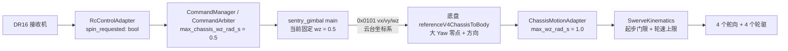

# 哨兵小陀螺变速提速与前进方向校准实施指南

> 状态：只读分析 + 手工实施指南。
> 本次没有修改任何业务源码、配置、测试或构建文件。
> 基线：`bad529abe5d6`，并注意工作区当前还有未提交的
> `include/robotics/vehicle/swerve_profile.hpp` 改动（见 §2.2.5 与 §3.7）。
>
> 目标：
>
> 1. 把小陀螺默认转速从固定 `0.5 rad/s` 提高；
> 2. 在右拨杆 Down 请求小陀螺期间，用 DR16 拨轮连续调速；
> 3. 修正“默认前进方向大约向左偏 90°”的问题。

---

## 1. 结论先行

### 1.1 只改云台应用里的 `.5f` 不够

当前小陀螺速度至少被以下多层限制：

| 层 | 位置 | 当前值 | 作用 |
|---|---|---|---|
| 遥控状态机 | `samples/robotics/common/rc_controls.hpp` | `spin_requested` 只有 bool | 只能表达“开/关”，没有速度 |
| 命令仲裁 | `include/robotics/vehicle/manual_profile.hpp` | `max_chassis_wz_rad_s = 0.5f` | 右 Down 归一化请求乘出来的物理速度 |
| 云台应用 | `applications/sentry_gimbal/src/main.cpp:229` | 固定 `.5f` | 发送前又覆盖一次 |
| 底盘运动适配 | `include/robotics/chassis/imu_heading.hpp:69` | `max_wz_rad_s = 1`，`motion_profile.hpp` 没有覆盖 | 底盘收到的 `wz` 再被夹到 ±1 rad/s |
| 舵轮运动学 | `include/robotics/vehicle/swerve_profile.hpp` | `resume_velocity_m_s = 0.2`（工作区未提交值） | 低于对应轮速时模块根本不启动 |
| 舵轮轮速上限 | `include/robotics/vehicle/swerve_profile.hpp` 与本文件循环 | 等效轮速上限 `0.5 m/s` | 小陀螺理论上限约 `1.77 rad/s` |

因此，**只改 `main.cpp` 的 `.5f` 会在底盘侧被继续限幅**，必须同时处理。

### 1.2 推荐参数

| 参数 | 建议值 | 说明 |
|---|---:|---|
| 默认小陀螺速度 | `1.5 rad/s` | 约 4.19 s 转一圈；比原来的 0.5 快 3 倍 |
| 拨轮调速范围 | `0.8 … 1.7 rad/s` | 拨轮中位为 1.5，向一侧最多 ±0.6 |
| 拨轮中位 | `1.5 rad/s` | 松手回中后自动回到默认速度 |
| 理论轮速上限 | `≈1.77 rad/s` | `0.5 m/s ÷ 0.2828 m`；1.7 已接近上限 |

速度换算：

- `0.5 rad/s ≈ 28.6 °/s ≈ 12.57 s/圈`
- `0.8 rad/s ≈ 45.8 °/s ≈ 7.85 s/圈`
- `1.5 rad/s ≈ 85.9 °/s ≈ 4.19 s/圈`
- `1.7 rad/s ≈ 97.4 °/s ≈ 3.70 s/圈`

### 1.3 前进 90° 偏差先隔离，不要同时改两个零点

“前进向左偏约 90°”至少有两个独立候选原因：

1. **舵向电机零点错误**：四个舵轮的目标角是 0°，但物理轮子实际指向左边 90°；
2. **大 Yaw 前向零点错误**：底盘把云台系前进旋成了车体系左移。

隔离方法：

- 用**不启动大 Yaw** 的 `samples/bringup/chassis_drive_link` 或 `samples/robotics/four_swerve`，只发车体系前进命令；
- 如果单独底盘也偏 90°，问题在**舵向零点**；
- 如果单独底盘直线正常，问题在**大 Yaw 前向零点**。

在隔离前不要同时修改 `steer_zero_ticks_by_id` 和 `reference_big_yaw_forward_zero_rad`，否则会互相掩盖。

---

## 2. 当前数据流与全部限速点

### 2.1 数据流



关键点：

- 云台系速度在底盘侧才转成车体系，旋转矩阵只依赖大 Yaw 的 `native_position_rad` 和前向零点；
- `wz_rad_s` 不参与这个旋转，纯小陀螺不受前进零点影响；
- 小陀螺在 `ChassisMode::BodyVelocity` 下也可以执行，不需要改成 `ChassisMode::Spin`；
- `ChassisMode::Spin` 会忽略 `vx/vy`，本应用当前没有使用它。

### 2.2 每一层的实际行为

#### 2.2.1 遥控状态机

`RcControlAdapter` 当前只输出：

```cpp
bool spin_requested = false; // 右 Down：小陀螺（仅手动档）
```

它没有保存拨轮对应的速度，因此应用层拿不到“用户想要多快”。

#### 2.2.2 命令仲裁

`ManualCommandMapper::map()` 在右 Down 时令：

```cpp
n.chassis_wz_norm = 1.0f;
```

随后 `fillManualMotion()` 乘上 `max_chassis_wz_rad_s`。`manual_profile.hpp` 当前为：

```cpp
c.max_chassis_wz_rad_s = 0.5f;
```

所以仲裁输出的物理命令也是 `0.5 rad/s`。

#### 2.2.3 云台应用固定覆盖

`applications/sentry_gimbal/src/main.cpp` 每 10 ms 发送一次底盘命令：

```cpp
auto wheel_command = frame.decision.command.chassis;
if (!operator_state.run_allowed)
    wheel_command.mode = ChassisMode::Disabled;
if (wheel_command.mode != ChassisMode::Disabled)
    wheel_command.wz_rad_s = operator_state.spin_requested ? .5f : 0;
endpoint.submit(wheel_command);
```

这里的 `.5f` 是实际发送值。

#### 2.2.4 底盘运动适配器

`ChassisMotionAdapter::Config` 默认：

```cpp
float max_wz_rad_s = 1;
```

`motion_profile.hpp::chassisMotionConfig()` **没有覆盖它**，所以底盘收到的任何 `wz` 都会被夹到 ±1 rad/s。即使云台发 1.7，底盘也只执行 1.0。这是最容易漏掉的一层。

#### 2.2.5 舵轮运动学起步门限

`SwerveKinematics::solve()`：

```cpp
moving[i] = speed > (moving_[i] ? config_.stationary_epsilon_m_s
                                : config_.resume_velocity_m_s);
next[i] = {moving[i] ? std::atan2(vy, vx) : last_angle_rad_[i],
           moving[i] ? speed : 0};
```

工作区当前未提交的 `swerve_profile.hpp` 把：

```cpp
c.kinematics.stationary_epsilon_m_s = 0.1f;
c.kinematics.resume_velocity_m_s = 0.2f;
```

模块到中心的距离：

$$
r = \sqrt{0.2^2 + 0.2^2} \approx 0.2828\ \text{m}
$$

小陀螺时每个模块的线速度：

$$
v_{\text{wheel}} = |\omega_z| \cdot r
$$

- `0.5 rad/s × 0.2828 ≈ 0.141 m/s < 0.2 m/s`，从静止开始请求 0.5 rad/s 时模块可能被判定为“不移动”，目标轮速直接为 0；
- `0.8 rad/s × 0.2828 ≈ 0.226 m/s > 0.2 m/s`，可以起步；
- 一旦已经移动，继续门限是 `0.1 m/s`（约 `0.354 rad/s`），所以起步比维持更难。

**这不是小陀螺自身的问题，而是低速门限把 0.5 rad/s 挡在门外。** 如果实际现象是“右 Down 后完全不动”，优先检查这里。

#### 2.2.6 舵轮轮速上限

`swerve_profile.hpp` 中：

```cpp
c.kinematics.max_wheel_velocity_m_s =
    std::min(c.kinematics.max_wheel_velocity_m_s,
             wheel_radius_m * m.drive.requested_velocity_abs_max_rad_s);
```

当前：

- `wheel_radius_m = 0.05 m`
- `wheel[i].velocity_limit_rad_s = 10 rad/s`（输出轴）
- 等效轮速上限 `= 0.05 × 10 = 0.5 m/s`

当任一模块超过 0.5 m/s 时，`SwerveKinematics` 会把四个轮速等比缩小。因此小陀螺的理论上限：

$$
\omega_{z,\max} = \frac{0.5}{0.2828} \approx 1.768\ \text{rad/s}
$$

超过约 1.77 rad/s 后，命令再大也只会被缩放，实际转速不再增加。

---

## 3. 小陀螺变速实现

### 3.1 交互定义

保持现有安全语义不变：

- 手动档（左 Up）后才允许小陀螺；
- 必须先经过右 Middle，再切右 Down 才请求小陀螺；
- 左 Down、失联、撤销授权立即停止；
- **拨轮只在小陀螺请求期间解释为速度微调**，不再映射底盘平移或大 Yaw；
- 拨轮中位使用默认速度，向一侧加速、向另一侧减速，松手回中后回到默认速度。

拨轮本身参与解锁归中检查，`centered()` 要求 `remote.analog.wheel` 绝对值不超过 33。因此**解锁前拨轮必须回中**，否则 500 ms 归中基线无法建立。

### 3.2 集中参数

在 `include/robotics/vehicle/calibration.hpp` 的 `reference_big_yaw_forward_zero_rad` 附近增加：

```cpp
// 调参：手动小陀螺速度，单位 rad/s。
// 拨轮中位 = default；拨轮 ±1 叠加 ±dial_span；最后夹到 [min, max]。
// 当前 wheel_radius=0.05m、模块半径≈0.2828m、轮速上限 0.5m/s，
// 所以 1.7rad/s 已接近运动学上限 1.768rad/s。
inline constexpr float manual_spin_rate_default_rad_s = 1.5f;
inline constexpr float manual_spin_rate_min_rad_s = 0.8f;
inline constexpr float manual_spin_rate_max_rad_s = 1.7f;
inline constexpr float manual_spin_rate_dial_span_rad_s = 0.6f;

static_assert(manual_spin_rate_min_rad_s >= 0 &&
                  manual_spin_rate_min_rad_s <= manual_spin_rate_default_rad_s &&
                  manual_spin_rate_default_rad_s <= manual_spin_rate_max_rad_s,
              "manual spin rates must be ordered");
```

说明：

- `0.8` 的下限不是随便取的：它对应 `0.226 m/s`，高于当前 `resume_velocity_m_s = 0.2`；
- 如果你希望更低的小陀螺速度，必须同时降低 `resume_velocity_m_s` / `stationary_epsilon_m_s`，不能只改这里；
- `1.7` 没有超过 `1.768` 的运动学上限，但已接近，实际轮速/电流要实测；
- 如果拨轮方向与预期相反，把 `manual_spin_rate_dial_span_rad_s` 改成负值即可，不要改默认速度符号；
- 如果实测轮径、轮距或轴距不是当前配置值，必须用 `wz_max = 0.5 / r` 重新计算上限，不能照抄 1.7。

### 3.3 修改 `samples/robotics/common/rc_controls.hpp`

#### 3.3.1 状态增加速度字段

在 `RcControlState` 的 `spin_requested` 后面增加：

```cpp
bool spin_requested = false;    // 右 Down：小陀螺（仅手动档）
// 已解析的小陀螺目标速度，rad/s；未请求或已撤权时为 0。
// 该字段只表达“请求速度”，不表示执行器已经达到该速度。
float spin_rate_rad_s = 0;
```

#### 3.3.2 配置增加调速参数

在 `RcControlAdapter::Config` 的 `neutral_arm_ms` 后面追加（保持已有聚合初始化兼容）：

```cpp
std::uint32_t neutral_arm_ms = 500;      // ms，安全档归中保持时间，防止上电直接运行。
// 小陀螺速度解析。默认值保持旧的固定 0.5 rad/s 行为；
// sentry_gimbal 会用车辆标定中的 manual_spin_rate_* 覆盖。
float spin_rate_default_rad_s = .5f;
float spin_rate_min_rad_s = .5f;
float spin_rate_max_rad_s = .5f;
float spin_rate_dial_span_rad_s = 0;
```

把新字段放在末尾，`RcControlAdapter controls({false, true});` 这类既有两元素聚合初始化不会被破坏。

#### 3.3.3 撤权时清零

在 `withdraw()` 中：

```cpp
state_.spin_requested = state_.friction_requested = state_.continuous_requested = false;
state_.spin_rate_rad_s = 0;
```

#### 3.3.4 每帧解析速度

在 `update()` 的 `if/else` 结束之后、`state_.armed = armed_;` 之前加入：

```cpp
const float dial = normalize(remote.analog.wheel);
const float requested =
    config_.spin_rate_default_rad_s + dial * config_.spin_rate_dial_span_rad_s;
state_.spin_rate_rad_s =
    state_.spin_requested
        ? std::clamp(requested, config_.spin_rate_min_rad_s, config_.spin_rate_max_rad_s)
        : 0;
```

要点：

- `normalize()` 已经把原始拨轮值映射到 `[-1, 1]` 并带 3% 死区；
- `receiverConfig()` 已设置 `decode_wheel = true`；如果改成 `false`，拨轮恒为 0，速度会一直是默认值；
- 放在 `if/else` 之后，可以保证左 Down 分支、未解锁分支也把速度清 0；
- 遥控失联时 `withdraw()` 已把速度清 0；
- 遥控帧序号没有更新时函数提前返回，保留上一帧的解析结果，这是正确的；
- 不要在这里加积分或斜坡，轮驱本身已有 `reference_slew`。

### 3.4 修改 `include/robotics/vehicle/manual_profile.hpp`

把：

```cpp
c.max_chassis_wz_rad_s = 0.5f;
```

改为：

```cpp
// 右 Down 的归一化请求按最大档解析；应用层会再用拨轮解析出实际速度。
c.max_chassis_wz_rad_s = manual_spin_rate_max_rad_s;
```

该文件通过 `gimbal_profile.hpp` 已经能看到 `calibration.hpp` 中的常量。

### 3.5 修改 `include/robotics/vehicle/motion_profile.hpp`

这是隐藏的第二道限幅，必须改。

文件顶部增加：

```cpp
#include <robotics/vehicle/calibration.hpp>
```

在 `chassisMotionConfig()` 中增加：

```cpp
c.max_wz_rad_s = manual_spin_rate_max_rad_s;
```

如果这一步漏掉，云台发 1.5 rad/s，底盘仍只执行 1.0 rad/s。

### 3.6 修改 `applications/sentry_gimbal/src/main.cpp`

#### 3.6.1 用车辆标定初始化遥控状态机

把：

```cpp
samples::control::RcControlAdapter controls;
```

改为：

```cpp
samples::control::RcControlAdapter controls(
    samples::control::RcControlAdapter::Config{
        .spin_rate_default_rad_s = installed::manual_spin_rate_default_rad_s,
        .spin_rate_min_rad_s = installed::manual_spin_rate_min_rad_s,
        .spin_rate_max_rad_s = installed::manual_spin_rate_max_rad_s,
        .spin_rate_dial_span_rad_s = installed::manual_spin_rate_dial_span_rad_s,
    });
```

设计化初始化器按声明顺序书写，四个新字段都在 `Config` 末尾，因此可以只列这四个。

#### 3.6.2 发送解析后的速度

把：

```cpp
wheel_command.wz_rad_s = operator_state.spin_requested ? .5f : 0;
```

改为：

```cpp
wheel_command.wz_rad_s =
    operator_state.spin_requested ? operator_state.spin_rate_rad_s : 0;
```

由于 `spin_rate_rad_s` 在未请求时已经是 0，也可以简写为：

```cpp
wheel_command.wz_rad_s = operator_state.spin_rate_rad_s;
```

但保留显式条件更容易看出安全边界。

> **可选安全互锁**：当前应用只检查 `run_allowed`，不检查 `big_channel_ready`。
> 如果大 Yaw 反馈、板载航向或小 Yaw 输出失效，底盘仍会按 `spin_rate_rad_s` 旋转，
> 头部会被底盘带着转。提高转速后建议改成：
>
> ```cpp
> wheel_command.wz_rad_s = operator_state.spin_requested && big_channel_ready
>                              ? operator_state.spin_rate_rad_s
>                              : 0;
> ```
>
> 这会让“大 Yaw 未就绪时仍能原地小陀螺”的能力消失，但能避免头部在高速下失控旋转。
> 如果保留原行为，必须把“大 Yaw 通道 Ready”作为高速测试的前置条件。

### 3.7 关于工作区未提交的 `swerve_profile.hpp`

当前工作区把：

```cpp
c.kinematics.stationary_epsilon_m_s = 0.01f;
c.kinematics.resume_velocity_m_s = 0.02f;
```

改成了：

```cpp
c.kinematics.stationary_epsilon_m_s = 0.1f;
c.kinematics.resume_velocity_m_s = 0.2f;
```

这会影响所有低速运动，不只是小陀螺：

- 前进/横移低于 `0.2 m/s` 时可能无法从静止起步；
- 小陀螺低于约 `0.71 rad/s` 时无法从静止起步；
- 已经移动后维持门限是 `0.1 m/s`，所以表现会像“起步困难、停下就再也起不来”。

建议二选一：

1. **恢复低速门限**为 `0.01/0.02`，这样 0.5–1.7 rad/s 的小陀螺都能起步，低速平移也不会被误杀；
2. 如果这组 `0.1/0.2` 是实测后确定要保留的，则把小陀螺下限设到 `0.8 rad/s` 以上，并接受“低于 0.2 m/s 的平移无法起步”。

如果改这组门限的目的是抑制静止抖动，应先检查 `SwerveModule::IdleBehavior::Coast`、舵角对齐门控和反馈噪声，不要用提高全局起步门限来掩盖零点/方向问题。

---

## 4. 前进方向约 90° 左偏的修复

### 4.1 坐标公式

底盘在 `referenceV4ChassisToBody()` 中计算：

$$
\theta = \text{direction} \cdot \frac{\text{encoder} - \text{forward\_zero}}{\text{gear\_ratio}}
$$

当前：

- `reference_big_yaw.direction = -1`
- `reference_big_yaw.gear_ratio = 1`
- `reference_big_yaw_forward_zero_rad = -1.132792`

所以：

$$
\theta = -(\text{encoder} - \text{forward\_zero})
      = \text{forward\_zero} - \text{encoder}
$$

纯前进命令 `vx > 0, vy = 0` 经过旋转后：

$$
v_{x,\text{body}} = v_x \cos\theta,\qquad
v_{y,\text{body}} = v_x \sin\theta
$$

- 机器人向左偏 90°：`theta = +π/2`；
- 机器人向右偏 90°：`theta = -π/2`；
- 机器人向后：`theta = π`。

### 4.2 隔离测试：先判断是舵向零点还是大 Yaw 零点

#### 测试 A：只启动底盘，不启动大 Yaw

使用：

- `samples/robotics/four_swerve`：底盘板自带本地遥控接收，最适合单独隔离；
- `samples/bringup/chassis_drive_link`：底盘板只做接收端，还需要云台板运行 `gimbal_drive_command` 发送端。

两者都不启动大 Yaw，命令是直接的车体系 `vx/vy/wz`。

> **先处理起步门限**：`four_swerve` 的前进输入上限是 0.1 m/s。如果 `resume_velocity_m_s`
> 仍是工作区未提交的 0.2，模块永远不会进入 `moving`，舵角会保持上一次角度，测试 A 无效。
> 先按 §3.7 恢复 `0.01/0.02`（或临时把测试速度提高到门限以上）再做本测试。

步骤：

1. 把底盘架空，四个轮子离地；
2. 用真实遥控完成解锁；
3. 给一个明确高于起步门限的前进输入（恢复 `0.01/0.02` 后 0.1 m/s 即可），观察四个轮子的**物理指向**；
4. 不要看 `steer_mrad` 或 `steer_absolute_rad` 来判断，因为它们也使用同一个零点；
5. 用直尺/车体边线作为参照。

判断表：

| 测试 A 的现象 | 结论 | 修改位置 |
|---|---|---|
| 四个轮子都明显指向左 90° | 舵向零点偏了约 +90° | `steer_zero_ticks_by_id` |
| 四个轮子都明显指向右 90° | 舵向零点偏了约 -90° | `steer_zero_ticks_by_id` |
| 四个轮子指向正常，但只有部分轮子偏 | 单轮零点/方向/ID 映射问题 | 逐轮测量 |
| 四个轮子指向正常 | 舵向零点正常 | 继续测试 B |

#### 测试 B：完整双板，前进方向检查

测试 A 直线正常后，再烧录完整的 `sentry_chassis` + `sentry_gimbal`：

1. 把大 Yaw 摆到机械正前方（云台/枪口与车体前向对齐）；
2. 架空或低速落地，给很小前进输入；
3. 如果四个轮子现在指向左 90°，而测试 A 正常，则是大 Yaw 前向零点问题；
4. 如果轮子指向正常但落地仍然跑偏，检查轮径、轮距、轴距、驱动方向和机械打滑。

### 4.3 情况 A：舵向零点错误

#### 推荐做法：实测每个轮子的原始 ticks

不要用“统一加/减 90°”作为最终标定。

`four_swerve` 的 500 ms 日志包含：

```text
pos=… steer_id=… raw_ticks=… raw_valid=… zero_ticks=…
```

步骤：

1. 编译并烧录 `samples/robotics/four_swerve`；
2. 底盘架空；
3. 双拨杆 Down、摇杆和拨轮归中，保持未解锁（电机无输出）；
4. 手动把每个舵轮摆到**机械正前方**（轮子滚动方向与车体 +x 一致）；
5. 只记录 `raw_valid=1` 时的 `raw_ticks`；
6. 按**电机 ID** 填回 `include/robotics/vehicle/calibration.hpp`：

```cpp
// 按电机 ID 1、2、3、4 填写，不是按 FL/FR/RL/RR 轮位顺序。
inline constexpr std::array<std::uint16_t, 4> steer_zero_ticks_by_id{{
    /* ID1 */ 0,
    /* ID2 */ 0,
    /* ID3 */ 0,
    /* ID4 */ 0,
}};
```

7. 重新编译、烧录底盘；
8. 回到测试 A，确认四个轮子物理指向正确。

当前轮位与 ID 的对应关系（不要混淆）：

```text
俯视车体、车头朝上：
       左前 FL(ID1)      右前 FR(ID4)
       左后 RL(ID2)      右后 RR(ID3)
```

`steer` 数组内部顺序是 FL、FR、RL、RR，通过 `steer_zero_ticks_by_id` 的下标重排；**不要**把轮位顺序直接写进按 ID 的数组。

#### 应急近似：只用于快速验证方向

当前 `legacy_steer` / `reference_steer` 的 `direction` 都是 `-1`。如果确认是“前进时四个轮子都指向左 90°”：

- 8192 ticks/圈，90° = 2048 ticks；
- 在当前方向符号下，把四个零点都**增加** 2048 ticks；
- 如果指向右 90°，则四个零点都**减少** 2048 ticks；
- 取模 8192，例如 `(3060 + 2048) % 8192 = 5108`。

但这只是应急值。四个轮子的机械安装可能不同，**必须逐轮实测原始 ticks 后再定稿**。

### 4.4 情况 B：大 Yaw 前向零点错误

#### 推荐做法：直接测量机械正前方时的 `native_position_rad`

`referenceV4ChassisToBody()` 使用的是 `yaw_feedback.native_position_rad`。把大 Yaw 摆在机械正前方时，该读数就是新的 `forward_zero`。

读取方法（临时诊断，读完恢复）：

1. 打开 `applications/sentry_chassis/src/main.cpp`，找到 `diagnostics.status({...})`；
2. 把 `.extra0` 临时改为：

```cpp
.extra0 = yaw_feedback.native_position_rad,
```

3. 编译、烧录底盘，用 VOFA 看通道 17（`extra0`）；若当前是文本日志，先按 `include/robotics/vehicle/diagnostics_config.hpp` 切到 VOFA；
4. 双板正常上电，但保持未解锁，手动把大 Yaw 摆到机械正前方；
5. 记录稳定的 `native_position_rad`；
6. 把读数填入 `include/robotics/vehicle/calibration.hpp`：

```cpp
// 调参：本车实测的大 Yaw 机械前向编码器角，rad。
// 不是参考底盘的固定值；换电机/换安装/换零点后必须重测。
inline constexpr float reference_big_yaw_forward_zero_rad = /* 实测值 */;
```

7. 恢复 `.extra0` 原来的内容（`float(unsigned(big_motor.state))`），重新编译、烧录。

注意：

- `theta` 最后用 `std::remainder(..., 2π)` 归一化，因此相差 `2π` 的零点等价；
- 不要把 `native_position_rad` 和连续展开后的位置参考混用；
- 如果大 Yaw 反馈无效，`referenceV4ChassisToBody()` 会把 `vx/vy` 清零，旋转仍可保留；
- 改这个值不会影响大 Yaw 电机控制、航向或小陀螺，只影响平移方向。

#### 应急近似：根据左偏 90° 反推

如果现场只能先快速试一版，根据公式：

$$
\text{forward\_zero}_{\text{new}}
= \text{forward\_zero}_{\text{old}} - \theta_{\text{err}}
$$

`direction = -1`、`gear_ratio = 1`，观察到左偏 `+π/2` 时：

```cpp
inline constexpr float reference_big_yaw_forward_zero_rad =
    -1.132792f - 1.5707963f; // ≈ -2.703588f，待实测确认
```

如果实际是右偏 90°：

```cpp
inline constexpr float reference_big_yaw_forward_zero_rad =
    -1.132792f + 1.5707963f; // ≈ 0.438004f，待实测确认
```

如果偏 180°：

```cpp
inline constexpr float reference_big_yaw_forward_zero_rad =
    -1.132792f + 3.1415927f; // ≈ 2.008801f，待实测确认
```

**这些只是从现象反推的应急值，不是标定结果。** 最终应以 §4.4 的实测读数为准。

#### 不要用大 Yaw 零点去补舵向零点

如果测试 A 中底盘单独前进已经偏 90°，说明舵轮的目标角和物理角不一致。此时再改大 Yaw 零点，只会把**平移命令**整体旋转：直线可能碰巧修好，但纯小陀螺的轮速矢量仍然带 90° 误差，可能变成横移而不是自转，属于用错误掩盖错误。必须先修舵向零点。

### 4.5 验证矩阵

完成修改后，按下面矩阵验证。测试时先架空，再低速落地。

| 大 Yaw 姿态 | 输入 | 预期车体运动 |
|---|---|---|
| 机械正前方 | 前进 | 车体沿 +x 直线前进 |
| 机械正前方 | 后退 | 车体沿 -x 直线后退 |
| 机械正前方 | 左横移 | 车体沿 +y 左移 |
| 机械正前方 | 右横移 | 车体沿 -y 右移 |
| 向左转 90° | 前进 | 车体向车体左侧（云台前方）运动 |
| 向右转 90° | 前进 | 车体向车体右侧（云台前方）运动 |
| 任意 | 纯小陀螺 | 原地旋转，平移为 0 |
| 任意 | 小陀螺 + 前进 | 边旋转边前进，方向仍遵循云台系 |

如果“大 Yaw 正前方前进正常”，但“大 Yaw 左转 90° 后前进方向相反”，问题在 `reference_big_yaw.direction` 的符号，不是零点。`direction` 只影响转动方向关系，不能靠零点修正。

另外，旋转时平移会被 `referenceV4ChassisToBody()` 按参考策略降速：仅前进时 ×0.3，含横移时 ×0.4。这是参考底盘的既有行为，不是小陀螺提速引入的故障；如果希望小陀螺边平移更快，应单独调整这段策略，不能靠提高 `wz` 解决。

---

## 5. 构建、烧录与上车步骤

### 5.1 编译

云台板：

```sh
west build -b dm_mc02/stm32h723xx applications/sentry_gimbal \
  -d ../build/applications/sentry_gimbal
```

底盘板：

```sh
west build -b dm_mc02/stm32h723xx applications/sentry_chassis \
  -d ../build/applications/sentry_chassis
```

零位隔离测试工程：

```sh
west build -b dm_mc02/stm32h723xx samples/robotics/four_swerve \
  -d ../build/four_swerve_rc
```

或：

```sh
west build -b dm_mc02/stm32h723xx samples/bringup/chassis_drive_link \
  -d ../build/bringup/chassis_drive_link
```

修改完成后可按仓库现有规则格式化：

```sh
./format-code.sh
```

### 5.2 烧录

```sh
west flash -d ../build/applications/sentry_gimbal
west flash -d ../build/applications/sentry_chassis
```

如果使用 DAPLink，确认烧录器、目标板和供电状态与现有流程一致。烧录底盘前先架空或断开轮驱供电。

### 5.3 测试顺序

1. **舵向零点隔离测试**（§4.2 测试 A）：优先烧 `four_swerve` 到底盘板，用底盘本地遥控确认四轮物理指向；若用 `chassis_drive_link`，云台板需同时运行 `gimbal_drive_command` 发送端；
2. **大 Yaw 零点检查**（§4.2 测试 B）：双板架空，大 Yaw 正前方给前进，观察四轮指向；
3. **小陀螺架空测试**：
   - 右 Down + 拨轮中位，确认四轮按同一方向旋转；
   - 拨轮向两侧，确认速度变化方向正确；
   - 松手回中，确认回到默认速度；
   - 右 Middle / 左 Down，确认立即停转；
   - 断开遥控，确认 100 ms 内停转；
4. **小陀螺低速落地测试**：先 0.8 rad/s，再 1.5 rad/s，观察是否打滑、电流、温升；
5. **前进方向落地测试**：大 Yaw 正前方低速前进、后退、横移；
6. **大 Yaw 转头测试**：左转/右转 90° 后再前进，确认方向跟随云台；
7. **组合测试**：小陀螺 + 平移，确认方向与速度可接受。

### 5.4 观测什么

- `sentry_gimbal` 诊断：小 Yaw 目标/反馈、大 Yaw 请求、航向有效性；
- `sentry_chassis` 诊断：大 Yaw 请求目标/实际速度、通道 6/7 是否 Active；
- 小陀螺实际转速：用秒表数 10 圈，或读底盘 IMU 的 z 轴角速度；
- 轮速：`four_swerve` / `chassis_drive_link` 的轮速目标/实际通道；
- 电流与温度：如果轮速长期跟不上目标，先查电流限幅、机械阻力和轮胎打滑，不要直接提高电流。

---

## 6. 故障排查

| 现象 | 优先检查 | 处理 |
|---|---|---|
| 右 Down 后完全不动 | `resume_velocity_m_s` / `stationary_epsilon_m_s` | 恢复 `0.01/0.02`，或把小陀螺下限提高到 0.8 以上 |
| 能转但速度明显低于 1.5 | `ChassisMotionAdapter::max_wz_rad_s` 是否已改为 1.7 | 改 `motion_profile.hpp` |
| 速度到约 1.77 就上不去 | 轮速上限 0.5 m/s | 这是运动学上限；要更高需重新标定轮径/提高轮速限幅 |
| 拨轮方向反了 | `manual_spin_rate_dial_span_rad_s` 符号 | 改成负值 |
| 拨轮一动就跳变 | 拨轮原始值噪声 / 死区 | 先看 `analog.wheel` 原始值，再决定是否加滤波 |
| 解锁失败 | 拨轮或摇杆没有回中 | 归中保持 500 ms 再解锁 |
| 前进仍左偏 90° | 测试 A 是否也偏 | 若测试 A 也偏，改舵向零点；否则改大 Yaw 零点 |
| 大 Yaw 正前方正常，转头后方向反 | `reference_big_yaw.direction` | 检查符号，不要用零点补 |
| 小陀螺时云台头部漂移/摆动 | 大 Yaw 反向补偿、`max_rate_rad_s`、`native_velocity_acceleration_rad_s2` | 先确认大 Yaw 反馈和目标，再逐步调参 |
| 小陀螺时小 Yaw 撞限位 | 头部是否被大 Yaw 保持住、小 Yaw 补偿方向 | 先修大 Yaw 跟随，不要把限位放宽 |
| 轮速目标有但实际为 0 | 模块是否进入 `moving`、驱动方向/电流限幅 | 看 `four_swerve` 的 `drive_target_mrad_s` 与 `drive_mrad_s` |

---

## 7. 风险与安全

1. **先架空**：任何零点、方向、转速修改都先在轮子离地时验证。
2. **保留左 Down 急停**：测试时操作手随时可切左 Down。
3. **不要用提高电流补偿零点/方向错误**：0.5 A 的台架驱动限幅是安全边界；如果轮速跟不上，先查机械阻力、轮径、打滑和限幅层级。
4. **高速小陀螺会提高轮驱电流、轮胎磨损和大 Yaw 反向负载**：从 0.8 → 1.5 → 1.7 逐级验证，观察温度与电流。
5. **大 Yaw 必须能反向补偿**：小陀螺时头部世界稳定依赖大 Yaw 的 `-body_rate` 前馈。大 Yaw 反馈失效、机械限位或电流不足时，不应继续提高小陀螺速度。
6. **功率模型未标定**：当前入口不启用功率闭环，不能用“裁判功率足够”假设来放宽电流。
7. **`connections_confirmed` / `imu_mounting_confirmed` 已是 true**：这表示代码允许输出，不表示你的实物接线/安装已验收。每次改线后重新核对。
8. **改动底盘前先记录可回退版本**：至少保留当前可工作的固件和标定值。

---

## 8. 最终勾选清单

### 小陀螺变速

- [ ] `calibration.hpp` 增加 `manual_spin_rate_*` 常量并通过 `static_assert`
- [ ] `RcControlState` 增加 `spin_rate_rad_s`
- [ ] `RcControlAdapter::Config` 增加四个速度参数
- [ ] `withdraw()` 清零 `spin_rate_rad_s`
- [ ] `update()` 每帧解析拨轮速度
- [ ] `manual_profile.hpp` 的 `max_chassis_wz_rad_s` 改为最大档
- [ ] `motion_profile.hpp` 的 `max_wz_rad_s` 改为最大档
- [ ] `sentry_gimbal` 用车辆标定初始化 `controls`
- [ ] `sentry_gimbal` 发送 `operator_state.spin_rate_rad_s`
- [ ] 已决定是否把 `big_channel_ready` 加入小陀螺允许条件（高速测试建议加入）
- [ ] `swerve_profile.hpp` 的低速门限已按需要恢复或确认
- [ ] 架空验证 0.8 / 1.5 / 1.7 rad/s 与拨轮方向
- [ ] 失联、左 Down、右 Middle 均能停转

### 前进方向

- [ ] 测试 A：底盘单独前进的四个轮子物理指向正确
- [ ] 若测试 A 偏 90°，已逐轮实测 `raw_ticks` 并更新 `steer_zero_ticks_by_id`
- [ ] 若测试 A 正常，已实测 `native_position_rad` 并更新 `reference_big_yaw_forward_zero_rad`
- [ ] 大 Yaw 正前方前进/后退/横移方向正确
- [ ] 大 Yaw 左转/右转 90° 后前进方向跟随云台
- [ ] 纯小陀螺时平移为 0
- [ ] 小陀螺 + 平移组合方向正确

### 文档

- [ ] `applications/sentry_gimbal/README.md` 的 0.5 rad/s 描述已更新
- [ ] `docs/applications/dual-controller.md` 的 0.5 rad/s 描述已更新
- [ ] `applications/sentry_chassis/README.md` 的前向零点/标定说明已更新
- [ ] 如修改了 `docs/protocols/interboard-v4.md` 中的零点值，已注明是本车实测值而非参考底盘值

---

## 9. 本次没有修改的文件

本次只新增了本指南。以下业务文件仍保持原样，需要你按本文手动修改：

- `applications/sentry_gimbal/src/main.cpp`
- `applications/sentry_chassis/src/main.cpp`
- `include/robotics/vehicle/calibration.hpp`
- `include/robotics/vehicle/manual_profile.hpp`
- `include/robotics/vehicle/motion_profile.hpp`
- `include/robotics/vehicle/swerve_profile.hpp`（工作区已有未提交改动）
- `samples/robotics/common/rc_controls.hpp`
- `applications/sentry_gimbal/README.md`
- `applications/sentry_chassis/README.md`
- `docs/applications/dual-controller.md`
- `docs/protocols/interboard-v4.md`
