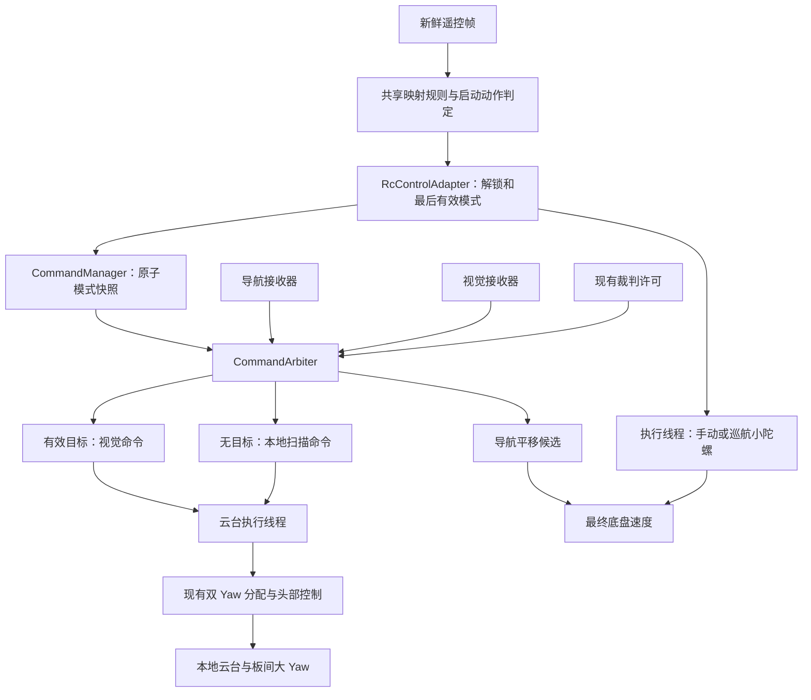

# 哨兵巡航模式与遥控掉线保持实施指南

日期：2026-11-15。

状态：根据当前工作区源码及本次确认的执行计划编写。本文是供手工实施的教程，尚未修改业务源码，也未执行构建、测试、固件运行或烧录。文中的新类型、函数和字段均为待实现接口，不代表仓库已有功能。

执行顺序分为三段：理解运行合同，连续完成全部修改，最后进行一次编译。中途不安排逐函数测试、差异审查或额外验证。末尾的场景表用于解释交付行为，不代表已经完成实机验证。

## 一、运行合同和当前代码依据

### 1.1 本次要实现的行为

“巡航”指云台自动搜索：没有有效视觉目标时扫描，出现有效目标时沿用现有视觉跟踪。底盘小陀螺是与此并行的旋转选择。

以下表格中的运动均要求已经解锁；未解锁时拨到巡航位置不会直接启动。

| 左拨杆 | 右拨杆 | 模式与输出 | 遥控掉线后的行为 |
| --- | --- | --- | --- |
| Down | 任意合法位置 | 停止、撤销解锁 | 保持停止 |
| Up | Middle / Up | 现有手动及合并键鼠控制 | 撤销解锁 |
| Up | Down | 现有手动小陀螺控制 | 撤销解锁 |
| Middle | Middle | 现有导航及视觉模式；无目标时沿用 Hold | 保持解锁和该模式 |
| Middle | Up | 云台扫描/视觉跟踪；小陀螺关闭 | 保持解锁和该模式 |
| Middle | Down | 云台扫描/视觉跟踪；小陀螺开启 | 保持解锁和该模式 |

“允许掉线”只指遥控链路：最后一帧已接受的有效输入处于左 Middle，且已经解锁，才保持自主运行。它不把上电无遥控、从未解锁、手动档掉线、板间掉线或对端重启转化为自动授权。

恢复通信后，使用新鲜且序号合格的新帧立即更新选择：左 Down 停止，左 Up 返回手动，左 Middle 按右拨杆选择自主子模式。掉线期间的旧摇杆、鼠标、键盘、拨轮值不参与自主运动。

### 1.2 扫描、导航和小陀螺怎样分工

第一版按已确认计划采用以下行为：

| 分量 | 普通导航：左中右中 | 巡航：左中右上 | 巡航带小陀螺：左中右下 |
| --- | --- | --- | --- |
| 云台有有效视觉目标 | 现有视觉跟踪 | 现有视觉跟踪 | 现有视觉跟踪 |
| 云台无有效视觉目标 | 现有 Hold | 低速扫描 | 低速扫描 |
| 底盘 `vx/vy` | 有效导航速度 | 有效导航速度，无有效帧则为零 | 有效导航速度，无有效帧则为零 |
| 底盘 `wz` | 有效导航帧的角速度 | 小陀螺减速到零后为零 | 现有小陀螺曲线 |

巡航两档的 `wz` 由本地小陀螺逻辑独占，不与导航 `wz` 相加。右下切右上是“停止请求旋转并按现有减速度回零”，并非物理转速瞬间为零。左 Down、真实撤权则立即撤销旋转请求。

云台扫描采用头部世界 Yaw 角速度，经过现有 `DualYawMotionAllocator` 分配到大小 Yaw。Pitch 保持每次进入扫描时的实际关节角；不是强行回水平，也不是保留上一次视觉的未完成目标。扫描速度和方向集中配置。本文给出的 `+0.3 rad/s` 仅为待实机确定的初值，约为 `17.2°/s`。

右上和右下之间切换只改变底盘旋转请求，不重启视觉会话、不重新捕获扫描 Pitch、不重置扫描来源。视觉跟踪开始或结束也不改变小陀螺开关。

### 1.3 两条解锁路径必须分开

**普通拨杆解锁保持当前条件：** 左 Down 建立归中基线，右 Middle，摇杆及拨轮满足现有 `centered()` 条件，再左 Down→Middle 解锁。当前源码已经没有 500 ms 等待，不从旧 README 重新加回来。

**上电快捷解锁改成动作语义判定：** 只有在解锁后当前输入不会主动产生动作时，才允许使用一次性的上电快捷路径。不固定要求右 Middle。

| 上电首次有效输入 | 快捷解锁结论 |
| --- | --- |
| 左 Up、右 Up，手动映射无动作 | 允许；这是用户明确要求的例子 |
| 左 Up、右 Middle，手动映射无动作 | 允许 |
| 左 Up、右 Down | 不允许，有小陀螺请求 |
| 左 Middle、右 Up / Down | 不允许，有巡航请求 |
| 左 Middle、右 Middle | 只有能确定自主候选无动作时允许，具体见 2.4 |
| 左 Down | 始终停机；可保留一次性快捷资格，离开 Down 时再次判断动作 |
| 手动运动输入、拨轮/键盘旋转请求、机构动作请求 | 不允许 |
| 输入无效、无法判定映射 | 不允许 |

动作判定使用解锁后的候选意图，发生在运行门控、裁判裁剪、驱动是否就绪等条件之前。不能因为“还未解锁，实际输出恰好为零”而判定无动作，也不能因为电机掉线或裁判拒绝而忽略已经存在的运动请求。

正式应用启用了 `merge_keyboard_mouse=true`，右 Up 本身不再产生发射请求；鼠标按钮才是该路径的机构输入。不要使用 `RcControlAdapter` 中保留给其他样例的 `friction_requested` 含义判断正式应用的右 Up。

### 1.4 当前代码中必须衔接的位置

| 文件与定位符 | 当前事实 | 本次修改目的 |
| --- | --- | --- |
| [rc_controls.hpp](../../samples/robotics/common/rc_controls.hpp)，`update()` | 左中统一为导航；启动快捷资格使用 `centered && arm_switch_ready` | 保存自主子模式，单独替换快捷解锁判定 |
| 同文件，`holdNavigationOnLinkLoss()` | 已允许左中掉线；清空 `spin_requested` | 保留自主选择，手动输入继续清空 |
| [command.cpp](../../lib/robotics/command.cpp)，`ManualCommandMapper::map()` | 左中只映射 Navigation；右 Down 的旋转仅在 Manual 产生 | 增加巡航子模式，维持主模式含义 |
| 同文件，`CommandArbiter::update()` | 掉线维持依赖 `allow_navigation && navigation_active_`；无目标时 Hold | 允许已授权巡航独立于导航接收器工作 |
| [command_manager.cpp](../../lib/robotics/command_manager.cpp)，`setOperatorGate()` | 跨线程只传允许状态和解锁会话 | 原子传递已接受的模式选择 |
| [command_source.hpp](../../include/robotics/command/command_source.hpp)，`sourceStamp()` | `Autonomous` 的来源戳固定取导航帧 | 新增本地行为来源戳 |
| [main.cpp](../../applications/sentry_gimbal/src/main.cpp)，`spin.update()` | 小陀螺只得到手动授权 | 接入巡航旋转，隔离旧键鼠/拨轮 |
| 同文件，`gimbal_mode_matches`、`navigation_command` | 只判断主模式或来源 | 加入会话和自主行为匹配 |
| 同文件，`input.command.mode == GimbalMode::Rate` | 已经通过分配器执行头部速率 | 扫描复用这条链路 |
| [gimbal_axis.cpp](../../lib/robotics/gimbal_axis.cpp)，`update()` | Rate=0 保持既有积分目标，不保证保持切换时的实际角度 | 扫描入口显式重播种 Pitch |
| [interboard_codec.cpp](../../lib/communication/interboard_codec.cpp)，`decodeChassisControl()` | 来源编号只接受 0…4 | 本地新增来源不得写入底盘报文 |

既有[空闲巡航规划](哨兵空闲巡航与搜索模式规划.md)可作为行为背景，但其中的旧 Router/SafetyManager 分层、未接通自动源等叙述不能照搬到当前实现。当前正式入口使用 CommandArbiter、双 Yaw 分配器和执行器链路。

### 1.5 数据流和线程所有权



`RcControlAdapter` 和 `SpinSpeedProfile` 仍由云台主循环独占。`CommandArbiter` 由命令管理线程独占。两个线程之间复制值，不共享可变对象指针，不让管理线程直接读取 `controls` 内部状态。所有新增接口均用于线程上下文；不在 UART/CAN ISR 中调用。

## 二、按文件连续完成实现

### 2.1 文件清单和顺序

| 顺序 | 文件 | 待完成内容 |
| --- | --- | --- |
| 1 | `include/robotics/messages/remote.hpp`、`common.hpp` | 自主子模式、选择快照、本地来源 |
| 2 | `include/robotics/command/manual_command_mapper.hpp`、`lib/robotics/command.cpp` | 共用归一化、正式巡航映射 |
| 3 | `include/robotics/vehicle/manual_profile.hpp` | 正式应用统一配置与巡航参数 |
| 4 | 新增 `include/robotics/vehicle/startup_action.hpp` | 纯函数动作判定，无线程或 I/O |
| 5 | `samples/robotics/common/rc_controls.hpp` | 快捷解锁、子模式和掉线保持 |
| 6 | `command_inputs.hpp`、`command_manager.hpp/.cpp` | 选择快照、会话与行为版本传递 |
| 7 | 新增 `include/robotics/command/cruise_scan.hpp`、`command_arbiter.hpp`、`lib/robotics/command.cpp` | 扫描命令与视觉仲裁 |
| 8 | `command_source.hpp` | 本地来源时间戳 |
| 9 | `gimbal_executor.hpp`、`applications/sentry_gimbal/src/main.cpp` | 扫描入口、双 Yaw、旋转与发布 |
| 10 | `applications/sentry_gimbal/README.md` | 操作合同和诊断说明 |

上述新增文件建议采用小型头文件实现；无需增加线程、注册第 4 个 `ICommandSource` 或修改源槽容量。若选择把非 inline 实现放入 `.cpp`，再在 `lib/robotics/CMakeLists.txt` 对应 `CONFIG_SKYWALKER_ROBOTICS_COMMAND` 条目登记，避免只声明未链接。

以下接口是推荐的完整接入合同。标为“结构伪代码”的段落用于说明插入顺序，不能单独粘贴后就视为功能完成。

### 2.2 增加自主选择和本地来源

在 `remote.hpp` 的 `OperatorMode` 后增加：

```cpp
enum class AutonomousMode : std::uint8_t {
    None, Navigation, Cruise, CruiseSpin
};

inline bool isCruise(AutonomousMode mode) {
    return mode == AutonomousMode::Cruise || mode == AutonomousMode::CruiseSpin;
}

struct OperatorSelection {
    bool valid = false; // false：兼容现有样例，由原始遥控映射决定模式。
    OperatorMode mode = OperatorMode::Safe;
    AutonomousMode autonomous = AutonomousMode::None;
    MessageStamp accepted_remote_stamp{}; // 最后一帧已接受输入，掉线时不刷新。
};

inline AutonomousMode selectAutonomousMode(const RemoteState &remote, bool cruise_enabled) {
    if (remote.left_switch != RcSwitch::Middle)
        return AutonomousMode::None;
    if (!cruise_enabled || remote.right_switch == RcSwitch::Middle)
        return AutonomousMode::Navigation;
    if (remote.right_switch == RcSwitch::Up)
        return AutonomousMode::Cruise;
    if (remote.right_switch == RcSwitch::Down)
        return AutonomousMode::CruiseSpin;
    return AutonomousMode::None;
}
```

调用该函数前必须已经验证两拨杆为合法值。`Unknown` 不获得导航或巡航授权。

给 `OperatorIntent` 追加 `AutonomousMode autonomous = AutonomousMode::None;`。主模式仍使用现有 `OperatorMode::Navigation` 表示左中自主大类，右拨杆决定其子模式。

在 `common.hpp` 的 `ControlSource` 末尾追加 `LocalBehavior`，保持旧编号不变：None=0、Remote=1、KeyboardMouse=2、Vision=3、Autonomous=4、LocalBehavior=5。该来源仅表达本机生成的扫描/自主 Hold 云台命令。

**底盘来源始终使用原有 `Autonomous`，不使用 `LocalBehavior`。** 板间编码器会检查来源编号；把 5 填入底盘命令会导致编解码返回 `-EINVAL`。大 Yaw 报文传递速率、序号和年龄，不携带这个云台来源枚举，无需扩展协议。

### 2.3 统一正式配置与映射

在 `ManualCommandMapper::Config` 末尾追加 `bool cruise_on_middle = false;`，默认关闭，避免改变其他样例。`map()` 完成主模式判定后增加：

```cpp
if (n.mode == OperatorMode::Navigation)
    n.autonomous = selectAutonomousMode(r, config_.cruise_on_middle);
```

把 `map()` 当前局部归一化 lambda 的公式提取为同类静态方法：

```cpp
static float normalizeChannel(float raw, float range, float deadband) {
    const float x = std::clamp(raw / range, -1.0f, 1.0f);
    return std::fabs(x) <= deadband
               ? 0.0f
               : std::copysign((std::fabs(x) - deadband) / (1.0f - deadband), x);
}
```

头文件补 `<algorithm>` 和 `<cmath>`。输入前提为 `range>0`、`0<=deadband<1` 且参数有限；沿用 `map()` 的配置错误检查，不把非法配置静默当成零输入。`map()` 的四摇杆轴和启动动作判断均调用同一公式。

`CommandArbiter::Config` 末尾追加：

```cpp
bool enable_cruise = false;
float cruise_yaw_rate_rad_s = 0.3f;
```

启用巡航时，`validateConfig()` 要求外部运行门控已启用，扫描速率有限、非零、绝对值不超过 `max_gimbal_yaw_rate_rad_s`；违反则返回 `-EINVAL`。启用巡航不要求导航接收器存在。

调整 `mapperConfig()` 中“无导航就把左 Up 自动变成 Auto”的补全逻辑：

```cpp
c.auto_on_up = c.auto_on_up ||
               (config_.allow_auto && !config_.allow_navigation && !config_.enable_cruise);
c.navigation_on_middle = c.navigation_on_middle ||
                         config_.allow_navigation || config_.enable_cruise;
c.cruise_on_middle = c.cruise_on_middle || config_.enable_cruise;
```

否则在关闭导航接收器、保留视觉及巡航的配置下，左 Up 会意外变成 Auto。

在 `manual_profile.hpp` 增加扫描参数入口，例如 `cruise_yaw_rate_rad_s=0.3f`。把正式 `main.cpp` 中创建命令配置的 lambda 提升为同一个 `static const auto command_config = ...;`，再用它构造 `CommandManager`。在该 lambda 中明确设置：

```cpp
config.enable_cruise = true;
config.cruise_yaw_rate_rad_s = installed::cruise_yaw_rate_rad_s;
config.mapper.cruise_on_middle = true;
config.mapper.navigation_on_middle = true;
config.mapper.auto_on_up = false;
// 保留已有 KeyboardMouseSelectable、merge_keyboard_mouse 和接收器能力设置。
```

启动动作判断复用这份 `command_config`，不重新创建一份可能缺少 `merge_keyboard_mouse` 的默认 mapper。`allow_navigation` 表示导航源能力，`enable_cruise` 表示本地行为能力，两者不互相替代。

### 2.4 编写启动动作判定函数

新增 `vehicle/startup_action.hpp`，用一个纯函数返回判定及原因位。函数不修改解锁状态、鼠标手势或小陀螺锁存，不进行 I/O。

```cpp
enum StartupActionReason : std::uint32_t {
    StartupMappingInvalid = 1u << 0,
    StartupChassisMotion  = 1u << 1,
    StartupGimbalMotion   = 1u << 2,
    StartupSpinRequest    = 1u << 3,
    StartupMechanism      = 1u << 4,
    StartupCruiseRequest  = 1u << 5,
    StartupAutoUnknown    = 1u << 6,
    StartupAutoMotion     = 1u << 7
};

struct StartupActionAssessment {
    bool known = false;
    std::uint32_t reasons = 0;
    bool noAction() const { return known && reasons == 0; }
};

StartupActionAssessment assessStartupAction(
    const RemoteState &remote,
    const CommandInputs *observed, // nullptr：尚无管理线程快照。
    const CommandArbiter::Config &config,
    const SpinSpeedProfile::Config &spin_config,
    core::TimeUs now_us);
```

若定义在头文件，函数加 `inline`。所需头文件包括命令输入/映射/仲裁、小陀螺配置及 `<cmath>`。返回值不使用负错误码；无效配置、无效输入用 `known=false` 和原因位表达。主循环只在决定快捷资格时消费 `noAction()`，详细位留作诊断。

按下列顺序实现函数体：

1. 输入必须在线、戳有效且新鲜、开关合法；调用正式配置的 mapper，`map()<0` 则返回 MappingInvalid。
2. Safe 返回已知无动作。此结论不使左 Down 获得运行权，离开 Down 时仍会再次判断。
3. 巡航任一子模式直接记录 CruiseRequest。即使当前无导航、无视觉或电机未就绪，也有扫描意图。
4. Manual 检查 mapper 输出、额外旋转输入和机构请求，全部为零才返回已知无动作。
5. Navigation 检查当前自主候选，禁止使用被运行门控清零后的 `decision.command`。

手动分支的核心示例：

```cpp
// i 是前面通过正式 mapper 得到的 OperatorIntent。
std::uint32_t reasons = 0;
if (i.chassis_vx_norm != 0 || i.chassis_vy_norm != 0)
    reasons |= StartupChassisMotion;
if (i.gimbal_yaw_rate_norm != 0 || i.gimbal_pitch_rate_norm != 0 ||
    (i.mouse_rate_mapping &&
     (i.mouse_yaw_rate_rad_s != 0 || i.mouse_pitch_rate_rad_s != 0)))
    reasons |= StartupGimbalMotion;

const auto bits = remote.keyboard.bits;
const bool shift = ((bits >> 4) & 1u) != 0;
const bool q = ((bits >> 6) & 1u) != 0;
const bool e = ((bits >> 7) & 1u) != 0;
// 与正式 main.cpp 的拨轮归一化和 Q/E 优先级完全一致。
const float wheel = ManualCommandMapper::normalizeChannel(
    remote.analog.wheel, 660.0f, 0.03f);
const float dial = e ? 1.0f : q ? -1.0f : wheel;
if (remote.right_switch == RcSwitch::Down || shift ||
    std::fabs(dial) >= spin_config.dial_deadband)
    reasons |= StartupSpinRequest;
if (i.friction_requested || i.fire_requested)
    reasons |= StartupMechanism;
return {true, reasons};
```

上面的键盘附加判定只用于正式应用的合并键鼠配置；不要无条件改变 PhysicalRemote 或其他样例。Shift 即使尚未形成锁存，也表达即将开启旋转的请求。无需因不参与动作映射的其他按键置位就拒绝快捷解锁。

普通归中条件是原始值 `abs(raw)<=33`，手动归一化死区是 `0.03*660≈19.8`。例如 raw=25 满足旧归中条件，却会得到非零运动意图。**普通解锁保留 ±33，快捷解锁使用实际映射结果，不能共用一个 `centered()` 代替两种语义。** 拨轮还要经过小陀螺自己的 `dial_deadband`，不能简单要求原始值等于零。

Navigation 分支采用三值判断“无动作／有动作／未知”：

| 候选情况 | 判定 |
| --- | --- |
| 已启用导航，有新鲜有效有限值命令，`vx/vy/wz` 任一非零 | 有动作 |
| 已启用视觉，有新鲜有效的 `control_requested=true` 目标 | 有动作，即使目标角等于当前角也不在此推测零误差 |
| 已启用源缺帧、过期、非法、参考不匹配，或尚无 `observed` 快照 | 未知，不授予快捷解锁 |
| 导航明确给出新鲜零速度，视觉明确给出新鲜 `control_requested=false` | 无动作 |
| 某源在配置中关闭 | 该源不贡献动作；不要求它提供帧 |

这里不把源暂时失联视为“明确无动作”，避免旧非零目标等待恢复后被自动放行。未知只限制上电快捷路径，普通拨杆解锁仍按既有条件可用。

来源数据从 `CommandSnapshot.observed` 取，并按原始时间戳检查 `navigation_timeout_us`、`vision_timeout_us`、有限值及视觉参考。不能使用 `WaitNewNavigation/WaitNewVision`、裁判拒绝或执行器初始化未完成把本来存在的动作请求变成“无动作”。这是针对已确认规则的明确实现口径。

### 2.5 修改遥控状态机，保留原普通解锁路径

在 `RcControlAdapter::Config` **末尾**追加：

```cpp
bool enable_cruise_switches = false;
bool semantic_startup_unlock = false;
```

该 Config 存在位置初始化调用，例如 `{false, true}`，不能在已有成员中间插字段。正式应用显式打开两项，其他样例维持默认行为。

在 `RcControlState` 追加：

```cpp
robotics::AutonomousMode autonomous = robotics::AutonomousMode::None;
```

保留 `run_allowed` 的现有含义：仅代表手动授权。不要为了让巡航旋转，把它改成“全部模式已解锁”，否则原有手动键鼠、Shift 锁存和来源匹配会在自主档生效。

给 `update()` 增加默认参数，使旧调用方仍能编译：

```cpp
const RcControlState &update(const robotics::RemoteState &remote,
                             std::uint64_t now_ms,
                             bool startup_no_action = false);
```

参数只描述当前候选帧的启动语义；内部必须先完成原有 online、时间戳、序号和开关合法性判定，只有真正接受这帧后才能使用它。返回值仍是内部状态的只读引用，主循环继续复制为局部 `operator_state`，不跨线程保存这个引用。

#### 2.5.1 分离两个条件

在接受帧之后、原 startup shortcut 之前计算：

```cpp
const bool neutral = centered(remote); // 普通解锁继续使用。
const bool arm_switch_ready = !config_.require_right_middle_to_arm ||
                              right == RcSwitch::Middle;
const bool startup_eligible = config_.semantic_startup_unlock
                                  ? startup_no_action
                                  : neutral && arm_switch_ready;
```

把建立、取消 `startup_neutral_available_` 的条件替换成 `startup_eligible`。具体结构为：

```cpp
if (first_frame && !startup_consumed_) {
    startup_neutral_available_ = startup_eligible;
    startup_consumed_ = !startup_eligible;
}
if (startup_neutral_available_ && !startup_eligible) {
    startup_neutral_available_ = false;
    startup_consumed_ = true;
}

if (left == RcSwitch::Down) {
    // 保留现有 stopMotion() 和安全档状态赋值。
    neutral_ready_ = neutral && arm_switch_ready;
    // 旧样例继续执行原清理；正式语义模式由 startup_eligible 管理快捷资格。
    if (!config_.semantic_startup_unlock && !neutral_ready_)
        startup_neutral_available_ = false;
} else {
    if (startup_neutral_available_ &&
        state_.start_event_id != std::numeric_limits<std::uint64_t>::max()) {
        ++state_.start_event_id;
        armed_ = true;
        startup_neutral_available_ = false;
        startup_consumed_ = true;
    }
    // 原 Down->Middle 普通解锁分支整体保留，条件不换成 startup_eligible。
}
```

这段是替换原分支的结构示例，不能与原 startup 分支并排保留，否则可能重复产生 start_event。达到事件号上限时保持不解锁，不能“没递增事件号但仍 armed=true”。

一次性资格的生命周期保持清楚：首个有效活动输入有动作或无法判定，则消耗资格；后续输入回零不重建。此前保持在左 Down 的资格，在真正离开 Down 时再按当前动作判断。已经完成解锁后，左 Down、真实撤权以及手动掉线均不得恢复快捷资格。

#### 2.5.2 接受有效帧后派生自主选择

在原 `navigation_active/manual_active/run_allowed` 赋值附近增加：

```cpp
state_.autonomous = state_.navigation_active
    ? robotics::selectAutonomousMode(remote, config_.enable_cruise_switches)
    : robotics::AutonomousMode::None;
```

现有 `spin_requested` 继续只表示手动拨杆小陀螺。巡航是否旋转由 `autonomous == CruiseSpin` 表示，不混入手动的 `right_neutral_seen_` 条件。普通解锁本来要求右 Middle；已经解锁后进入巡航无需再额外往返右 Middle。

`stopMotion()` 和安全档清理追加 `state_.autonomous = AutonomousMode::None;`。每个分支最终保持 `state_.armed == armed_`。

#### 2.5.3 掉线保持使用最后接受的输入

当前 `!remote.online` 分支会先用候选覆盖 `state_.remote`，再检查左拨杆。改为依据已有状态判断，不能由失联快照中的 Unknown、旧帧或异常候选改写最后自主选择：

```cpp
if (!remote.online) {
    state_.fresh = false;
    state_.remote.online = false; // 保留已经接受的拨杆、序号和原始戳。
    if (!holdNavigationOnLinkLoss(state_.remote.left_switch)) {
        withdraw();
        previous_left_ = previous_right_ = RcSwitch::Unknown;
    }
    return state_;
}
```

在 `holdNavigationOnLinkLoss()` 中保留原有条件：配置允许、`armed_`、当前 `RcMode::Navigation`、最后接受的左 Middle。保持 `navigation_active=true`、`navigation_hold=true`、`manual_active=false`、`run_allowed=false`，**不清空 `state_.autonomous`**。

继续清空手动 `spin_requested/friction_requested/continuous_requested`、鼠标就绪和手动右拨中性记忆。巡航小陀螺并不依赖这些字段，故不会被误停。重复掉线更新只保持相同选择，不更新遥控时间戳，不重新产生解锁事件。

坏序号、时间倒退候选和重复快照仍沿用当前“保留已接受帧，到原始输入期限后才处理掉线”的规则，不引入另一套超时。

### 2.6 把模式选择原子传给命令线程

只让 `RcControlAdapter` 记住巡航还不够：管理线程目前独立读取遥控，并依赖内部 `navigation_active_` 处理掉线。它可能尚未看到新档位就遇到断流。应以执行线程已经接受并授权的选择快照为准。

#### 2.6.1 扩展输入和决策

在 `CommandInputs` 末尾增加：

```cpp
OperatorSelection operator_selection{};
std::uint32_t operator_session = 0;
std::uint32_t operator_revision = 0;
```

在 `command_inputs.hpp` 定义并加入 `CommandDecision`：

```cpp
enum class GimbalBehavior : std::uint8_t { None, Hold, Scan, Track };

// 以下为 CommandDecision 的新增成员。
AutonomousMode autonomous = AutonomousMode::None;
GimbalBehavior gimbal_behavior = GimbalBehavior::None;
std::uint32_t operator_session = 0;
std::uint32_t operator_revision = 0;
core::Stamp local_gimbal_stamp{};
```

`operator_session` 对应现有 `start_event_id` 的板内 32 位表示；`operator_revision` 标记当前可执行的行为版本；`local_gimbal_stamp` 只属于本地云台行为。开始仲裁时复制会话和版本，所有早退也保留它们。最终输出 Disabled 时，清空本地来源戳和实际行为标识。

#### 2.6.2 扩展已有 gate，保持旧调用可用

推荐将 `setOperatorGate()` 改为以下签名，旧调用方可以忽略新增返回值：

```cpp
std::uint32_t setOperatorGate(bool run_allowed,
                              std::uint32_t session = 0,
                              const OperatorSelection &selection = {});
```

返回当前 revision，用于主循环拒绝旧命令快照。不是成功/失败错误码。保留线程上下文限制；ISR 中直接返回 0 且不写状态，正式代码不得在 ISR 调用。正常版本从第一次变更后开始递增，不使用大小关系比较版本，只做相等比较。

私有 `OperatorGate` 追加 `OperatorSelection selection{};`。在已有 `operator_gate_lock_` 临界区内一次性写入允许状态、会话、选择和版本。不要分别调用“设置授权”“设置子模式”两个无关联接口，否则管理线程可能读到两次更新的混合。

revision 的更新规则：允许状态变化、解锁会话变化、选择有效性变化、主模式变化、**自主行为类别**变化时递增。自主行为类别为 None、Navigation、Cruise 三种，Cruise 与 CruiseSpin 属于同类。仅右上/右下互切时复制新子模式，但不递增行为版本、不重置鼠标会话边界。

这样做的原因是：巡航两档的云台和导航平移完全相同，唯一差异 `wz` 由主循环依据最新状态生成。允许复用同一会话中仍新鲜的巡航云台决策，可以让小陀螺按原减速度连续回零；不能从旧决策读取旋转开关。

`accepted_remote_stamp` 每次调用照实复制，但新遥控帧本身不递增 revision，否则会每帧清空手势、重建目标。

管理线程 `run()` 在已有 gate 快照处写入：

```cpp
next.observed.run_allowed = gate.allowed && !safe_gate_latched;
next.observed.operator_selection = gate.selection;
next.observed.operator_session = gate.session;
next.observed.operator_revision = gate.revision;
```

保留现有队列中的有效左 Down 优先停止及 `safe_gate_latched` 处理。新的普通帧只更新遥控观察值，不抢先覆盖 gate 中的模式；模式变更等执行线程接受后统一发布。发现比选择快照更新的停止帧仍应撤权，不能因本周期开始已复制旧 gate 而忽略停止。

#### 2.6.3 仲裁怎样使用外部选择

启用正式巡航时要求 `operator_selection.valid`，运行门控关闭立即按既有分支禁用。门控开启后：

- Manual：遥控必须新鲜；mapper 的主模式必须与已接受选择一致，否则本周期不执行旧手动输入，等待下一轮选择同步。
- Navigation：以选择快照中的子模式为准，遥控掉线不改变这个选择，不依赖管理线程以前是否见过 `navigation_active_`。
- Safe：停止。

不启用巡航、未提供选择快照的旧调用方走原有分支。不能删除所有旧样例的状态逻辑。

`navigation_active_` 仍可用于记录“进入自主会话，等待新导航帧”的基线，但不再作为正式掉线授权的唯一来源。会话变更、退出自主模式时清基线；同一会话内普通导航与巡航切换保留已建立的导航/视觉输入基线，右上/右下互切也不重新等待一遍目标。为此在仲裁器保存最近处理的 `operator_session`，会话变化时清理入口基线，随后按当前输入重新建立；该缓存同时在 `reset()` 中清理。

解析最终意图后同步填写 `n.operator_mode = i.mode; n.autonomous = i.autonomous;`，非自主模式将子模式设为 None。不能只扩展结构却忘记填决策字段，否则主循环会一直判定快照不匹配。

### 2.7 生成扫描命令并加入仲裁

#### 2.7.1 第一版生成器只负责目标值

新增 `command/cruise_scan.hpp`：

```cpp
#pragma once
#include <robotics/messages/command.hpp>

namespace skywalker::robotics {
// 调用前已经完成配置验证；加速度和机械限位由现有下游执行。
inline GimbalCommand makeCruiseScanCommand(float head_yaw_rate_rad_s) {
    GimbalCommand command{};
    command.mode = GimbalMode::Rate;
    command.source = ControlSource::LocalBehavior;
    command.yaw_rate_rad_s = head_yaw_rate_rad_s;
    command.pitch_rate_rad_s = 0.0f;
    return command;
}
}
```

函数无状态、无 I/O、无错误码，不积分 360° 绝对角，不自己控制大 Yaw，不重新实现加速度限制。源序号和时间戳由实际调用它的仲裁线程产生。Pitch=0 表示进入扫描并重播种后维持该关节目标，重播种步骤在 2.9。

#### 2.7.2 修改自主分支，解除导航对扫描的绑定

在 `CommandArbiter::update()` 解析选择后计算：

```cpp
const bool autonomous_mode = i.mode == OperatorMode::Navigation;
const bool cruise_mode = autonomous_mode && isCruise(i.autonomous);
const bool automatic_aim = i.mode == OperatorMode::Auto ||
                           (autonomous_mode && config_.allow_auto);
```

巡航只检查 `enable_cruise`；导航接收器未启用时仍能扫描。普通 Navigation 子模式保留原导航能力约束。自主模式继续清空手动覆盖和鼠标机构意图。

巡航底盘候选每轮先建立合法零速：

```cpp
if (cruise_mode) {
    auto &chassis = n.requested.chassis;
    chassis.mode = ChassisMode::BodyVelocity;
    chassis.source = ControlSource::Autonomous;
    chassis.vx_m_s = chassis.vy_m_s = chassis.wz_rad_s = 0.0f;
}
```

随后沿用导航的有效戳、新鲜度、有限值及进入会话后的新帧条件。导航合格时填写 `vx/vy`，巡航保持 `wz=0` 交给主循环；普通导航仍填写完整 `vx/vy/wz`。每轮重新从零构造候选，导航过期后不能残留上一帧平移。

没有导航帧时保留 `NavigationMissing/Stale/WaitNewNavigation` 等诊断，但巡航的合法零平移命令不因此变成 Disabled。`NavigationUnavailable` 对巡航表达可选源缺失，不能提前禁用整车。有效裁判拒绝仍在现有最终裁剪处令底盘三轴为零。

普通左中右中的底盘行为保持当前逻辑，包含当前掉线保持时的零速 BodyVelocity 行为；不要为了增加巡航而一并重写普通导航的缺帧语义。

#### 2.7.3 在原视觉判定之后增加扫描兜底

继续使用现有视觉条件：目标戳、序号、超时、`control_requested`、参考、有限值，以及进入自动会话后等待新帧。有效目标仍填写 `selected_vision` 和 `ControlSource::Vision`，并置 `gimbal_behavior=Track`。

无目标时的处理区分如下：

| 原因 | 巡航行为 |
| --- | --- |
| `VisionMissing`、`VisionStale`、`VisionStopped` | 转 Scan |
| `WaitNewVision` | 继续 Scan，直到收到该会话的新目标 |
| 配置关闭视觉 | 仅执行 Scan |
| `InvalidVision`、`VisionReferenceMismatch`、时钟倒退 | 保持既有拒绝/Hold/Disabled 语义，不以扫描吞掉错误 |
| 云台许可被有效拒绝 | 最终 Disabled |
| 已选视觉目标，但主循环发现头部 IMU 不可用 | 继续原停止处理，不在主循环私自切 Scan |

扫描选择必须放在视觉候选完成后、`n.command = n.requested` 之前；最终裁判裁剪仍最后执行。结构伪代码：

```cpp
// 前文已建立视觉结果 visual_control，以及原因位。
if (cruise_mode && !visual_control) {
    const bool bad_vision = (n.gimbal_reasons &
                            (InvalidVision | VisionReferenceMismatch)) != 0;
    if (!bad_vision) {
        n.requested.gimbal = makeCruiseScanCommand(config_.cruise_yaw_rate_rad_s);
        n.selected_vision = {};
        n.gimbal_behavior = GimbalBehavior::Scan;
    }
}
```

这段不是“凡是未选视觉都强行扫描”。全局禁用、配置错误、时钟倒退等原有早退仍优先；最终许可照常裁剪。不要清除缺目标原因位，它们用于解释为何选择扫描。诊断不能把所有非零原因位都当成执行禁止。

自主模式产生的 Hold 也改为 `ControlSource::LocalBehavior`，`gimbal_behavior=Hold`。手动 Hold 保持原来源，避免扰动键鼠来源判断。这样自主在线/离线时 Hold 都有同一种真实本地产生时间，不再依赖原来仅为掉线 Hold 特判的补丁。

新增扫描不会改变现有自主模式的发射策略：保留当前自主分支的 `ShooterNotArmed` 及鼠标撤销行为，不从 `control_requested` 推导新的发射权限。

#### 2.7.4 最终输出和时间戳

`finish()` 仍负责普通命令的 `MessageStamp`。本地来源戳在最终输出确定之后产生：

```cpp
if (n.command.gimbal.source == ControlSource::LocalBehavior &&
    n.command.gimbal.mode != GimbalMode::Disabled) {
    n.local_gimbal_stamp = {now, std::uint64_t(stamp.sequence), true};
} else {
    n.local_gimbal_stamp = {};
}
if (n.command.gimbal.mode == GimbalMode::Disabled)
    n.gimbal_behavior = GimbalBehavior::None;
if (n.command.gimbal.source != ControlSource::Vision)
    n.selected_vision = {};
```

此处 `now` 为本次仲裁时间，单位微秒；`stamp.timestamp_ms` 为毫秒。每轮真正生成本地指令时允许生成新戳。只读快照、板间重发和执行循环不能刷新这一戳。管理线程停产后，旧扫描会按现有 100 ms 命令/来源期限失效。

在 `reset()`、全局 `disable()` 以及退出自主会话时，清理新增行为状态和基线；不保留上一个会话的扫描目标或选择。对象中若新增会话缓存，需要同时在这些路径清空。

### 2.8 扩展来源时间戳解析

在 `sourceStamp()` 中增加：

```cpp
if (source == ControlSource::LocalBehavior)
    return frame.decision.local_gimbal_stamp;
```

保留 Remote/KeyboardMouse、Vision、Autonomous 三种既有来源的取戳规则。尤其不能把所有 `Autonomous` 来源都改成当前仲裁时间，那会让过期导航看似仍新鲜。

在主循环删除原有“仅 `navigation_hold && Hold` 时从命令戳合成 source_stamp”的特判。新的自主 Hold 和 Scan 都通过 `LocalBehavior` 解析；视觉仍使用 `selected_vision.stamp`，手动仍使用真实遥控戳。

### 2.9 修改正式云台主循环

本节按 `main.cpp` 实际控制链的先后顺序说明插入位置。所有局部状态仍属于现有主循环，不增加后台线程。

#### 2.9.1 创建状态与取得启动判定

构造遥控适配器时显式启用新规则：

```cpp
samples::control::RcControlAdapter controls({
    .enable_cruise_switches = true,
    .semantic_startup_unlock = true,
});
```

这两个成员位于 Config 末尾，指定初始化顺序与声明一致；其他参数保留原默认值。

主循环先取得用于判定动作的管理线程快照，再读取遥控、判定、更新状态。结构示例：

```cpp
const bool have_action_snapshot = commands.snapshot(frame) == 0;
(void)remote.snapshot(remote_frame);
const auto startup = installed::assessStartupAction(
    remote_frame.remote,
    have_action_snapshot ? &frame.observed : nullptr,
    command_config, installed::spinProfileConfig(), now_us);
auto operator_state = controls.update(remote_frame.remote, now_ms, startup.noAction());
```

`assessStartupAction()` 定义在 `skywalker::robotics::vehicle` 命名空间，与 `installed` 别名一致。主循环计算判定并不意味着每轮尝试自动解锁；真正的一次性限制仍在适配器内部。

继续执行当前对端掉线/boot id 变化检测。对端撤权时，除了当前清零的字段，还要清本地副本中的 `armed`、`autonomous`，避免 `controls.withdraw()` 后本轮旧副本仍表示巡航：

```cpp
if (peer_revoked) {
    controls.withdraw();
    operator_state.armed = false;
    operator_state.run_allowed = false;
    operator_state.manual_active = false;
    operator_state.navigation_active = false;
    operator_state.navigation_hold = false;
    operator_state.autonomous = AutonomousMode::None;
    operator_state.mode = samples::control::RcMode::Safe;
}
```

不要将真实对端撤权归入遥控掉线保持。正常上电时对端尚未首次上线仍按当前初始化流程等待。

#### 2.9.2 提交选择并匹配返回决策

继续沿用原授权含义：

```cpp
const bool operator_authorized = operator_state.fresh || operator_state.navigation_hold;
const bool autonomous_allowed = operator_state.navigation_active &&
                                operator_authorized && setup_ready;
const bool gimbal_allowed = operator_state.run_allowed || autonomous_allowed;
const bool cruise_selected = autonomous_allowed && isCruise(operator_state.autonomous);

OperatorSelection selection{};
selection.valid = true; // 本应用明确采用外部选择。
selection.mode = autonomous_allowed ? OperatorMode::Navigation
               : operator_state.run_allowed ? OperatorMode::Manual
                                            : OperatorMode::Safe;
selection.autonomous = autonomous_allowed ? operator_state.autonomous : AutonomousMode::None;
selection.accepted_remote_stamp = operator_state.remote.stamp;
const auto session = static_cast<std::uint32_t>(operator_state.start_event_id);
const auto expected_revision = commands.setOperatorGate(gimbal_allowed, session, selection);
const bool have_decision = commands.snapshot(frame) == 0;
```

不因 `selection.valid=true` 就允许运行；`gimbal_allowed=false`、无有效输入、未解锁时 gate 仍关闭。失联保持的 accepted stamp 继续是最后真实遥控帧的旧戳，不伪造遥控在线。

给主循环增加一个可复用的行为匹配条件：

```cpp
const auto &decision = frame.decision;
const bool same_autonomous_behavior = decision.autonomous == selection.autonomous ||
    (isCruise(decision.autonomous) && isCruise(selection.autonomous));
const bool decision_matches = have_decision &&
    decision.operator_session == session &&
    decision.operator_revision == expected_revision &&
    decision.operator_mode == selection.mode &&
    (selection.mode != OperatorMode::Navigation || same_autonomous_behavior);
```

在原 `gimbal_mode_matches`、底盘来源判定以及其他模式相关门控中使用它。它只说明“这份快照属于当前行为”，不替代命令和来源的新鲜度检查。

巡航两档允许复用同一行为决策，但**是否旋转只看当前 `operator_state.autonomous`**。普通导航与巡航、手动与自主、解锁会话之间必须严格区分。切换后的第一个周期可能尚无匹配快照，此时按现有 Disabled/等待逻辑处理，不能给旧快照换上新时间戳再执行。

#### 2.9.3 扫描进入现有双 Yaw 速率链

创建 `GimbalExecutionInputs` 时继续从 `decision.command.gimbal` 和 `sourceStamp()` 取值。通过行为、授权及新鲜度后判断：

```cpp
const bool scan_selected = decision_matches && cruise_selected &&
    decision.gimbal_behavior == GimbalBehavior::Scan &&
    input.command.source == ControlSource::LocalBehavior &&
    input.command.mode == GimbalMode::Rate;
```

`raw_head_rate_rad_s` 取扫描命令的世界角速度，按当前流程进入 `DualYawAllocatorInputs.head_rate_target_rad_s`。`vision_active=false`，分配器走速率意图路径。后面的 `GimbalMode::Rate` 分支继续使用分配器输出的小 Yaw 关节速率，并发送分配器的大 Yaw 世界意图。

不要再向大 Yaw 请求中加一遍扫描速度，也不要把扫描改成整个云台 `Hold` 后仍强行让大 Yaw 转动。当前代码已经解释过：小 Yaw Hold 只锁关节角，会破坏载体补偿和回中假设。

扫描只需要当前速率链原有的载体航向与关节反馈；头部 CAN IMU 的视觉约束仍用于视觉分支。已经选中视觉但外置 IMU 不可用时保持原拒绝执行，不在应用层把该故障解释为“没目标”。

#### 2.9.4 进入扫描时重播种 Pitch

在 `GimbalExecutor` 中紧邻 `reseedYawTarget()` 增加：

```cpp
int reseedPitchTarget() {
    return pitch_.reseedTargetFromFeedback();
}
```

接口由执行线程调用，返回现有 `GimbalAxis` 的结果：未配置为 `-EACCES`，反馈暂不可用为 `-EAGAIN`，缺少参考为 `-ENODATA`，非法测量为 `-EINVAL`，成功为 0。它只重建控制目标，不重新定义电机编码器零点。

主循环增加 `bool scan_entry_pending=false, scan_was_selected=false;`。从非 Scan 进入 Scan 时置 pending；退出 Scan 清理；授权、会话、来源参考恢复后需要重新建立本次扫描入口。处理顺序放在关节反馈和 `heading_fresh` 已经取得之后、分配器更新之前：

1. 判断本轮是否选择 Scan，是否新进入或从反馈中断恢复。
2. 新进入时 `dual_yaw.reset()`，保留现有 `head_control.suspend()` 的来源切换处理。
3. 等待 `joint_valid`、`pitch_valid`、载体航向和大 Yaw 执行通道所需反馈；合格后调用 `reseedYawTarget()` 和 `reseedPitchTarget()`。
4. 两个调用成功才清 `scan_entry_pending`，开始输出扫描 Rate；失败保留 pending，当前周期不推进扫描目标。
5. 本次扫描阶段 Pitch 速率持续为零，不每帧重播种，否则会变成随动而非定角保持。

初次启动还没有位置参考时，不要形成“先有参考才调用执行器、先调用执行器才能建参考”的循环等待。已授权但扫描尚未准备好时，将本地云台候选暂作新鲜的 `Hold`，继续原 `gimbal.update()` 初始化路径；分配器不推进非零意图。`GimbalAxis::poll()/seed()` 会按既有流程建立参考。该 Hold 的来源仍是已经由管理线程生成的 `LocalBehavior` 戳，不在执行线程续戳。

大 Yaw 原有“零速度使能以取得初始反馈”也保留：不要新增必须已有大 Yaw 有效反馈才允许发送零速使能的门槛。只有发出非零扫描意图时才要求相关反馈和分配结果可用。

因反馈或参考变化暂停后，把 pending 重新置位；恢复时捕获当时实际 Pitch。左中右上↔右下只是旋转选择变化，不重新置位。视觉跟踪→扫描则是新的扫描阶段，要重新捕获。

若追踪/扫描切换时 Yaw 积分目标也仍有残留，入口的 `reseedYawTarget()` 丢弃该残留；之后继续使用现有头部速率/加速度整形。不要在视觉持续跟踪的每一帧重播种。

#### 2.9.5 调整小陀螺请求和允许条件

保留一份现有 `SpinSpeedProfile`。它有独立的时间和速度状态，因此需要在手动、自主巡航、普通导航之间明确归属：

```cpp
enum class SpinOwner : std::uint8_t { None, Manual, Cruise };
SpinOwner previous_spin_owner = SpinOwner::None; // 循环外。
```

主循环每轮根据当前授权和选择确定 owner。Manual↔Cruise 或进入 None 时调用 `spin.reset()`，防止手动转速/拨轮方向带进巡航。Cruise↔CruiseSpin 的 owner 都是 Cruise，不 reset。

Shift 锁存只在新鲜手动帧和 `run_allowed` 成立时处理；离开手动立即清零。掉线或自主档不要从缓存帧推进 Shift 边沿。现有 Q/E、拨轮优先级只用于 Manual。

用于 `spin.update()` 的三项输入为：

| owner | requested | intensity | allowed |
| --- | --- | --- | --- |
| Manual | 原 `spin_requested || keyboard_spin_latched` | 原 Q/E 优先、否则拨轮 | 手动授权、决策匹配、底盘命令新鲜且许可允许 |
| Cruise | 当前子模式是否为 CruiseSpin | 固定 `0.0f` | 自主授权、巡航行为匹配、底盘命令新鲜且许可允许 |
| None | false | 0 | false |

这里 `intensity=0` 不表示禁止旋转：`SpinSpeedProfile` 在 requested=true 且拨轮居中时使用完整速度曲线。requested=false 后它按 `deceleration_rad_s2` 回零。allowed=false 则立即清零。拨轮本身能触发手动旋转，因而不能仅靠 requested=false 来关闭旧拨轮影响。

主循环结构示例：

```cpp
const bool chassis_command_fresh = isFresh(
    decision.command.chassis.stamp, now_ms, command_config.input_timeout_ms);
const bool chassis_permission_ok = (decision.chassis_reasons & PermissionDenied) == 0;
const bool body_command_ready = decision_matches && chassis_command_fresh &&
    decision.command.chassis.mode == ChassisMode::BodyVelocity && chassis_permission_ok;

const SpinOwner owner = operator_state.run_allowed && operator_state.fresh
                           ? SpinOwner::Manual
                       : cruise_selected ? SpinOwner::Cruise : SpinOwner::None;
if (owner != previous_spin_owner)
    spin.reset();
previous_spin_owner = owner;

const bool requested = owner == SpinOwner::Cruise
    ? operator_state.autonomous == AutonomousMode::CruiseSpin
    : owner == SpinOwner::Manual && (operator_state.spin_requested || keyboard_spin_latched);
const float intensity = owner == SpinOwner::Manual ? manual_dial : 0.0f;
const bool spin_allowed = owner != SpinOwner::None && body_command_ready;
const auto spin_out = spin.update(requested, spin_allowed, intensity, now_us);
```

`manual_dial` 是原代码的 `keyboard_dial != 0 ? keyboard_dial : wheel_dial`，只在手动在线分支取值；其他分支直接零。使用当前主循环已有命令超时配置，不另造一套更长的旋转超时。

将这段放在获得匹配决策后，每个 5 ms 控制周期计算一次；不能只在 10 ms 板间发送周期更新 profile。受限的正常右下→右上切换保留减速尾段；授权丢失、命令过期或有效许可拒绝优先立即撤销。

#### 2.9.6 最终底盘命令发布

`wheel_command` 始终先复制 `decision.command.chassis`，只对授权、匹配、新鲜的命令覆盖旋转分量。结构为：

```cpp
auto wheel_command = decision.command.chassis;
const bool autonomous_command = autonomous_allowed && decision_matches &&
    wheel_command.source == ControlSource::Autonomous;
const bool manual_command = operator_state.run_allowed && operator_state.fresh &&
    decision_matches && wheel_command.source == expected_manual_source;

if (!chassis_command_fresh || (!autonomous_command && !manual_command)) {
    wheel_command.mode = ChassisMode::Disabled;
    wheel_command.vx_m_s = wheel_command.vy_m_s = wheel_command.wz_rad_s = 0;
} else if (wheel_command.mode != ChassisMode::Disabled && chassis_permission_ok) {
    if (manual_command || (autonomous_command && cruise_selected))
        wheel_command.wz_rad_s = spin_out.applied_rad_s;
    // 普通导航保持仲裁后的 navigation wz。
}
endpoint.submit(wheel_command);
```

保留现有普通导航掉线零速 BodyVelocity 补全，但将它限定为普通 Navigation 子模式，并要求匹配决策且戳新鲜。巡航无导航时已经由仲裁器主动产生零平移 BodyVelocity，不再依赖这个离线补丁。

裁判明确拒绝时不要覆盖回非零 `wz`；先由仲裁器裁剪，再由这里显式尊重 `PermissionDenied`。保持当前“缺少/过期裁判数据不等于拒绝”的既有语义。

退出巡航到普通导航时 owner=None，旋转 profile 清理，`wz` 完整交回导航；退出到手动时新建手动 profile。不得把上一巡航的速度叠加到新来源。

#### 2.9.7 大 Yaw、视觉反馈和停止顺序

大 Yaw 的 `source_sequence/source_age_ms` 从最终 `input.source_stamp` 派生：扫描使用本地行为戳，视觉使用视觉戳，手动使用遥控戳。`command_age_ms` 继续来自实际命令戳。板间重发只增加年龄，不能重置源年龄。

当前 `request.permission` 的 valid 来自 `operator_state.fresh`，在允许遥控掉线时会变 false。将它明确表达为“本次应用层授权”，而不是冒充遥控仍在线：

```cpp
const bool local_authority = autonomous_allowed && decision_matches &&
    input.command.source == ControlSource::LocalBehavior;
const bool visual_authority = autonomous_allowed && decision_matches && vision_active;
const bool manual_authority = operator_state.run_allowed && operator_state.fresh && decision_matches;
const bool authority_valid = local_authority || visual_authority || manual_authority;
request.permission = {authority_valid, authority_valid && big_channel_ready, input.command.stamp};
```

本地授权戳来自正在执行的有效命令；遥控的真实在线和原始戳仍保存在 `operator_state.remote`，不修改它们。`big_channel_ready` 同时要求当前匹配决策，原有载体航向、关节反馈、对端在线和本地 Yaw 输出门控继续生效。

视觉反馈模式在全部授权自主子模式中保持 `AutoAim`，含掉线保持；手动和停止为 Idle。姿态数据继续使用真实头部 IMU 原始采样戳。这样扫描期间视觉仍能发现目标，掉线不会让视觉进入 Idle。

左 Down、对端掉线/重启、命令失效的处理优先于 profile 和最终发布。维持“生成请求→提交板间请求→每条本地 CAN 每周期一次 commit”的现有顺序；本次不移动物理总线提交职责。

### 2.10 诊断和操作说明

#### 2.10.1 区分掉线事实和运行授权

当前 `reason` 只要 `!operator_state.fresh` 就报告 RemoteStale，I37 也把它列为失能前提。允许掉线后，应使用以下含义：

- 原始遥控是否在线：继续如实记录 fresh=false。
- 是否允许自主保持：单独记录 navigation_hold。
- 主运行原因：只有 `!fresh && !navigation_hold` 才按遥控撤权报告 RemoteStale；已授权自主运行可以是 Ready。

LED 仍由最终运行原因驱动，不把“遥控离线但自主正常”一律显示成停止故障。没有改变板间掉线、执行器反馈故障等原因的优先级。

#### 2.10.2 复用现有 49 通道，不扩大串口帧

当前云台诊断 schema 为 I19=111，I19…I48 共 30 个扩展量。建议本功能使用新 schema=112，并把现有 I37 扩展为“控制上下文位图”，其余跟踪量保持：

| I37 位 | 新定义 |
| --- | --- |
| bit0 | setup 未就绪 |
| bit1 | 遥控不可用且不允许自主保持 |
| bit2…8 | 沿用原 gimbal_allowed、对端、安装、航向、关节、Yaw 输出、头部 IMU 条件 |
| bit9 | 已解锁 |
| bit10 | 遥控帧新鲜 |
| bit11 | 遥控掉线自主保持 |
| bits12…13 | AutonomousMode：None=0、Navigation=1、Cruise=2、CruiseSpin=3 |
| bits14…15 | GimbalBehavior：None=0、Hold=1、Scan=2、Track=3 |
| bit16 | 本周期启动动作判定为已知 |
| bit17 | 本周期启动动作判定为无动作 |
| bit18 | 当前决策与本地行为/会话匹配 |
| bit19 | 扫描入口仍等待准备 |

这个位图不是“任意非零都禁止运行”；同步修改注释和说明，原有观察界面若按整值判断必须改用相关位。最大使用 bit19，整数值小于 `2^20`，可由当前 float 通道精确表示；不要继续堆到 float 无法精确表达的整数位数。

I42 继续表示小陀螺 profile 的实际输出，I46 继续表示头部世界速率原始请求，I48 继续表示分配器标志。扫描时可以从 I37 行为位、I46 扫描速率、I42 底盘旋转区分两种运动。

启动拒绝的详细 `StartupActionReason` 可在原因变化时用已有 `diagnostics.event("startup_action", reasons)` 输出，不在每个 5 ms 周期打日志。事件是诊断记录，不作为新的故障锁存。若继续使用 VOFA 模式，以 I37 的 known/noAction 和行为状态为主要观测，日志按现有输出模式切换。

实际执行因反馈等待转为 Hold 时，诊断必须区分管理线程“请求 Scan”和本地“仍等待入口”，用 bit19 表达，不能仅因请求位是 Scan 就宣称已经扫描。

#### 2.10.3 更新应用 README

用本文 1.1 的完整拨杆表替换仅描述手动键鼠的模式说明，并增加：

- 左 Up/右 Up 且无动作输入可使用上电快捷解锁；普通 Down→Middle 手势保持。
- 左中两巡航档不会因上电就自动运行，必须先建立解锁。
- 左中任意合法右拨位置允许遥控掉线，重连新鲜左 Down 优先停止。
- 巡航无导航时平移为零，有导航时保留 `vx/vy`；普通导航 `wz` 与巡航小陀螺 `wz` 的分工。
- 扫描速度参数位置、Pitch 保持方式、schema=112 和 I37 位图。

README 中仍有旧回中控制器和旧 schema 的历史描述，涉及本次实际调用链的段落应写成当前双 Yaw 分配器行为；不要直接复制旧指南中的“只让大 Yaw 转、小 Yaw Hold”。与本次无关的 MPC、PID 调参记录保持独立。

## 三、全部实现完成后的收口

### 3.1 最终编译命令

本文不执行以下命令。完成第二部分全部代码和说明修改之后，使用当前实际开发的构建目录进行一次编译。已有两个目录都配置为 `dm_mc02/stm32h723xx`，不要混用其产物或编辑生成的 `.config` 来作为长期配置。

若继续使用 IDE 当前的应用内构建目录：

```sh
cd /home/shm-white/skywalker_ws/skywalker_code
west build -d applications/sentry_gimbal/build/dm_mc02/stm32h723xx
```

若当前实际维护的是 `build/sentry-gimbal`，则改用下面这一条，**两组选一组**：

```sh
cd /home/shm-white/skywalker_ws/skywalker_code
west build -d build/sentry-gimbal
```

只有在选定目录尚不存在时，才需要显式指定应用和板卡：

```sh
west build -b dm_mc02/stm32h723xx applications/sentry_gimbal -d build/sentry-gimbal
```

预期生成该目录下的 `zephyr/zephyr.elf`。编译只说明类型、声明、链接和构建配置能够通过，不能证明方向、转速、机械行程或模式切换的实机效果。

本次设计没有改变板间报文布局或来源编号 0…4 的含义，底盘继续消费已有速度和大 Yaw 请求。这里不安排底盘改造、额外测试套件、格式化、固件运行或自动烧录。

### 3.2 操作合同与预期现象

下表用于解释实现后的使用行为，未执行这些场景，不把它当作已通过的测试记录。

| 场景 | 预期状态与输出 |
| --- | --- |
| 首帧左上右上，实际映射无动作 | 上电快捷解锁，手动速度保持零；右上不会单独启动机构 |
| 首帧左上右中，实际映射无动作 | 上电快捷解锁，等待手动操作 |
| 首帧左上右下、Shift、Q/E 或有效拨轮请求 | 拒绝快捷解锁，记录旋转动作原因 |
| 首帧手动平移/云台输入非零，或鼠标机构请求 | 拒绝快捷解锁，按映射记录动作原因 |
| 首帧左中右上/右下 | 不自动解锁，不扫描、不旋转 |
| 首帧左中右中，导航或视觉会产生动作 | 不自动解锁 |
| 首帧左中右中，已启用源无法判断 | 不自动解锁；仍可使用普通拨杆手势 |
| 左下基线、右中、摇杆拨轮归中，再左下→左中 | 按原普通流程建立解锁；不新增等待时间 |
| 已解锁，左中右上，无目标 | 头部低速扫描；Pitch 保持扫描入口角度；小陀螺回零 |
| 已解锁，左中右下，无目标 | 扫描并运行现有小陀螺曲线 |
| 巡航得到有效视觉目标 | Scan→Track，沿用现有视觉控制，小陀螺选择保持 |
| 目标停止请求或按现有期限过期 | Track→Scan，重新捕获扫描 Pitch；不继续旧视觉目标 |
| 巡航右下→右上 | 扫描/跟踪会话保持，profile 按现有减速度回零 |
| 巡航右上→右下 | 扫描/跟踪会话保持，profile 按现有加速度起转 |
| 左中三个右拨位置分别发生遥控掉线 | 保留各自已授权子模式；遥控 fresh=false、hold=true |
| 未解锁就掉线 | 保持未解锁，不因最后拨杆是左中而启动 |
| 左上手动掉线 | 撤权，profile 清零；重连不恢复上电快捷资格 |
| 掉线恢复后收到有效左下 | 立即停止并撤销解锁 |
| 掉线恢复后收到有效左上 | 返回现有手动输入路径，清理巡航状态 |
| 巡航期间导航过期 | `vx/vy=0`，扫描和选定的小陀螺继续；不续用旧导航速度 |
| 关闭导航接收器但保留巡航功能 | 巡航可用、平移为零；左 Up 仍是手动 |
| 关闭视觉接收器但保留巡航功能 | 按配置持续扫描，不能报告视觉跟踪 |
| 新鲜非法视觉目标或参考不匹配 | 保留拒绝/Hold/Disabled 语义，不用扫描隐藏故障 |
| 载体航向、关节反馈或大 Yaw 通道暂不可用 | 暂停非零扫描意图，沿用初始化/恢复路径，不积压扫描角度 |
| 有效裁判许可拒绝底盘输出 | 最终三轴速度为零，小陀螺不能覆盖回来 |
| 板间掉线或对端重启 | 按现有规则撤权，清理自主选择和旋转状态 |
| 命令管理线程不再生产快照 | 原始命令/来源戳自然超时，执行线程不自行续命 |

人工使用时的正常操作顺序为：左 Down 保持停止，等待板卡和姿态参考初始化；使用原归中手势建立解锁；左 Middle 保持不变，右 Up 选择巡航，右 Down 选择巡航加小陀螺，右 Middle 返回普通导航。左 Down 始终是主动停止入口。

允许遥控掉线并不提供新的远程停止通道。实际使用时应在现有可控场地和停止措施下操作；本文没有新增急停协议，也没有自动发送任何运动或机构命令。

### 3.3 常见接入现象及对应位置

本表供后续遇到具体问题时定位，不是要求在编译后另行执行一轮审查。

| 现象 | 优先定位 |
| --- | --- |
| 左上右上仍无法快捷解锁 | 正式应用是否启用 semantic_startup_unlock；动作判定是否使用了错误的物理遥控/机构映射；是否仍有旧 `arm_switch_ready` 取消快捷资格的分支 |
| raw=25 时被当成无动作 | 是否仍拿 `centered()` 的 ±33 代替 mapper 的实际零输出 |
| 巡航档上电直接扫描 | 快捷分支是否漏掉 CruiseRequest；是否用 Disabled 输出为零判断无动作 |
| 已解锁巡航刚掉线就停止 | 适配器是否保留自主子模式；仲裁是否仍要求 `navigation_active_` 先前已见到帧；执行是否仍要求 fresh=true |
| 没导航时不扫描 | `allow_navigation` 是否仍提前禁用整个自主分支；本地 source_stamp 是否误取导航戳 |
| 云台能扫描，底盘收不到巡航命令 | 是否误把 `LocalBehavior=5` 填入底盘来源，触发板间 `-EINVAL` |
| 右上不带小陀螺却一直旋转 | 是否保留旧拨轮/Q/E intensity；是否仍填写导航 `wz`；是否漏掉 profile 归属清理 |
| 右下切右上瞬间断续或重新起转 | 是否对子模式互切递增了行为版本、重置 owner 或 reset profile；是否从旧决策读取旋转请求 |
| 视觉丢目标后 Pitch 继续走 | 是否只把 Rate 设零，却没有重播种 Pitch 目标；是否保留了旧视觉积分目标 |
| 首次启动一直等不到关节参考 | 是否在调用执行器建立参考之前，先用“参考无效”把初始化路径永久禁用 |
| 小 Yaw 锁角，大 Yaw 不断转 | 是否在整个云台 Hold 时仍发送非零扫描意图；扫描是否真正进入现有分配器 Rate 路径 |
| 掉线时仍扫描但 LED 一直显示链路故障 | 主 reason 是否仍仅按 `!fresh` 选择 RemoteStale；是否未区分自主保持 |
| 切模式后一直 Disabled | `CommandDecision` 的 session/revision/autonomous 是否遗漏填写，或两边行为类别定义不一致 |
| 管理线程停产后运动仍一直续期 | 是否在执行/发送线程重新生成命令时间戳，或把所有来源都改为当前时间 |

### 3.4 交付范围和待确定参数

本指南确定的是状态、来源、时间戳与接入方法。以下事项仍需在实际应用中确定，本文不宣称已验证：

- 扫描 `+0.3 rad/s` 的方向和速度适合当前机构、视场及场地；方向沿用现有头部世界坐标约定。
- 现有小陀螺曲线在巡航时的机械表现；本文复用当前曲线，没有提高转速上限。
- 当前视觉端能用 `control_requested=false` 或停止新鲜目标表达“无可跟踪目标”；沿用现有 AB 接口，没有新增目标分类字段。
- 目标获得/丢失直接使用当前新鲜度和有效性条件，第一版没有增加连续多帧确认或额外丢目标等待时间。
- Pitch 保持的是进入扫描时的关节角，不是世界坐标下固定俯仰，也不是水平中心；若之后需要俯仰往返扫描，应另行增加行为合同。
- 导航 `vx/vy` 继续使用现有板间坐标转换，不能在巡航接入时再额外旋转一次向量。

下面仅列实施交付项，勾选表示已经完成对应修改或明确执行过编译，不表示通过实机测试：

- [x] 正式应用显式启用巡航和动作语义快捷解锁；旧样例默认配置保持原行为。
- [x] 普通 Down→Middle 解锁条件保持，快捷解锁不再固定要求右 Middle。
- [x] 最后有效自主子模式能跨遥控掉线保持，旧手动输入不参与自主运动。
- [x] 命令线程收到原子授权/模式快照，执行线程匹配会话和行为版本。
- [x] 本地 Scan/Hold 有独立生产时间戳，导航和视觉原始戳保持各自来源。
- [x] 扫描接入现有双 Yaw Rate 链，入口捕获 Pitch，恢复不积压旧目标。
- [x] 巡航小陀螺使用最新选择，右上/右下互切不重置其减速状态。
- [x] 导航过期时巡航平移归零，底盘 `wz` 只由选定分支生成。
- [x] 板间来源仍为原有编号，发布和 CAN commit 顺序保持。
- [x] README 与 schema=112/I37 诊断说明同步完成。
- [x] 全部实现后，选定云台构建目录完成一次编译，并如实记录结果。

### 3.5 实施记录（2026-11-15）

上述业务修改已按本文顺序落地，涉及 `remote.hpp`、`common.hpp`、`manual_command_mapper.hpp`、`command_inputs.hpp`、`command_arbiter.hpp`、`command.cpp`、`command_manager.hpp/.cpp`、`command_source.hpp`、`manual_profile.hpp`、`rc_controls.hpp`、`gimbal_executor.hpp`、`sentry_gimbal/src/main.cpp` 与 `sentry_gimbal/README.md`，并新增 `command/cruise_scan.hpp`、`vehicle/startup_action.hpp`。

执行过的唯一验证是一次编译：

```sh
west build -d applications/sentry_gimbal/build/dm_mc02/stm32h723xx
```

结果：33/33 步全部通过，链接生成 `zephyr/zephyr.elf`（FLASH 28.46%，RAM 44.65%）。未运行固件、未烧录、未执行测试，扫描方向/速度、Pitch 保持角度、小陀螺机械表现与掉线保持行为仍需实机确认。

### 3.6 俯仰摆头补充（2026-11-15）

3.4 节曾把“Pitch 固定保持入口角”列为待定项。后续确认巡航需要俯仰往返搜索，因此在同一条 Rate 链上补充了摆头行为，没有引入新的轨迹类型：

| 项 | 内容 |
| --- | --- |
| 参数 | `manual_profile.hpp`：`cruise_pitch_rate_rad_s`（0.2 rad/s，0 = 仅保持入口角）、`cruise_pitch_span_rad`（0.15 rad 单边幅度）、`cruise_pitch_margin_rad` + `cruise_pitch_min/max_rad`（`pitch_min/max_rad` 内缩 0.02 rad） |
| 仲裁器 | `CommandArbiter` 新增 `cruisePitchRate()`：进入扫描时用实测 Pitch 关节角播种，之后自己按仲裁周期积分并在“入口角±幅度 ∩ 软限位”处折返，输出 ±速率；`reset()`、会话变化、视觉接管或退出扫描均重新播种 |
| 输入通道 | `CommandInputs::pitch_joint_rad/pitch_joint_valid`，由执行线程通过 `CommandManager::setPlantState()` 与门控同临界区推送，只用于播种 |
| 执行 | 仍走 `GimbalMode::Rate`：`GimbalAxis` 负责目标积分、关节限速与软限位；`reseedPitchTarget()` 仍只在真正新进入扫描时执行一次，与仲裁器播种角一致 |
| 诊断 | I44 直接显示当前 Pitch 关节速率指令（扫描时为 ±`cruise_pitch_rate_rad_s`），I37 行为位显示 Scan |

本次只执行一次增量编译（同上命令，`west build -d applications/sentry_gimbal/build/dm_mc02/stm32h723xx`）通过；摆头幅度/速率与机械余量仍需实机确认。

本文撰写时以上业务实现项均未代为执行；当前交付物仅为这份实施指南。
