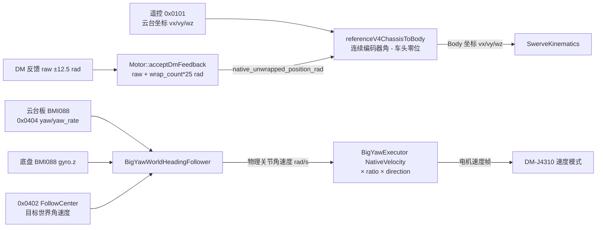

# 大 Yaw 编码器展开与世界航向闭环：标定与排障

本文对应 `fix/big-yaw-encoder-heading` 分支的两项修复：

1. 底盘平移坐标改用大 Yaw 电机**连续原始编码器坐标**（跨 ±25 rad 协议边界不跳变）。
2. 恢复参考工程已有的大 Yaw 世界航向闭环（航向 P + 角速度 PI）。

涉及源码：

- [`applications/sentry_chassis/src/main.cpp`](../../applications/sentry_chassis/src/main.cpp)
- [`include/robotics/chassis/reference_v4_motion.hpp`](../../include/robotics/chassis/reference_v4_motion.hpp)
- [`include/robotics/execution/big_yaw_heading_follower.hpp`](../../include/robotics/execution/big_yaw_heading_follower.hpp)
- [`lib/robotics/big_yaw_heading_follower.cpp`](../../lib/robotics/big_yaw_heading_follower.cpp)
- [`drivers/motor/motor.cpp`](../../drivers/motor/motor.cpp)
- [`include/drivers/motor/motor.hpp`](../../include/drivers/motor/motor.hpp)
- [`include/robotics/vehicle/calibration.hpp`](../../include/robotics/vehicle/calibration.hpp)
- [`include/robotics/vehicle/big_yaw_profile.hpp`](../../include/robotics/vehicle/big_yaw_profile.hpp)

## 1. 数据流



编码器坐标与 IMU 航向是**两件事**：

- 编码器决定“云台相对底盘的角度”，只用于平移坐标变换；
- 云台板 BMI088 决定“云台相对世界的航向”，只用于航向保持。

两者不可互相替代。

## 2. 编码器语义：raw 与 unwrapped

| 名称 | 字段 | 含义 |
| --- | --- | --- |
| 原始角 | `native_position_rad` | 驱动器反馈的 `[-PMAX, +PMAX)` 单段角度，J4310 为 ±12.5 rad |
| 连续角 | `native_unwrapped_position_rad` | 原始角 + `native_wrap_count * 25`，第一帧等于原始角 |
| 相对角 | `feedback.position_rad` | 第一帧为 0 的增量位置，受 `position_reference_valid` / `reseedPosition()` 影响 |

新字段 `native_unwrapped_position_rad` / `native_wrap_count` 位于 [`MotorSnapshot`](../../include/drivers/motor/motor.hpp)：

- 与 `feedback.position_rad` 完全独立，停用/使能、`reseedPosition()`、反馈 gap 都不会重启它；
- 只在通过现有序列/时间戳/有限性检查的新帧上更新；
- 只在跨段时按最近分支 ±1 计数，双精度累计，最终角度再转 `float`。

### 25 rad ≠ 2π 的陷阱

J4310 协议段为 25 rad，而 4 圈是 25.1327 rad。若直接用原始角算方向：

$$
\Delta\theta = \left|25 - 4\times2\pi\right| = 0.132741\ \text{rad} \approx 7.61^\circ
$$

每次跨段平移方向就跳 7.61°，且只会单向累积。这就是“小陀螺持续旋转后方向突然偏一点”的来源。
测试 `test_dm_native_unwrap_stays_continuous_across_25_rad_spans` 同时断言：新坐标步进 ≈ 0.05 rad，旧坐标在跨段处 > 0.12 rad。

### 恢复边界

- 断流短于 `feedback_timeout_ms`（50 ms）时，段计数保留，编码器本身是绝对角，可直接继续；
- 断流更长时，跨越了多少个 25 rad 段无法从数据判断，只能按最近分支继续，**残留至多 k×7.61° 的方向误差**；
- 电机/主控重新上电后段计数从 0 开始；若关节相对标定零位转过多圈，需要重新对车头零位。

现场判断方法：让大 Yaw 在安全环境中持续同向旋转跨过 ±12.5 rad 反馈边界，记录 `native_position_rad`、`native_unwrapped_position_rad`、`native_wrap_count` 与平移方向。若方向在跨段瞬间跳约 7.6°，说明仍在用原始角；若是缓慢偏移，则不是本项问题。

## 3. 车头零位现场标定（不自动改写）

`include/robotics/vehicle/calibration.hpp` 中：

```cpp
inline constexpr float reference_big_yaw_forward_zero_rad = -1.132792f; // 2026-10-28 参考车记录
```

该值是参考车历史读数，**不是本次实测**。步骤：

1. 云台物理正前方与车体正前方严格对齐；
2. 读取 `big_drive.snapshot().native_position_rad`（原始角）5–10 次，确认稳定、时间戳新鲜、驱动无错误码；
3. 若与 `-1.132792` 不同，由现场人员确认后再改常量，并记录日期、量具、硬件零位状态；
4. 静态把大 Yaw 相对底盘转 +90°，正前推杆应输出车体 +Y；转 −90° 应输出 −Y。方向不符时先核对 `reference_big_yaw.direction` 的物理含义，**不要用额外负号补偿**。

禁止把首次上电角度、遥控开始运行角度或两颗 IMU 的 yaw 初值自动当作车头零位。

## 4. 世界航向闭环

`BigYawWorldHeadingFollower`（[头文件](../../include/robotics/execution/big_yaw_heading_follower.hpp)）输出**物理关节角速度**，`BigYawExecutor` 的 NativeVelocity 分支再做一次 `× motor_to_joint_ratio × direction`，单位与符号只应用一次。

控制结构：

$$
e_\theta = \mathrm{clamp}\big(\mathrm{wrap}(\theta_{target} + \omega_{req}dt - \theta_{meas}), \pm90^\circ\big)
$$

$$
\omega_{world} = \omega_{req} + \mathrm{clamp}(K_\theta e_\theta,\ \pm1.5)
$$

$$
\omega_{joint} = \omega_{world} - \omega_{body} + K_p(\omega_{world}-\omega_{head}) + I
$$

- 航向误差限幅 ±90°，避免跟随失败后误差穿过 π 使修正方向翻转；
- 角速度积分含前馈抗饱和：输出饱和且误差仍指向饱和方向时不积分；
- 遥控回中（`|ω_req| ≤ release_epsilon`）时捕获当前实测航向并清积分，不追赶滞后目标；
- 云台板 Boot ID、软件零位代次变化或采样失效时清除状态，恢复后以当前测量重新捕获；
- 云台 IMU 采样按 `source_age_ms + 接收后经过时间` 做短时预测，上限 50 ms。

初始增益（`calibration.hpp`，仅作整定起点，**未在新硬件上验证**）：

| 参数 | 值 | 含义 |
| --- | --- | --- |
| `big_yaw_heading_kp` | 2.0 | 航向 P |
| `big_yaw_heading_rate_max_rad_s` | 1.5 | 航向修正限幅 |
| `big_yaw_heading_rate_kp` | 0.25 | 角速度 P |
| `big_yaw_heading_rate_ki` | 0.5 | 角速度 I |
| `big_yaw_heading_integral_max_rad_s` | 1.5 | 积分限幅 |
| `big_yaw_native_acceleration_rad_s2` | 4.0 | 电机轴目标加速度 |

## 5. 现场调参与排障

1. **先看方向后再闭环**：架空、低速、关闭小陀螺，确认平移方向与四舵轮目标正确；
2. **记录基线**：`head_yaw, head_rate, body_rate, target_heading, heading_error, joint_rate, motor_feedback_rate`；
3. **一次只动一个参数**：先 `big_yaw_heading_kp`，再 `rate_kp`，最后 `rate_ki`；
4. **振荡**：降低 `rate_kp` 或 `rate_ki`；持续单侧偏移：检查 `body_rate` 轴方向与安装；
5. **反复重捕获**：确认 `desired_world_rate` 的回中死区与 `release_epsilon_rad_s` 匹配，避免浮点噪声触发“松手捕获”；
6. **断链/重启**：分别重启两块板，确认恢复后是平滑重捕获，而不是快速转向旧航向。

## 6. 6 轴 IMU 的长期航向边界

BMI088 无外部航向约束时，yaw 会随零偏缓慢漂移，闭环只能让“云台相对其自身 IMU 参考”保持稳定，**不能承诺永久无漂移**。消除该漂移需要视觉/激光等外部航向观测；编码器坐标变换与航向闭环都不能替代它。

## 7. 验证命令

```bash
# 单元测试（含新增 encoder / follower 用例）
west twister -T tests -p native_sim/native/64 --inline-logs --jobs 4 -O build/unit-tests

# 固件编译
west build -b dm_mc02/stm32h723xx applications/sentry_chassis -d build/sentry-chassis --pristine
west build -b dm_mc02/stm32h723xx applications/sentry_gimbal -d build/sentry-gimbal --pristine
```

新增用例集中在 [`tests/sentry_control`](../../tests/sentry_control/src/main.cpp)：

- 编码器：跨 ±25 rad 连续性、正反向多圈、非法/旧帧、`reseedPosition()` 独立性、坐标象限与旋转倍率；
- 航向：捕获/前馈符号、±π 连续旋转、松手捕获、会话与零位切换、输出饱和抗积分、执行器只应用一次符号与传动比；
- 仿真：0.03 rad/s 底盘陀螺偏置 + 10% 速度增益误差 + 20 ms 延迟，两分钟不发散。

以上全部为宿主机回归，**不能替代实车验证**。
