# 小 Yaw 低速偏慢的定位与提速参数指南

> 适用入口：`samples/bringup/gimbal_yaw_encoder`（CAN1 单轴小 Yaw）。
> 本文只写给操作者亲手修改的步骤；**业务源码、配置和构建文件均未改动**。
> 所有数值来自当前工作区源码快照，未做真机验证。

## 1. 结论速览

按对"动得慢"的实际影响排序：

| 排序 | 位置 | 现象贡献 | 结论 |
| --- | --- | --- | --- |
| 1 | `include/robotics/vehicle/bringup_policy.hpp:4` `yaw_encoder_rate_rad_s = 0.2f` | **直接上限**。满杆也只有 0.2 rad/s ≈ 11.5 °/s | 这就是"最快就这速度"的原因，第一处要改 |
| 2 | `include/robotics/vehicle/gimbal_profile.hpp` 速度环 `kp = 0.33f`、`ki = 0.55f`，无速度前馈 | 起步电流很小，靠积分慢慢建立力矩，前 0.5～1 s 明显迟滞 | 想"起步干脆"改这里 |
| 3 | 同文件 `effort_abs_max = 1.2f`、速度 PID `output_min/max = ±1.2f` | 输出电流只有 1.2 A（硬件 3 A、协议满量程 3 A） | 负载重时速度追不上，先看 effort 是否顶住 |
| 4 | 同文件位置环 `deadband = 0.012f`、`kd = 1.48f` | 速率模式继承了位置环的死区和阻尼，低速出现粘滑/滞后 | 只在需要更慢更顺滑时改 |
| 5 | 同文件 `reference_slew = {20, 20}` rad/s² | 20 rad/s² 到 0.2 rad/s 只需 10 ms，**当前不是瓶颈** | 提到 1 rad/s 以上才需要动 |
| 6 | GM6020 反馈速度来自 rpm，1 rpm = 0.1047 rad/s | 0.2 rad/s ≈ 1.9 rpm，量化台阶占目标一半 | 属物理限制，提速后自然改善 |

**一句话：先把 `bringup_policy.hpp` 的 0.2 提到 0.6～1.0，这是唯一真正的硬上限；其余参数是"手感/加速/抗负载"的二级优化。**

## 2. 当前状态、目标、范围与假设

- 当前状态：`small_yaw` 标定已改为 `effort_limit = 3.0 A`、`velocity_limit_rad_s = 10`（`include/robotics/vehicle/calibration.hpp:29`），但样例指令仍被 `bringup_policy` 限制在 0.2 rad/s，所以"改标定不会变快"。
- 目标：在不超过机械行程、电流和温升的前提下，让该样例的小 Yaw 明显变快且起步/停转可控。
- 范围：只涉及 `bringup_policy.hpp`、`gimbal_profile.hpp`（`yawMotorConfig()`）两处参数，以及观察用的诊断配置。
- 假设：
  - `yaw_low_ticks = 5770`、`yaw_high_ticks = 7340`、零点 `5670` 仍是当前实测值。
  - GM6020 走电流模式（`connections_confirmed = true` → `current_mode_confirmed`）。
  - 机械侧无卡滞，方向 `small_yaw.direction = 1` 与 `main.cpp` 中的负号组合已确认。
  - 未做的验证：真机温升、堵转电流、限位开关有效性。

## 3. 控制链路与每个限幅的位置

```mermaid
flowchart LR
    A[RC right_x -660..660] --> B[normalize: 死区0.03 + 重标定]
    B --> C["× bringup::yaw_encoder_rate_rad_s<br/>= 0.2 rad/s（第一道上限）"]
    C --> D["GimbalAxis::updateRate<br/>clamp ±max_rate_rad_s = 10"]
    D --> E["积分成角度目标<br/>clamp 到 yaw_min_rad..yaw_max_rad"]
    E --> F["PositionMotor 位置环<br/>PD + deadband 0.012, 输出 ±4.0 rad/s"]
    F --> G["速度环<br/>slew 20 rad/s², kp 0.33, ki 0.55<br/>输出 ±1.2 A"]
    G --> H["effort clamp ±1.2 A"]
    H --> I["Motor::stage 校验<br/>|I| ≤ small_yaw.effort_limit = 3 A"]
    I --> J[CAN1 → GM6020]
```



三个容易混淆的点：

1. **0.2 是"输入意图"上限**，位于 `main.cpp:52` 的乘法里，与标定和 PID 无关。改它立刻见效，且只影响这一个样例（`pitch_encoder_rate_rad_s`、`big_yaw_rate_rad_s` 是另外两个常量）。
2. **`max_rate_rad_s` 现在是 10，但真正可用上限是 4.0 rad/s**：位置环 `output_min/max = ±4.0` 和速度环 `requested_velocity_abs_max_rad_s = 4.0` 会把速度参考钳在 4。超过 4 时，角度目标会继续积分而实际速度卡在 4，`max_lead_rad = 0` 没有前导保护，目标会越跑越远。**本次不要把速率调到 4 以上。**
3. 速率模式并不是"速度直通"：`GimbalAxis::updateRate()` 先按速率积分出角度目标，再交给 `PositionMotor` 的位置环，位置环输出才是速度指令。因此速率模式**继承位置环的死区和 `kd` 阻尼**。

## 4. 定量分析（为什么 0.2 会又慢又顿）

记 $v$ 为实际角速度，位置环 `kp = 20`、`kd = 1.48`、`deadband = 0.012 rad`。

- **稳态跟踪误差**（位置环 D 项作用在测量上）：
  $$e \approx \frac{1+k_d}{k_p}\,v = 0.124\,v$$
  - $v = 0.2$ → $e = 0.0248$ rad ≈ 1.42°
  - $v = 0.6$ → $e = 0.0744$ rad ≈ 4.3°
- **死区边界速度**：$v_{bd} = \dfrac{\text{deadband}\cdot k_p}{1+k_d} = 0.0968$ rad/s。
  低于这个速度时，P 项被死区清零，只剩下 $ -k_d v$ 的"反向阻尼"，轴会被刹住、误差涨出死区再突然窜动 —— 这就是低速粘滑的机制。
- **跨死区的速度指令突跳**：$k_p\cdot\text{deadband} = 0.24$ rad/s，等于 0.2 rad/s 目标值的 120%，在边界附近极易形成一顿一顿的极限环。
- **停转拖尾距离**（目标停止积分后，误差衰减时间常数约 $1/(k_p/(1+k_d)) \approx 124$ ms）：$\approx 0.124\,v$，即 0.2 rad/s 约 1.4°、0.6 rad/s 约 4.3°、1.0 rad/s 约 7.1°。
- **速度环起步电流**：速度误差 0.2 rad/s 时，P 项只有 $0.33\times0.2 = 0.066$ A；积分项在同样误差下以 $0.55\times0.2 = 0.11$ A/s 增长（积分限幅 ±1.2 A）。所以起步力矩主要靠积分慢慢堆，这是"松杆后要等一下才动"的原因。
- **反馈量化**：GM6020 反馈速度由 `speed_rpm` 换算（`drivers/motor/motor.cpp:623`），1 rpm = 0.1047 rad/s；0.2 rad/s 只有约 1.9 rpm，速度环几乎工作在量化噪声上。

**结论：0.2 rad/s 本身太慢，而且正好落在死区/量化敏感区。提到 0.6 rad/s 同时改善"速度"和"顺滑度"。**

## 5. 机械行程约束（提速前必须先确认）

- 软限位：`5770 → 7340` ticks，零点 `5670` → $yaw_{min} = 0.0767$ rad、$yaw_{max} = 1.281$ rad，跨度 1570 ticks ≈ **1.204 rad ≈ 69°**。
- 走完全行程耗时：0.2 rad/s → 6.0 s；0.6 → 2.0 s；1.0 → 1.2 s。
- 到达限位后 `GimbalAxis` 会把角度目标 clamp 住（`mechanical_limited = true`），表现为**突然停住**，不是故障。提速后现场极易误判，先确认当前机械中心与两端余量。

## 6. 参数清单

| 文件 / 符号 | 现值 | 建议范围 | 作用 | 改动代价/风险 |
| --- | --- | --- | --- | --- |
| `bringup_policy.hpp` `yaw_encoder_rate_rad_s` | 0.2 | **0.6 → 1.0** | 本样例的唯一指令上限 | 仅影响该样例；越大越容易撞 69° 行程端点 |
| `calibration.hpp` `small_yaw.effort_limit` | 3.0 A | 保持 3.0 | 硬件电流上限，`validateEffort` 要求 `effort_abs_max ≤ 它` | 3.0 已是 GM6020 协议满量程（`djiProtocolCurrentMax`） |
| `gimbal_profile.hpp` `effort_abs_max` | 1.2 A | 1.2 → 1.8/2.0 | 速度环最终电流钳位 | 必须同时改速度 PID `output_min/max`，否则被 ±1.2 先钳住 |
| `gimbal_profile.hpp` 速度 PID `output_min/max` | ±1.2 A | 与 `effort_abs_max` 同值 | 速度环输出钳位 | 同上 |
| `gimbal_profile.hpp` 速度 `kp` | 0.33 | 0.5 → 0.8 | A/(rad/s) | 过高会放大 rpm 量化噪声 → 啸叫/抖动 |
| `gimbal_profile.hpp` 速度 `ki` | 0.55 | 0.6 → 1.0 | 消除稳态误差速度 | 过高易过冲；与 `kp` 分开调 |
| `gimbal_profile.hpp` 位置 `deadband` | 0.012 rad | 0.008（不要 0） | 静止微抖抑制 | 减小会放大静止噪声和微调台阶 |
| `gimbal_profile.hpp` 位置 `kd` | 1.48 | 保持，必要时 1.2 → 1.0 | 速度阻尼，影响滞后与停转 | 减小会缩短拖尾但降低稳定裕度 |
| `gimbal_profile.hpp` 位置 `kp` | 20 | 保持 | 位置刚度，决定 $e=0.124v$ | 提高会同时放大噪声 |
| `gimbal_profile.hpp` `reference_slew` | 20 rad/s² | 40（可选） | 速度参考加减速 | 到 1 rad/s 需 50 ms，当前不是主因 |
| `gimbal_profile.hpp` 位置 `output_min/max` 与速度 `requested_velocity_abs_max_rad_s` | ±4.0 / 4.0 | 本次不动 | 真正的速率硬上限 | 两者必须同步改，否则 `configure()` 返回 `-ERANGE` |

## 7. 推荐修改顺序（每步只改一组，改完记录）

### 第 0 步：留基线

改之前记录：`extra0`（目标速率）、`extra1`（实际速率）、`effort`（电流 A）、`error`。这四项足以区分"指令小"和"追不上"。

### 第 1 步：放开指令上限（主要收益）

- 文件：`include/robotics/vehicle/bringup_policy.hpp:4`
- 改法：`0.2f` → `0.6f`
- 预期：满杆速度变成 3 倍（≈34 °/s），`extra0` 绝对值出现 0.6，`extra1` 能跟上。
- 自检：全行程约 2 s；松杆后目标停止积分并保持（`hold_on_zero_rate = true`），不会漂。

### 第 2 步：确认是否还要更快

- 改法：`0.6f` → `1.0f`
- 预期：全行程 1.2 s；跟踪滞后从 4.3° 增到约 7.1°，停转拖尾同级增长。
- 判据：若 `extra1` 已经明显落后 `extra0`，或 `effort` 长时间顶在 ±1.2，说明不是指令问题，进入第 3 步，不要再加大 `yaw_encoder_rate_rad_s`。

### 第 3 步：让起步更硬（速度内环）

- 文件：`include/robotics/vehicle/gimbal_profile.hpp` 的 `yawMotorConfig()`
- 改法（一次只改一项）：`kp 0.33 → 0.6`，观察后再决定 `ki 0.55 → 0.8`
- 预期：同样的 0.6 rad/s 目标，起步电流更快建立，`extra1` 上升更快。
- 停止条件：出现抖动/啸叫、`effort` 频繁反号、或 `error` 变成非 0，立即回退一档。

### 第 4 步：加大电流权限（负载重时）

- 改法：`effort_abs_max 1.2 → 1.8`，**同时**把该 PID 的 `output_min = -1.8`、`output_max = 1.8`
- 约束：必须 ≤ `small_yaw.effort_limit`（3.0 A），否则 `PositionMotor::configure()` 返回 `-ERANGE`，`axis.begin()` 直接失败。
- 上限：3.0 A 是 GM6020 协议满量程，再往上没有意义。
- 预期：`effort` 峰值抬高，速度跟随更快；持续大电流会明显发热，只在需要时开。

### 第 5 步：只在低速仍然粘滑时动位置环

- `deadband 0.012 → 0.008`；仍不够再考虑 `kd 1.48 → 1.2`。
- 原因见第 4 节：死区边界速度 $v_{bd} = 0.0968$ rad/s，`kd` 决定滞后与停转阻尼。
- 不要清零 `deadband`；不要同时改 `kp` 和 `kd`。

### 第 6 步（可选）：参考斜坡

- `reference_slew {20, 20} → {40, 40}` 只影响更高速度下的起步/换向拖尾，前五步无效时再动。

### 后续可选（属设计改动，本文不建议现在做）

当前速率模式"先积分成角度、再走位置环"，天然继承位置环死区与 `kd` 阻尼。若需要真正的速度直通，需要给 `GimbalAxis` 增加一条 Rate 执行路径（直接驱动 `VelocityMotor` 或在 `PositionMotor` 内增加速率模式），涉及控制库接口和测试，超出本次调参范围。

## 8. 构建、烧录与操作

```sh
# 与 samples/bringup/README.md 一致
west build -b dm_mc02/stm32h723xx samples/bringup/gimbal_yaw_encoder -d ../build/bringup/gimbal_yaw_encoder
west flash -d ../build/bringup/gimbal_yaw_encoder
```

若使用 VS Code 的 Zephyr IDE 任务，构建产物在 `samples/bringup/gimbal_yaw_encoder/build/dm_mc02/stm32h723xx`，与当前已烧录目录一致。

上电与解锁顺序：

1. 双拨杆 Down，摇杆/拨轮归中保持 ≥ 500 ms。
2. 左拨杆先切 Middle 建立解锁，再拨左 Up 手动运行；右杆 X 控制 Yaw 速率。
3. 左拨杆 Down 立即撤销；遥控过期（100 ms）同样撤销。
4. 先小幅、再满杆；每次只验证一组参数。

观察通道：`include/robotics/vehicle/diagnostics_config.hpp` 的 `diagnostic_output` 切换文本/VOFA；JustFloat 通道 11=effort、14=error、17=extra0（目标速率）、18=extra1（实际速率）。

## 9. 现象与排查

| 现象 | 可能原因 | 处理 |
| --- | --- | --- |
| `extra0` 明显小于预期 | 摇杆未打满（`normalize` 以 ±660 为满量程）或上限仍偏小 | 打满杆复测；回到第 1/2 步 |
| `extra0` 正常、`extra1` 明显偏小，`effort` 长期 ±1.2 | 电流权限不足或机械阻力大 | 第 4 步；先确认减速箱/线束无卡滞 |
| `extra1` 跟上但整体仍慢 | 指令上限仍是主因 | 第 2 步 |
| 转到某个角度突然不动 | 撞 `yaw_min_rad/yaw_max_rad`（5770/7340 ticks） | 正常限幅；核对机械中心与两端余量，不要放宽限位来"变快" |
| 低速一顿一顿 | 死区边界粘滑（$v < 0.097$ rad/s） | 提高目标速率或第 5 步 |
| 抖动、啸叫、`effort` 反号 | 速度环 `kp` 过大，放大 rpm 量化噪声 | 回退上一档 |
| `error = -ERANGE`，`axis.setup` 非 0 | `effort_abs_max > effort_limit`，或位置环输出 > `requested_velocity_abs_max_rad_s` | 按第 6 节表格把相关值同步调整 |
| `error = -ESTALE/-ENODATA` | 反馈超时/缺字段 | 查 CAN1 接线、GM6020 ID=7、终端电阻 |

## 10. 风险与安全

- 行程只有 69°，1.0 rad/s 下 1.2 s 就到端点；先脱负载或减小幅度验证方向与限位。
- 电流放开后堵转发热快；连续 1.8～3 A 必须有温升观察，不允许长时间顶住。
- 不要用提高增益或电流去掩盖零点、方向、单位错误。
- 每次只改一组参数并记录波形；回退时按相反顺序。
- `velocity_limit_rad_s` 已从 4 改成 10，但位置环/速度环仍限制在 4 rad/s；在该不一致被处理前，任何超过 4 rad/s 的命令都会让角度目标无界领先实际位置。

## 11. 最终勾选清单

- [ ] 已记录基线 `extra0/extra1/effort/error`
- [ ] 已确认机械零点、两端余量与 `direction` 符号
- [ ] 已把 `yaw_encoder_rate_rad_s` 改为 0.6 并实测
- [ ] 视需要再试 1.0，并观察跟踪滞后与停转拖尾
- [ ] 若速度追不上：已按 第 3 → 4 步顺序调整，且 `effort_abs_max` 与 PID `output_min/max` 同步
- [ ] 若低速粘滑：已按第 5 步调整 `deadband`/`kd`，未清零死区
- [ ] 每次改动都重新编译、烧录并记录波形
- [ ] 温升与堵转电流在可接受范围
