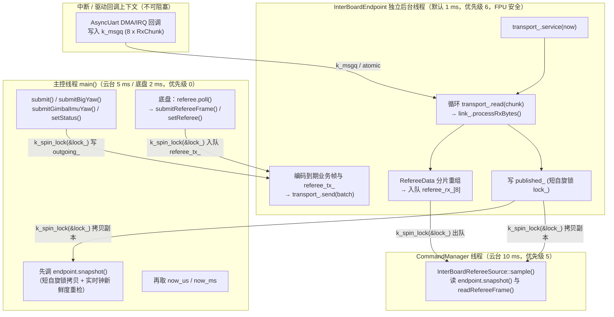

# 板间通信 `InterBoardEndpoint` 独立后台线程与 `snapshot()` 改造实施指南

> **状态声明（2026-11-22）**：本文档基于对当前仓库源码的只读分析编写。按古法编程边界，**目前尚未修改任何业务源码、头文件、Kconfig、应用或测试文件，也未执行编译、单元测试或上机烧录**。
>
> **实施流程约定**：请严格按照本文第 4 节的先后顺序**连续完成全部目标文件修改**（先理清完整路径、集中写完所有改动，不在小步骤之间穿插局部复核或 lint/格式检查），全部代码改完后再统一执行一次编译检查；单元测试仅在需要验证契约时按第 5.2 节命令单独运行。

---

## 1. 当前状态、目标、范围与假设

### 1.1 现状与仓库同类实现对比

当前仓库中的其他串口/IMU 通信模块与命令管理服务都已经在类内部自己持有后台线程（Zephyr `k_thread` + 类内 `K_KERNEL_STACK_MEMBER` 栈空间），并通过 `start()` 启动线程、通过 `snapshot()` 向外暴露最新状态帧；而 `InterBoardEndpoint` 是目前唯一仍然依赖外部线程周期调用 `poll(now_ms)` 的通信门面类。

下表汇总了仓库现有后台模块与 `InterBoardEndpoint` 现状的对照（行号均对应当前工作区源码）：

| 模块与文件 | 后台线程与栈资源 | 线程职责（RX / TX） | 启动入口 `start()` | 读取方式 `snapshot()` |
|---|---|---|---|---|
| `RemoteReceiver`<br>[remote_receiver.hpp](file:///home/shm-white/skywalker_ws/skywalker_code/include/communication/remote/remote_receiver.hpp)<br>[remote_receiver.cpp](file:///home/shm-white/skywalker_ws/skywalker_code/lib/communication/remote_receiver.cpp) | `k_thread` + `K_KERNEL_STACK_MEMBER`<br>`3072 B`，优先级 `6`，`1 ms` 周期 | 独占 `AsyncUart` 与 `RemoteService`（仅 RX） | 校验配置 → `atomic_cas(&started_, 0, 1)` → 创建线程 | `Latest<Snapshot>` 取值，读取时按实时钟重检 `online` |
| `VisionReceiver`<br>[vision_receiver.hpp](file:///home/shm-white/skywalker_ws/skywalker_code/include/communication/vision/vision_receiver.hpp)<br>[vision_receiver.cpp](file:///home/shm-white/skywalker_ws/skywalker_code/lib/communication/vision_receiver.cpp) | `k_thread` + `K_KERNEL_STACK_MEMBER`<br>`4096 B`，优先级 `6`，`1 ms` 周期 | 独占 `AsyncUart` 与 `VisionLink`（**RX 收目标 + 定时 TX 反馈**） | `atomic_cas(&started_, 0, 1)` → `link_.init()` → 创建线程 | `k_spinlock` 复制 `Snapshot`，读取时按实时钟重检 `aim_fresh` |
| `NavigationReceiver`<br>[navigation_receiver.hpp](file:///home/shm-white/skywalker_ws/skywalker_code/include/communication/navigation/navigation_receiver.hpp)<br>[navigation_receiver.cpp](file:///home/shm-white/skywalker_ws/skywalker_code/lib/communication/navigation/navigation_receiver.cpp) | `k_thread` + `K_KERNEL_STACK_MEMBER`<br>`2048 B`，优先级 `6`，`1 ms` 周期 | 独占 `AsyncUart` 与 `NavigationProtocol`（**RX 收导航 + TX 转发裁判帧**） | `atomic_cas(&started_, 0, 1)` → 创建线程 | `k_spinlock` 按值返回 `Snapshot` |
| `ImuReceiver`<br>[imu_receiver.hpp](file:///home/shm-white/skywalker_ws/skywalker_code/include/drivers/imu/imu_receiver.hpp)<br>[imu_receiver.cpp](file:///home/shm-white/skywalker_ws/skywalker_code/drivers/imu/imu_receiver.cpp) | `k_thread` + `K_KERNEL_STACK_MEMBER`<br>可配置周期与优先级 | 独占 `ImuSource`（与可选 `ImuHeater`） | 校验参数 → `atomic_cas` → 启用 `K_FP_REGS` 创建线程 | 直接转发 `source_.snapshot()` |
| `CommandManager`<br>[command_manager.hpp](file:///home/shm-white/skywalker_ws/skywalker_code/include/robotics/command/command_manager.hpp)<br>[command_manager.cpp](file:///home/shm-white/skywalker_ws/skywalker_code/lib/robotics/command/command_manager.cpp) | `k_thread` + `K_KERNEL_STACK_MEMBER`<br>`6144 B`，优先级 `5`，`10 ms` 周期 | 轮询多路源与权限源并运行仲裁器 | `k_is_in_isr()` 返回 `-EWOULDBLOCK`，校验源并创建线程 | `k_spinlock` 拷贝 `CommandSnapshot`（`-EAGAIN` 表示尚未首次发布） |
| **`InterBoardEndpoint`（当前）**<br>[interboard_endpoint.hpp](file:///home/shm-white/skywalker_ws/skywalker_code/include/communication/interboard/interboard_endpoint.hpp)<br>[interboard_endpoint.cpp](file:///home/shm-white/skywalker_ws/skywalker_code/lib/communication/interboard/interboard_endpoint.cpp) | **无内置线程** | 必须由外部唯一通信线程调 `poll(now_ms)` | **无 `start()`** | 已有 `k_spinlock` 保护的 `snapshot()`，以及线程安全的 `submit*`/`set*` |

当前仓库里所有调用 `endpoint.poll(...)` 的方式分裂成两种：

1. **正式应用在控制主循环直接 `poll()`**：
   - 云台 [applications/sentry_gimbal/src/main.cpp](file:///home/shm-white/skywalker_ws/skywalker_code/applications/sentry_gimbal/src/main.cpp#L243) 在 `5 ms` 控制周期里调用 `endpoint.poll(now_ms)`；
   - 底盘 [applications/sentry_chassis/src/main.cpp](file:///home/shm-white/skywalker_ws/skywalker_code/applications/sentry_chassis/src/main.cpp#L126) 在 `2 ms` 控制周期里调用 `endpoint.poll(now_ms)`；
   - 另有 5 个测试/观察样例直接在主循环调用 `poll()`。
2. **10 多个样例各自手写重复线程模板**：
   - 每个样例文件顶部都要复制粘贴一份 `K_THREAD_STACK_DEFINE(link_stack, 4096); k_thread link_thread; void linkTask(...) { endpoint.poll(k_uptime_get()); k_sleep(K_MSEC(1)); }`。

### 1.2 主循环调用 `poll()` 的具体问题

1. **串口接收队列溢出风险**：`AsyncUart` 的接收环形队列 `queue_` 容量只有 **8 个 `RxChunk`**（每个最多 `64 B`，见 [async_uart.hpp](file:///home/shm-white/skywalker_ws/skywalker_code/include/communication/async_uart.hpp#L21-L61)）。云台主循环 `5 ms` 才读取一次，当对端连续发送心跳 + 底盘反馈 + 大 Yaw 反馈 + 多片裁判转发数据（`RefereeData` 发送间隔可低至 `1 ms`）或一次收到多个分散小包时，极易打满 8 项队列触发 `-EOVERFLOW`，导致 `link_.discardPartial()` 丢弃半帧。
2. **发送调度与传输恢复被主循环周期节流**：`InterBoardEndpoint::poll()` 内部依赖 `1 ms` 级别的 `next_tx_ms_ = now + 1`、`RefereeData` `1 ms` 分片周期、以及 RS485/CAN 传输状态机推进；放在 `5 ms` 云台主循环里会把分片发送和恢复节奏拖慢 5 倍。
3. **控制周期抖动耦合**：在控制闭环线程内做 UART/RS485/CAN 服务、字节解析、CRC16 校验和裁判分片重组，会把总线抖动直接耦合进小 Yaw/Pitch/舵轮执行器周期。

### 1.3 改造目标与范围

**目标**：让 `InterBoardEndpoint` 像 `RemoteReceiver`、`VisionReceiver`、`NavigationReceiver` 一样**自己维护独立后台线程**，外部主循环只需在初始化阶段调用 `endpoint.start()`，在控制循环里直接调用 `endpoint.snapshot()` 读取最新帧（并继续用 `submit*`/`set*` 提交发送数据），不再在主循环调用 `endpoint.poll()`。

**范围划分**：

- **阶段一（必做，直接解决正式应用与库层改造）**：
  1. [lib/Kconfig](file:///home/shm-white/skywalker_ws/skywalker_code/lib/Kconfig)（新增板间通信线程栈大小与优先级配置项）
  2. [include/communication/interboard/interboard_endpoint.hpp](file:///home/shm-white/skywalker_ws/skywalker_code/include/communication/interboard/interboard_endpoint.hpp)
  3. [lib/communication/interboard_endpoint.cpp](file:///home/shm-white/skywalker_ws/skywalker_code/lib/communication/interboard/interboard_endpoint.cpp)
  4. [applications/sentry_gimbal/src/main.cpp](file:///home/shm-white/skywalker_ws/skywalker_code/applications/sentry_gimbal/src/main.cpp)
  5. [applications/sentry_chassis/src/main.cpp](file:///home/shm-white/skywalker_ws/skywalker_code/applications/sentry_chassis/src/main.cpp)
  6. [include/robotics/command/receiver_sources.hpp](file:///home/shm-white/skywalker_ws/skywalker_code/include/robotics/command/receiver_sources.hpp)（仅补充注释明确启动权归属）
  7. [tests/execution/prj.conf](file:///home/shm-white/skywalker_ws/skywalker_code/tests/execution/prj.conf)（调大 ZTEST 线程栈以容纳类内嵌栈成员）
- **阶段二（可选清理，向后兼容不强制一次改完）**：
  - 清理仓库中 16 个仍手动调用 `poll()` 或手写 `linkTask` 样板线程的样例（详见第 4.8 节清单），以及同步更新 [docs/modules/communication/interboard-transports.md](file:///home/shm-white/skywalker_ws/skywalker_code/docs/modules/communication/interboard-transports.md)。
- **明确不在本次改造范围内**：
  - [applications/sentry_chassis/src/main.cpp](file:///home/shm-white/skywalker_ws/skywalker_code/applications/sentry_chassis/src/main.cpp#L127) 中的 `RefereeReceiver`（`referee.poll(...)`）目前同样仍在底盘主循环中轮询，但它是一个独立的裁判串口接收类（[referee_receiver.hpp](file:///home/shm-white/skywalker_ws/skywalker_code/include/communication/referee/referee_receiver.hpp)），不属于本次 `InterBoardEndpoint` 改造范围，后续如有需要可参照相同模式单独线程化。

### 1.4 明确假设

1. **静态生命周期约束**：与 `RemoteReceiver`、`VisionReceiver`、`CommandManager` 一致，启用了 `start()` 的 `InterBoardEndpoint` 对象及其绑定的 `InterBoardTransport`、DMA 缓冲区必须具有静态生命周期（`static` 存储期），运行期间不支持停止、重启或析构。
2. **后台线程独占物理传输（RX + TX 统一归属）**：`InterBoardTransport` 和 `AsyncUart` 约定同一时间只能有一个线程调用 `service()`、`read()`、`send()`、`txBusy()`。因此后台线程必须同时承担接收与发送调度，不能拆成“后台只读、主循环发送”。
3. **保留 `poll(std::uint64_t now_ms)` 兼容测试与未迁移样例**：[tests/execution/src/main.cpp](file:///home/shm-white/skywalker_ws/skywalker_code/tests/execution/src/main.cpp) 与 [tests/execution/src/imu_heading.cpp](file:///home/shm-white/skywalker_ws/skywalker_code/tests/execution/src/imu_heading.cpp) 使用虚拟时间戳推进 `poll(100..1200)` 做确定性单元测试。因此保留 `poll()` 接口，但与 `start()` 通过原子所有权标志严格互斥，杜绝双线程同时驱动同一个 `InterBoardEndpoint`。

---

## 2. 架构设计、数据流与拆分理由

### 2.1 数据流与线程边界图



### 2.2 为什么直接改造 `InterBoardEndpoint`，而不是新建 `InterBoardReceiver` 包装类？

1. **职责层级已经对齐**：在仓库现有分层中，DR16 是 `RemoteService`（纯解析/会话）+ `RemoteReceiver`（线程+UART+快照），视觉是 `VisionLink` + `VisionReceiver`，导航是 `NavigationProtocol` + `NavigationReceiver`。而在板间通信中，**`InterBoardLink` 已经承担了纯协议/会话层角色**，`InterBoardEndpoint` 本身就是外部业务直接持有的门面与快照层（并且它本身不仅收，还要调度多周期 TX 发送）。
2. **已有线程安全基础**：`InterBoardEndpoint` 内部已经用 `k_spinlock lock_` 保护了 `outgoing_`、`published_`、`referee_tx_` 和 `referee_rx_`，本身就是按“后台通信线程 + 外部控制线程”跨线程模型设计的。
3. **零破坏下游接口**：`InterBoardRefereeSource`（[receiver_sources.hpp](file:///home/shm-white/skywalker_ws/skywalker_code/include/robotics/command/receiver_sources.hpp#L24-L40)）和 `OperatorControlPublisher`（[operator_controls.hpp](file:///home/shm-white/skywalker_ws/skywalker_code/samples/robotics/common/operator_controls.hpp#L10)）等组件直接持有 `InterBoardEndpoint &`。直接在类内增加 `start()` 和后台线程，所有下游调用方签名保持不变。

### 2.3 术语解释与初学者踩坑说明

- **自旋锁（`k_spinlock`）**：在多核或可抢占 RTOS 中用于极短临界区（几微秒内单纯内存结构体拷贝）的锁。相比 `k_mutex`（互斥锁），`k_spin_lock()` 在单核下会临时屏蔽本地中断并禁止线程切换，因此**绝不能在持有 `k_spinlock` 时调用阻塞函数、打印日志或做串口 I/O**。
- **`Latest<T>` vs `k_spinlock` 按值返回**：`RemoteReceiver` 使用 `Latest<Snapshot>`（基于 `k_mutex_lock(K_NO_WAIT)`），当锁竞争时返回 `-EAGAIN`，调用方必须自己保留一份 `remote_frame` 缓存。`VisionReceiver`、`NavigationReceiver` 和 `InterBoardEndpoint` 则直接用 `k_spinlock` 按值返回 `Snapshot`：拷贝几十/几百字节只需微秒级时间，读取端永远不会遇到 `-EAGAIN` 竞争失败，代码更简洁、无状态。
- **FPU 上下文（`K_FP_REGS`）**：STM32H723 开启了硬件浮点单元及共享切换（`CONFIG_FPU=y`、`CONFIG_FPU_SHARING=y`）。如果线程内执行了任何 `float` 运算（包括 `std::isfinite()`、速度缩放、NaN 检查等）而创建线程时没传 `K_FP_REGS` 选项，Zephyr 不会为该线程保存/恢复浮点寄存器，可能污染其他线程的浮点计算或触发异常。因此必须像 `ImuReceiver` 一样在 `CONFIG_FPU && CONFIG_FPU_SHARING` 时传入 `K_FP_REGS`。
- **时钟域与“未来时间戳”陷阱**：`isFresh(stamp, now_ms, timeout_ms)`（[common.hpp](file:///home/shm-white/skywalker_ws/skywalker_code/include/robotics/messages/common.hpp#L17-L19)）的定义是 `s.valid && now_ms >= s.timestamp_ms && now_ms - s.timestamp_ms <= timeout_ms`。一旦“数据里携带的时间戳”比“校验者手里的 `now_ms`”大了哪怕 `1 ms`（即 `now_ms < s.timestamp_ms`），**就会被判定成“来自未来时间的非法/过期数据”**，导致直接撤权或复位控制状态。第 3.3 节专门给出解决这一跨线程时钟竞态的硬措施。

### 2.4 可参考复用与不可照搬的对照表

| 现有实现 | 可直接参考复用的设计 | 绝对不能照搬的部分与原因 |
|---|---|---|
| `VisionReceiver` / `NavigationReceiver` | `State` 枚举（`NotStarted`, `Starting`, `Running`, `InitFailed`）；`k_spinlock` 按值返回 `Snapshot`；`1 ms` 周期、优先级 `6`；同时负责 RX 和 TX。 | 不可使用 `AsyncUart` 独有的 `uart_.service()` 直调模式：`InterBoardEndpoint` 通过 `InterBoardTransport` 抽象支持 UART / RS485 / CAN 三种后端。 |
| `ImuReceiver` | `k_thread_create` 时根据 `IS_ENABLED(CONFIG_FPU) && IS_ENABLED(CONFIG_FPU_SHARING)` 附加 `K_FP_REGS`。 | `ImuReceiver::snapshot()` 不经过内部缓存而是透传 `source_.snapshot()`；`InterBoardEndpoint` 必须保持内部 `published_` 副本。 |
| `CommandManager` | `start()` 首行 `if (k_is_in_isr()) return -EWOULDBLOCK;` 防止中断上下文误启线程。 | 不要只把线程启动错误记成 `failStart`：如果配置非法（`-EINVAL`），`InterBoardEndpoint::start()` 也要更新 `published_.state = State::InitFailed` 与 `error = -EINVAL`，同时直接返回错误码。 |
| `RemoteReceiver::snapshot()` | 在 `snapshot()` 返回前对副本重检超时，不依赖后台线程最后一次轮询的过期判断，也不反向修改底层缓存。 | **不可无条件用实时钟重检**：`tests/execution` 通过手动 `poll(100..341)` 传入虚拟毫秒数！如果无条件用系统实时钟去卡 `snapshot()`，虚拟测试时间与真实开机时间不符会导致全线单测失败。必须仅在 `owner_ == kOwnerWorker` 时才执行实时钟重检。 |
| `RemoteSource::start()` | `RemoteSource` 自己拥有 `RemoteReceiver`，所以在 `RemoteSource::start()` 里调 `receiver_.start()`。 | **不可在 `InterBoardRefereeSource::start()` 里调 `endpoint_.start()`**：裁判权限源是可选功能（受 `CONFIG_SKYWALKER_REFEREE` 控制），且底盘应用根本没有 `InterBoardRefereeSource`。`endpoint.start()` 必须由各应用 `main()` 显式调用，且早于 `commands.start()`。 |

---

## 3. 接口契约、线程/中断语义与关键边界行为

### 3.1 Kconfig 新增配置项

在 `lib/Kconfig` 的 `config SKYWALKER_INTERBOARD_ENDPOINT` 块后新增两项配置：

- `CONFIG_SKYWALKER_INTERBOARD_STACK_SIZE`：`int`，默认 `4096`，合法范围 `2048..16384`，`depends on SKYWALKER_INTERBOARD_ENDPOINT`。
  - **栈消耗估算**：工作线程执行 `serviceOnce()` 时，栈上同时存在：`Outgoing outgoing`（约 `240 B`）+ `Snapshot next`（约 `350 B`）+ `std::uint8_t batch[240]`（`240 B`）+ `std::uint8_t frame[142]`（`142 B`）+ `RxChunk chunk`（`80 B`）+ `InterBoardLink::processRxBytes` 内部 `uint8_t payload[128]`（`128 B`）+ `Rs485InterBoardTransport::transmit` 的 `frame[256]`（`256 B`）+ 函数调用帧与 FPU 寄存器保存现场 ≈ `1.8~2.2 KB`。设为 `4096 B`（与仓库现有 `VisionReceiver` 及样例 `link_stack` 一致）留有约一倍安全余量。
- `CONFIG_SKYWALKER_INTERBOARD_PRIORITY`：`int`，默认 `6`，合法范围 `0..15`，`depends on SKYWALKER_INTERBOARD_ENDPOINT`。
  - **优先级关系**：Zephyr 中数字越小优先级越高。控制主循环（`main` 线程）优先级为 `0`，电机 CAN I/O 与 `CommandManager` 优先级为 `5`，`RemoteReceiver` / `VisionReceiver` / `NavigationReceiver` / `InterBoardEndpoint` 均为 `6`。板间线程（优先级 `6`）不会抢占控制闭环和电机 CAN，同时又能以 `1 ms` 周期充分排空 8 项 `AsyncUart` 队列并推进 RS485/CAN 收发。

### 3.2 `InterBoardEndpoint` 新增/变更接口契约

| 接口 / 类型 | 声明与签名 | 职责、参数、返回值与状态变化 | 线程 / 中断上下文与边界约束 |
|---|---|---|---|
| `Config::poll_period_ms` | `std::uint32_t poll_period_ms = 1;` | 后台线程每轮休眠周期（ms）。必须放在 `Config` 结构体**末尾**，以保持现有列表初始化 `{BoardRole::ChassisController, 0, 100, 60, 100}`（[tests/execution/src/main.cpp:147](file:///home/shm-white/skywalker_ws/skywalker_code/tests/execution/src/main.cpp#L147)）编译兼容。合法范围 `1..1000`。 | 构造期配置，启动后不可修改。 |
| `enum class State` | `enum class State : std::uint8_t { NotStarted, Starting, Running, InitFailed };` | 表示本地传输通道与端点的生命周期：<br>• `NotStarted`：未调用 `start()` 也未调用 `poll()`。<br>• `Starting`：线程已创建或底层传输返回 `-EAGAIN`（初始化/恢复等待中，如 RS485 协调端上电静默 `1002 ms`）。<br>• `Running`：本地传输 `transport_.service()` 返回 `0` 且本轮读取未遇硬错误（**注意：不代表对端在线，对端在线只看 `Snapshot::online`**）。<br>• `InitFailed`：配置校验失败（`-EINVAL`）或传输返回非 `-EAGAIN` 负错误码（如 `-ENODEV`、`-ENETDOWN`、`-ETIMEDOUT`）。 | 仅作为状态反馈发布在 `Snapshot::state`。 |
| `Snapshot::state` | `State state = State::NotStarted;` | 随 `Snapshot` 原子拷贝给外部读取。 | 默认构造为 `State::NotStarted`。 |
| `start()` | `[[nodiscard]] int start();` | 启动独立后台线程：<br>• ISR 中调用：直接返回 `-EWOULDBLOCK`。<br>• 配置非法（`role` 非法、任意超时/周期为 `0`、`tx_timeout_ms > 1000`、`poll_period_ms > 1000`）：写入 `published_.state = State::InitFailed` 与 `published_.error = -EINVAL`，不创建线程，返回 `-EINVAL`。<br>• 已调用过 `start()`：返回 `-EALREADY`。<br>• 之前已调用过 `poll()`：返回 `-EBUSY`。<br>• 成功：CAS 抢占所有权 `kOwnerIdle -> kOwnerWorker`，写入 `published_.state = State::Starting`，创建线程，返回 `0`。 | **仅线程上下文**；建议仅在 `main()` 初始化阶段调用一次；对象必须为静态存储期。 |
| `poll(std::uint64_t now_ms)` | `void poll(std::uint64_t now_ms);` | 保留给确定性单元测试与未迁移样例的同步驱动入口：<br>• ISR 中调用：直接返回。<br>• 若已 `start()`（`owner_ == kOwnerWorker`）：**静默直接返回**，防止双线程同时操作 `transport_` 和 `link_`。<br>• 首次调用时 CAS 转为 `kOwnerManual`，以 `live_clock = false` 执行一轮 `serviceOnce(now_ms, false)`。 | **一旦调用过 `poll()`，再调用 `start()` 会返回 `-EBUSY`**；同一时间只允许单一外部线程调用 `poll()`。 |
| `snapshot()` | `Snapshot snapshot() const;` | 在短 `k_spinlock` 内拷贝 `published_` 副本。当 `owner_ == kOwnerWorker` 时，在**锁外**以当前 `core::monotonicTimeUs() / 1000` 对副本重检：<br>1) `online`（`heartbeat_timeout_ms`）；<br>2) `gimbal_imu.valid`（含 `50 ms` `forwardedFresh` 及 boot 绑定）；<br>3) `operator_control_valid`（含 `command_timeout_ms` 及 boot 绑定）；<br>4) `big_yaw_request`（过期清空）；<br>5) `big_yaw_feedback`（`status_timeout_ms` 过期则清 `valid/ready/armed`）。 | 线程与多消费者安全；不改写 `published_`，不刷新任何消息时间戳；当 `owner_ != kOwnerWorker`（手动 `poll` 模式）时直接返回 `published_` 原样，保证单测确定性。 |

### 3.3 必须重点防护的两个跨线程时钟竞态

#### 竞态 A：后台工作线程被高优先级线程抢占导致“数据来自未来”

由于 `main()`（优先级 `0`）和 `CommandManager`（优先级 `5`）的优先级均**高于**板间工作线程（优先级 `6`），在线程化之后必然出现如下抢占场景：

```text
t = 1000 ms : [工作线程] run() 取到 now = 1000，进入 serviceOnce(1000, true)
t = 1000 ms : [工作线程] 正在读 transport_.read(chunk)
t = 1001 ms : [系统滴答跳变 + 抢占] main() 抢占工作线程，生成 stamp=1001 的 BigYawRequest / RunStatus / ChassisCommand，
              调用 endpoint.submitBigYaw(req) 写入 outgoing_；或底盘调用 submitRefereeFrame(..., 1001)
t = 1001 ms : [工作线程恢复] 从 lock_ 中拷出 outgoing_（里面的 stamp.timestamp_ms == 1001！）
              如果工作线程仍拿旧的 now = 1000 去调用 forwardedFresh(req.stamp, ..., now, ...)：
              检查 now >= stamp.timestamp_ms → 1000 >= 1001 为 FALSE！！
              结果：后台线程误判本地刚生成的指令“过期/来自未来”，直接发给底盘 BigYawMode::Disabled 停机！
```

**同样的问题也发生在 RX 侧**：UART 中断回调可能把 `chunk.timestamp_ms = 1001` 放进 `RxChunk`，如果 `now` 还是 `1000`，后续 `link_.peerOnline(now, ...)` 会判定 `1000 >= 1001` 为假，瞬间触发误判掉线并 `link_.invalidateControl()`！

**解决方案**：
1. `serviceOnce(std::uint64_t now, bool live_clock)` 接受 `live_clock` 标记（`run()` 传 `true`，`poll()` 传 `false`）。
2. 在读取完所有 `transport_.read(chunk)` **并且**在 `lock_` 内拷贝完 `outgoing_` 到局部栈变量之后，若 `live_clock == true`，**立即刷新一次时间**：
   ```cpp
   if (live_clock)
       now = std::max(now, core::monotonicTimeUs() / 1000);
   ```
   然后再执行 `link_.processRxBytes(nullptr, 0, now)`、`link_.peerOnline(now, ...)`、`forwardedFresh(..., now, ...)` 与 TX 编码。因为 `outgoing` 已是本地栈副本且 `chunk` 已全部读出，这次刷新后的 `now` 必然 `>=` 所有已读/已拷入消息的时间戳。
3. 在底盘侧裁判转发队列 `referee_tx_` 出队循环内（由于该循环在 `serviceOnce` 后半段再次加锁取出队列头元素），如果主循环刚在第 2 步之后入队了 `receive_ms = now + 1` 的新裁判帧，同样会在 `now < referee_pending_.receive_ms` 时误丢帧！因此在 `while (referee_tx_count_)` 判断过期前加一行防护：
   ```cpp
   if (live_clock && now < referee_pending_.receive_ms)
       now = std::max(now, core::monotonicTimeUs() / 1000);
   ```
   这样既不拖慢正常路径，又能彻底杜绝抢占导致的合法裁判帧被误丢或 `now - receive_ms` 无符号下溢。

#### 竞态 B：主循环先取 `now_ms` 再调用 `endpoint.snapshot()` 导致“快照来自未来”

在 `sentry_gimbal` 与 `sentry_chassis` 中，原本是先取 `now_us / now_ms`，再调用 `endpoint.poll(now_ms)`，最后 `endpoint.snapshot()`（因为以前是同线程顺序执行，两者共用同一个 `now_ms`）。

改成后台线程后，如果主循环依然先取 `now_ms = 1000`，再调用 `endpoint.snapshot()`：在极短间隙内后台线程（或 `snapshot()` 内部重检）可能把 `timestamp_ms = 1001` 的消息写入副本，主循环拿着 `now_ms = 1000` 去检验 `forwardedFresh(feedback.stamp, ..., now_ms, 250)` 时同样会因为 `1000 < 1001` 导致 `peer_feedback_valid` 瞬间变 `false`，进而在云台侧触发 `dual_yaw.reset()`（[applications/sentry_gimbal/src/main.cpp:414-415](file:///home/shm-white/skywalker_ws/skywalker_code/applications/sentry_gimbal/src/main.cpp#L414-L415)）！

**解决方案**：完全沿用 `sentry_gimbal/src/main.cpp:236-240` 对 `onboard.snapshot()` 和 `head.snapshot()` 的既定规范——**在每个控制周期顶部，先依次完成 `onboard.snapshot()`、`head.snapshot()`、`endpoint.snapshot()`（底盘先完成 `endpoint.snapshot()`），最后再取 `now_us = core::monotonicTimeUs(), now_ms = now_us / 1000;`”。**

---

## 4. 按 `implementation-first` 顺序的文件级修改清单与示例代码

请严格按 **4.1 → 4.7** 的文件顺序连续完成全部修改（阶段一），再决定是否顺带清理 **4.8** 中的样例（阶段二）。

### 4.1 修改 `lib/Kconfig`

- **目标文件**：[lib/Kconfig](file:///home/shm-white/skywalker_ws/skywalker_code/lib/Kconfig)
- **修改位置**：第 89–93 行 `config SKYWALKER_INTERBOARD_ENDPOINT` 块之后、第 94 行 `config SKYWALKER_INTERBOARD_RS485` 之前。
- **操作说明**：新增后台线程栈大小与优先级两个 Kconfig 符号。

```kconfig
config SKYWALKER_INTERBOARD_ENDPOINT
    bool "Interboard endpoint with selectable transport"
    depends on SKYWALKER_INTERBOARD && ENTROPY_GENERATOR
    default y if SKYWALKER_UART_TRANSPORT

config SKYWALKER_INTERBOARD_STACK_SIZE
    int "Interboard endpoint thread stack bytes"
    depends on SKYWALKER_INTERBOARD_ENDPOINT
    default 4096
    range 2048 16384

config SKYWALKER_INTERBOARD_PRIORITY
    int "Interboard endpoint thread priority"
    depends on SKYWALKER_INTERBOARD_ENDPOINT
    default 6
    range 0 15
```

---

### 4.2 修改 `include/communication/interboard/interboard_endpoint.hpp`

- **目标文件**：[include/communication/interboard/interboard_endpoint.hpp](file:///home/shm-white/skywalker_ws/skywalker_code/include/communication/interboard/interboard_endpoint.hpp)
- **修改内容**：
  1. 增加 `<zephyr/kernel.h>` 和 `<zephyr/sys/atomic.h>` 头文件；
  2. 更新类注释说明：拥有独立后台线程（或兼容单线程 `poll()`）；
  3. 在 `Config` 末尾增加 `poll_period_ms = 1`；
  4. 新增 `enum class State`，在 `Snapshot` 中增加 `State state = State::NotStarted;`；
  5. 新增 `[[nodiscard]] int start();`，更新 `poll()` 注释；
  6. 在 `private:` 区增加 `configValid()`、`serviceOnce()`、`threadEntry()`、`run()`、`owner_`、`thread_` 和 `K_KERNEL_STACK_MEMBER(thread_stack_, CONFIG_SKYWALKER_INTERBOARD_STACK_SIZE);`。

完整替换文件内容如下：

```cpp
#pragma once
#include <array>
#include <communication/interboard/interboard_transport.hpp>
#include <communication/interboard/interboard_link.hpp>
#include <robotics/execution/run_status.hpp>
#include <robotics/messages/referee.hpp>
#include <zephyr/kernel.h>
#include <zephyr/spinlock.h>
#include <zephyr/sys/atomic.h>

namespace skywalker::communication {
// Call start() once to launch the dedicated interboard worker thread, or drive
// poll() manually from a single communication thread (mutually exclusive;
// used by deterministic unit tests). Other calls exchange owned copies under a
// short spinlock. Endpoint, transport and callback storage must outlive reboot.
class InterBoardEndpoint {
public:
    struct Config {
        robotics::BoardRole role;
        std::uint32_t command_timeout_ms = 100, heartbeat_timeout_ms = 200;
        std::uint32_t tx_timeout_ms = 60;
        std::uint32_t status_timeout_ms = 100;
        // Per-message send periods. Control/feedback stay at 100 Hz; heartbeat
        // is reduced to 20 Hz and IMU samples remain at 50 Hz.
        std::uint32_t heartbeat_period_ms = 50, control_period_ms = 10;
        std::uint32_t imu_period_ms = 20, aux_period_ms = 20;
        std::uint32_t poll_period_ms = 1;
    };
    enum class State : std::uint8_t { NotStarted, Starting, Running, InitFailed };
    struct Snapshot {
        robotics::BoardHeartbeat peer{};
        robotics::RemoteChassisControl control{};
        robotics::ChassisConstraint constraint{};
        robotics::ChassisFeedbackSummary feedback{};
        robotics::OperatorControl operator_control{};
        robotics::BigYawRequest big_yaw_request{};
        robotics::BigYawFeedback big_yaw_feedback{};
        robotics::GimbalImuYaw gimbal_imu{};
        bool operator_control_valid = false;
        std::uint64_t local_boot_id = 0;
        State state = State::NotStarted;
        bool online = false;
        int error = 0;
        InterBoardTransportKind transport = InterBoardTransportKind::Uart;
        InterBoardParser::Stats parser_stats{};
        std::uint32_t rejected_frames = 0;
    };
    InterBoardEndpoint(InterBoardTransport &transport, const Config &config)
        : config_(config), transport_(transport), link_(config.role) {
        link_.setRefereeHandler(
            [](const RefereeFragment &fragment, void *context) {
                static_cast<InterBoardEndpoint *>(context)->receiveRefereeFragment(fragment);
            },
            this);
    }
    InterBoardEndpoint(const InterBoardEndpoint &) = delete;
    InterBoardEndpoint &operator=(const InterBoardEndpoint &) = delete;
    // Thread context only. 0 schedules the background I/O worker; inspect
    // Snapshot::state and Snapshot::error for transport readiness.
    // -EINVAL: invalid config; -EALREADY: already started; -EBUSY: poll() used;
    // -EWOULDBLOCK: called from ISR.
    [[nodiscard]] int start();
    void submit(const robotics::ChassisCommand &);
    // Thread-only. 0 copies; -EACCES for a non-gimbal producer; -EINVAL for
    // contradictory run/stop/clear requests. Ages are measured at value.stamp.
    // receiver_boot_id is the producer's binding, including for clear retries.
    [[nodiscard]] int submitOperatorControl(const robotics::OperatorControl &);
    void setReferee(const robotics::RefereeState &);
    void setStatus(const robotics::RunStatus &);
    void submitGimbalImuYaw(const robotics::GimbalImuYaw &);
    void submitBigYaw(const robotics::BigYawRequest &);
    void setBigYawFeedback(const robotics::BigYawFeedback &);
    Snapshot snapshot() const;
    // Manual single-thread step for deterministic tests and unmigrated samples.
    // Ignored once start() owns the transport.
    void poll(std::uint64_t now_ms);
    // Bounded thread-only copies. TX is chassis-only, RX is gimbal-only.
    // Frames are bound to the current peer boot and expire after 300 ms.
    int submitRefereeFrame(const std::uint8_t *, std::size_t, std::uint64_t receive_ms);
    int readRefereeFrame(RefereeRelayFrame &);

private:
    static constexpr atomic_val_t kOwnerIdle = 0, kOwnerWorker = 1, kOwnerManual = 2;
    bool configValid() const;
    void serviceOnce(std::uint64_t now_ms, bool live_clock);
    static void threadEntry(void *self, void *, void *);
    void run();
    void receiveRefereeFragment(const RefereeFragment &);
    std::array<RefereeRelayFrame, 8> referee_tx_{}, referee_rx_{};
    std::size_t referee_tx_head_ = 0, referee_tx_count_ = 0, referee_rx_head_ = 0, referee_rx_count_ = 0;
    std::uint32_t referee_transfer_id_ = 0;
    RefereeRelayFrame referee_pending_{}, referee_assembly_{};
    std::size_t referee_tx_offset_ = 0, referee_rx_offset_ = 0;
    std::uint64_t referee_assembly_start_ms_ = 0;
    bool referee_pending_valid_ = false;
    struct Outgoing {
        robotics::ChassisCommand command{};
        robotics::RefereeState referee{};
        robotics::RunStatus status{};
        robotics::OperatorControl operator_control{};
        robotics::BigYawRequest big_yaw_request{};
        robotics::BigYawFeedback big_yaw_feedback{};
        robotics::GimbalImuYaw gimbal_imu{};
    };
    Config config_;
    InterBoardTransport &transport_;
    InterBoardLink link_;
    mutable k_spinlock lock_{};
    Outgoing outgoing_{};
    Snapshot published_{};
    std::uint64_t boot_id_ = 0, next_tx_ms_ = 0;
    std::array<std::uint64_t, kMessageCount> next_message_ms_{};
    std::array<std::uint32_t, kMessageCount> wire_sequence_{};
    std::uint64_t peer_boot_ = 0;
    std::uint32_t baseline_sequence_ = 0, big_yaw_baseline_sequence_ = 0;
    bool peer_online_ = false, have_baseline_ = false;
    bool have_big_yaw_baseline_ = false;
    int error_ = 0;
    atomic_t owner_ = kOwnerIdle;
    k_thread thread_{};
    K_KERNEL_STACK_MEMBER(thread_stack_, CONFIG_SKYWALKER_INTERBOARD_STACK_SIZE);
};
} // namespace skywalker::communication
```

---

### 4.3 修改 `lib/communication/interboard_endpoint.cpp`

- **目标文件**：[lib/communication/interboard/interboard_endpoint.cpp](file:///home/shm-white/skywalker_ws/skywalker_code/lib/communication/interboard_endpoint.cpp)
- **修改说明**：
  1. 添加 `BUILD_ASSERT` 校验 `CONFIG_SKYWALKER_INTERBOARD_PRIORITY`；
  2. 实现 `configValid()`、`start()`、`threadEntry()`、`run()`；
  3. 更新 `snapshot()`：仅当 `atomic_get(&owner_) == kOwnerWorker` 时，按实时钟对副本重检心跳及 4 项转发/本地有效性，同时保持 `readRefereeFrame()` 对工作线程模式下心跳超时的同步保护；
  4. 将原 `poll(std::uint64_t now)` 主体抽为 `serviceOnce(std::uint64_t now, bool live_clock)`，加入两处 `live_clock` 时钟刷新与 `next.state` 发布；
  5. `poll(std::uint64_t now)` 仅在 `kOwnerManual` 状态下调用 `serviceOnce(now, false)`。

**建议按区域替换修改**（为便于一次准确改完，下面按块给出要替换或新增的代码）：

1. **在 `using namespace robotics;` 后（第 10 行之后）加入编译期优先级断言**：

```cpp
BUILD_ASSERT(CONFIG_SKYWALKER_INTERBOARD_PRIORITY >= 0 &&
             CONFIG_SKYWALKER_INTERBOARD_PRIORITY < CONFIG_NUM_PREEMPT_PRIORITIES,
             "InterBoard endpoint priority must be a valid preemptive priority");
```

2. **更新 `readRefereeFrame()` 中第 83 行判断（在原第 83 行条件中增加工作线程模式下对心跳实时新鲜度的校验）**：

```cpp
        const bool link_online =
            published_.online &&
            (atomic_get(&owner_) != kOwnerWorker || isFresh(published_.peer.stamp, now, config_.heartbeat_timeout_ms));
        if (!link_online || frame.sender_boot_id != published_.peer.sender_boot_id ||
            frame.receiver_boot_id != published_.local_boot_id || now < frame.receive_ms || frame.source_age_ms > 300 ||
            now - frame.receive_ms > 300 - frame.source_age_ms)
            continue;
```

3. **替换第 151–205 行（`snapshot()` 与 `poll()` 开头直到 `next.online` 判定）**：

```cpp
InterBoardEndpoint::Snapshot InterBoardEndpoint::snapshot() const {
    Snapshot value{};
    {
        const auto key = k_spin_lock(&lock_);
        value = published_;
        k_spin_unlock(&lock_, key);
    }
    if (atomic_get(&owner_) == kOwnerWorker) {
        const auto now = core::monotonicTimeUs() / 1000;
        value.online = value.online && isFresh(value.peer.stamp, now, config_.heartbeat_timeout_ms);
        if (!value.online || value.gimbal_imu.receiver_boot_id != value.local_boot_id ||
            value.gimbal_imu.sender_boot_id != value.peer.sender_boot_id ||
            !forwardedFresh(value.gimbal_imu.stamp, value.gimbal_imu.source_age_ms, now, 50))
            value.gimbal_imu.valid = false;
        const auto &op = value.operator_control;
        value.operator_control_valid = value.online && op.sender_boot_id == value.peer.sender_boot_id &&
                                       op.receiver_boot_id == value.local_boot_id &&
                                       forwardedFresh(op.stamp, op.source_age_ms, now, config_.command_timeout_ms);
        if (!forwardedFresh(value.big_yaw_request.stamp,
                            std::max(value.big_yaw_request.command_age_ms, value.big_yaw_request.source_age_ms), now,
                            config_.command_timeout_ms))
            value.big_yaw_request = {};
        if (!value.big_yaw_feedback.valid ||
            !forwardedFresh(value.big_yaw_feedback.stamp, value.big_yaw_feedback.production_age_ms, now,
                            config_.status_timeout_ms)) {
            value.big_yaw_feedback.valid = false;
            value.big_yaw_feedback.ready = false;
            value.big_yaw_feedback.armed = false;
        }
    }
    return value;
}
bool InterBoardEndpoint::configValid() const {
    return (config_.role == BoardRole::GimbalController || config_.role == BoardRole::ChassisController) &&
           config_.command_timeout_ms && config_.heartbeat_timeout_ms && config_.tx_timeout_ms &&
           config_.tx_timeout_ms <= 1000 && config_.status_timeout_ms && config_.heartbeat_period_ms &&
           config_.control_period_ms && config_.imu_period_ms && config_.aux_period_ms && config_.poll_period_ms &&
           config_.poll_period_ms <= 1000;
}
int InterBoardEndpoint::start() {
    if (k_is_in_isr())
        return -EWOULDBLOCK;
    if (!configValid()) {
        const auto key = k_spin_lock(&lock_);
        published_ = {};
        published_.transport = transport_.kind();
        published_.state = State::InitFailed;
        published_.error = -EINVAL;
        k_spin_unlock(&lock_, key);
        return -EINVAL;
    }
    if (!atomic_cas(&owner_, kOwnerIdle, kOwnerWorker))
        return atomic_get(&owner_) == kOwnerWorker ? -EALREADY : -EBUSY;
    {
        const auto key = k_spin_lock(&lock_);
        published_.transport = transport_.kind();
        published_.state = State::Starting;
        published_.error = 0;
        k_spin_unlock(&lock_, key);
    }
    std::uint32_t options = 0;
#if defined(CONFIG_FPU) && defined(CONFIG_FPU_SHARING)
    options |= K_FP_REGS;
#endif
    k_thread_create(&thread_, thread_stack_, K_KERNEL_STACK_SIZEOF(thread_stack_), threadEntry, this, nullptr, nullptr,
                    CONFIG_SKYWALKER_INTERBOARD_PRIORITY, options, K_NO_WAIT);
    return 0;
}
void InterBoardEndpoint::threadEntry(void *self, void *, void *) {
    static_cast<InterBoardEndpoint *>(self)->run();
}
void InterBoardEndpoint::run() {
    for (;;) {
        serviceOnce(core::monotonicTimeUs() / 1000, true);
        k_sleep(K_MSEC(config_.poll_period_ms));
    }
}
void InterBoardEndpoint::poll(std::uint64_t now) {
    if (k_is_in_isr())
        return;
    auto owner = atomic_get(&owner_);
    if (owner == kOwnerIdle) {
        if (atomic_cas(&owner_, kOwnerIdle, kOwnerManual))
            owner = kOwnerManual;
        else
            owner = atomic_get(&owner_);
    }
    if (owner != kOwnerManual)
        return;
    serviceOnce(now, false);
}
void InterBoardEndpoint::serviceOnce(std::uint64_t now, bool live_clock) {
    if (!configValid()) {
        const auto key = k_spin_lock(&lock_);
        published_ = {};
        published_.transport = transport_.kind();
        published_.state = State::InitFailed;
        published_.error = -EINVAL;
        k_spin_unlock(&lock_, key);
        return;
    }
    if (!boot_id_)
        boot_id_ = sys_rand64_get() | 1ULL;
    // Advance backend recovery even when no application message can be sent.
    const int serviced = transport_.service(now);
    bool transport_ready = serviced == 0;
    if (serviced != -EAGAIN)
        error_ = serviced;
    InterBoardTransport::RxChunk chunk{};
    for (unsigned budget = 0; budget < 8; ++budget) {
        const int ret = transport_.read(chunk);
        if (ret == -EOVERFLOW) {
            link_.discardPartial();
            continue;
        }
        if (ret == -EAGAIN)
            break;
        if (ret < 0) {
            error_ = ret;
            transport_ready = false;
            break;
        }
        (void)link_.processRxBytes(chunk.bytes, chunk.size, chunk.timestamp_ms);
    }
    Outgoing outgoing{};
    {
        const auto key = k_spin_lock(&lock_);
        outgoing = outgoing_;
        k_spin_unlock(&lock_, key);
    }
    if (live_clock)
        now = std::max(now, core::monotonicTimeUs() / 1000);
    (void)link_.processRxBytes(nullptr, 0, now);
    Snapshot next{};
    next.transport = transport_.kind();
    next.local_boot_id = boot_id_;
    (void)link_.latestHeartbeat(next.peer);
    next.online = link_.peerOnline(now, config_.heartbeat_timeout_ms);
```

> **注意**：务必删去原第 192–198 行重复的 `link_.processRxBytes(nullptr, 0, now)` 与 `Outgoing outgoing{}` 复制块，因为已合入上方“先读完 RxChunk 并拷贝 `outgoing_`，再刷新 `now` 并过期半帧”的顺序中。

4. **更新原第 391–405 行的底盘裁判出队循环（加入 `live_clock` 时钟刷新防止新入队帧误判未来时间）**：

```cpp
            if (next.online && !referee_pending_valid_) {
                const auto key = k_spin_lock(&lock_);
                while (referee_tx_count_) {
                    referee_pending_ = referee_tx_[referee_tx_head_];
                    referee_tx_head_ = (referee_tx_head_ + 1) % referee_tx_.size();
                    --referee_tx_count_;
                    if (live_clock && now < referee_pending_.receive_ms)
                        now = std::max(now, core::monotonicTimeUs() / 1000);
                    if (referee_pending_.receiver_boot_id != peer_boot_ || now < referee_pending_.receive_ms ||
                        now - referee_pending_.receive_ms > 300)
                        continue;
                    referee_pending_valid_ = true;
                    referee_tx_offset_ = 0;
                    break;
                }
                k_spin_unlock(&lock_, key);
            }
```

5. **更新原第 439–445 行的末尾发布块（填充 `next.state`）**：

```cpp
    next.state = transport_ready ? State::Running
                 : error_ < 0    ? State::InitFailed
                                 : State::Starting;
    next.error = error_;
    next.parser_stats = link_.stats();
    next.rejected_frames = link_.rejectedFrames();
    const auto key = k_spin_lock(&lock_);
    published_ = next;
    k_spin_unlock(&lock_, key);
}
```

---

### 4.4 修改 `applications/sentry_gimbal/src/main.cpp`

- **目标文件**：[applications/sentry_gimbal/src/main.cpp](file:///home/shm-white/skywalker_ws/skywalker_code/applications/sentry_gimbal/src/main.cpp)
- **修改步骤**（共 4 处）：
  1. **启动端点（必须早于 `commands.start()`，第 170 行之后）**：
     在 `if (command_error == 0) command_error = commands.start();` **之前**启动 `endpoint`，因为 `CommandManager` 后台线程中的 `InterBoardRefereeSource` 会立即读 `endpoint.snapshot()` 与 `readRefereeFrame()`；同时在诊断事件区（第 187 行附近）记录 `"interboard"` 事件：

     ```cpp
         const int link_error = endpoint.start();
         if (command_error == 0)
             command_error = commands.start();
         // ... 保持 onboard.start()、head.start() 等现有初始化代码不变 ...
         diagnostics.event("interboard", link_error);
         diagnostics.event("command", command_error);
     ```

  2. **删除主循环 `endpoint.poll(now_ms)`（原第 243 行）并调整 `endpoint.snapshot()` 时序（原第 236–252 行）**：
     把 `const auto peer_state = endpoint.snapshot();` 从第 252 行上移到 `const auto head_snapshot = head.snapshot();` 之后、`const auto now_us = ...` 之前：

     ```cpp
         for (;;) {
             // Snapshot before taking the validation time: higher-priority IMU
             // or interboard worker updates must not make a new stamp appear in our future.
             const auto carrier_snapshot = onboard.snapshot();
             const auto head_snapshot = head.snapshot();
             const auto peer_state = endpoint.snapshot();
             const auto now_us = core::monotonicTimeUs(), now_ms = now_us / 1000;
             const auto dt_us = previous_cycle_us && now_us > previous_cycle_us ? now_us - previous_cycle_us : 0;
             previous_cycle_us = now_us;
             // 先用管理线程现有快照判定“解锁后是否会产生动作”，再把新鲜遥控帧交给状态机。
             const bool have_action_snapshot = commands.snapshot(frame) == 0;
             (void)remote.snapshot(remote_frame);
             const auto startup_test = installed::assessStartupAction(remote_frame.remote,
                                                                      have_action_snapshot ? &frame.observed : nullptr,
                                                                      command_config, installed::spinProfileConfig(),
                                                                      now_us);
             auto operator_state = controls.update(remote_frame.remote, now_ms, startup_test.noAction());
             const bool peer_revoked = (was_peer_online && !peer_state.online) ||
     ```

  3. **更新第 732 行状态灯原因判断**：
     加入 `link_error`（本地 `endpoint.start()` 失败即报 `InitFailed`）：

     ```cpp
             const auto reason = !setup_ready || link_error || onboard_error || (vision_selected && head_error)
                                     ? installed::DiagnosticReason::InitFailed
     ```

  4. **保持其余发送/读取逻辑不变**：第 679 行 `submitGimbalImuYaw`、第 682 行 `submitBigYaw`、第 709 行 `submit`、第 731 行 `setStatus` 均为自旋锁保护的跨线程提交，无需改动。

---

### 4.5 修改 `applications/sentry_chassis/src/main.cpp`

- **目标文件**：[applications/sentry_chassis/src/main.cpp](file:///home/shm-white/skywalker_ws/skywalker_code/applications/sentry_chassis/src/main.cpp)
- **修改步骤**（共 4 处）：
  1. **启动端点（第 82 行附近、诊断事件区第 108 行附近）**：

     ```cpp
         const int body_error = need_body ? body.start() : 0;
         const int link_error = endpoint.start();
         // ... 保持 CAN 与执行器启动不变 ...
         diagnostics.event("interboard", link_error);
         diagnostics.event("steer_bus", steer_error);
     ```

  2. **删除主循环 `endpoint.poll(now_ms)`（原第 126 行）并将 `endpoint.snapshot()` 上移至取 `now_us` 之前（原第 121–130 行）**：

     ```cpp
         for (;;) {
             // 先取快照再采样 now_us/now_ms，避免后台线程新发布帧的时间戳领先于本周期检验时刻。
             const auto rx = endpoint.snapshot();
             const auto now_us = core::monotonicTimeUs(), now_ms = now_us / 1000;
             const auto dt_us = previous_cycle_us && now_us > previous_cycle_us ? now_us - previous_cycle_us : 0;
             const bool cycle_valid = dt_us && dt_us <= big_yaw_config.max_cycle_us;
             previous_cycle_us = now_us;
             const auto referee_state = referee.poll(core::monotonicTimeUs() / 1000);
             endpoint.setReferee(referee_state);
     ```
     > **提醒**：`referee.poll(...)`（[referee_receiver.hpp](file:///home/shm-white/skywalker_ws/skywalker_code/include/communication/referee/referee_receiver.hpp)）属于裁判接收器，本次保留不改；`referee` 回调函数内调用的 `submitRefereeFrame` 已受 `k_spinlock` 保护，可安全被工作线程消费。

  3. **更新第 254 行状态灯原因判断**：

     ```cpp
             const auto reason = link_error || chassis_error || big_error || power_error
                                     ? installed::DiagnosticReason::InitFailed
     ```

  4. **可选补充诊断错误码**：第 261 行 `execution_error` 或第 331 行 `diagnostics.status(.error)` 也可在最前端判断 `link_error ? link_error : ...`（若不改，仍可在启动事件 `diagnostics.event("interboard", link_error)` 看到结果）。

---

### 4.6 修改 `include/robotics/command/receiver_sources.hpp`

- **目标文件**：[include/robotics/command/receiver_sources.hpp](file:///home/shm-white/skywalker_ws/skywalker_code/include/robotics/command/receiver_sources.hpp#L24-L34)
- **修改说明**：不改代码行为，只在 `InterBoardRefereeSource::start()`（第 28 行）上方补充注释，防止后续维护者误在这里调用 `endpoint_.start()`：

```cpp
    // Endpoint is started explicitly by the application before CommandManager::start();
    // referee permission sources do not own or restart the shared interboard worker.
    int start() override {
        return 0;
    }
```

---

### 4.7 修改 `tests/execution/prj.conf`

- **目标文件**：[tests/execution/prj.conf](file:///home/shm-white/skywalker_ws/skywalker_code/tests/execution/prj.conf#L6)
- **修改说明**：将 `CONFIG_TEST_EXTRA_STACK_SIZE=8192` 提高到 `32768`：

```conf
CONFIG_TEST_EXTRA_STACK_SIZE=32768
```

- **原因说明**：在 [tests/execution/src/imu_heading.cpp](file:///home/shm-white/skywalker_ws/skywalker_code/tests/execution/src/imu_heading.cpp#L157-L189) 的测试函数 `test_two_endpoint_freshness_receiver_reboot_and_rebinding` 中，同一个栈帧内同时声明了 **3 个局部 `InterBoardEndpoint` 对象**（`g`、`c`、`reboot`）。每个 `InterBoardEndpoint` 新增 `K_KERNEL_STACK_MEMBER(thread_stack_, 4096)` 后体积大约增加 `~4.25 KB`，3 个实例叠加原结构体总栈帧会显著超出原有的 `8192 B` 额外栈配置。不调整该配置在 `native_sim` 下极易在运行 ZTEST 时发生栈溢出。

---

### 4.8 可选阶段二：清理样例中的旧 `poll()` 与手工 `linkTask` 样板代码

由于 `poll()` 与 `start()` 保持向后兼容且互斥，**所有样例均可在阶段一编译通过后分批清理，无需阻塞正式应用上线**。涉及文件共 16 个（外加 1 份文档）：

1. **主循环直接调用 `endpoint.poll()` 的样例（5 个）**：
   - [samples/bringup/gimbal_link_observe/src/main.cpp](file:///home/shm-white/skywalker_ws/skywalker_code/samples/bringup/gimbal_link_observe/src/main.cpp)
   - [samples/bringup/chassis_link_observe/src/main.cpp](file:///home/shm-white/skywalker_ws/skywalker_code/samples/bringup/chassis_link_observe/src/main.cpp)
   - [samples/bringup/gimbal_big_yaw_command/src/main.cpp](file:///home/shm-white/skywalker_ws/skywalker_code/samples/bringup/gimbal_big_yaw_command/src/main.cpp)
   - [samples/bringup/chassis_big_yaw/src/main.cpp](file:///home/shm-white/skywalker_ws/skywalker_code/samples/bringup/chassis_big_yaw/src/main.cpp)
   - [samples/communication/interboard/src/main.cpp](file:///home/shm-white/skywalker_ws/skywalker_code/samples/communication/interboard/src/main.cpp)
   - **迁移模板**：进入 `for (;;)` 前调用 `(void)endpoint.start();`（`interboard` 样例变量名为 `link`，即 `(void)link.start();`），删去循环内的 `endpoint.poll(...)`，并将 `endpoint.snapshot()` 移至取 `now` 之前。
   - **特别注意 [samples/communication/interboard/src/main.cpp](file:///home/shm-white/skywalker_ws/skywalker_code/samples/communication/interboard/src/main.cpp#L18-L79)**：其中 `DiagnosticTransport::invalid_protocol` 是普通 `bool`，主循环写入、通信线程在 `send()` 读取；改成 `link.start()` 后存在跨线程访问，请把 `bool invalid_protocol = false;` 改为 `atomic_t invalid_protocol = 0;` 并用 `atomic_set` / `atomic_get` 访问。

2. **手工自建 `K_THREAD_DEFINE` / `linkTask` 只调 `endpoint.poll()` 的样例（10 个，含 `manual_big_yaw_link` 配套入口）**：
   - [samples/bringup/chassis_module_fl/src/main.cpp](file:///home/shm-white/skywalker_ws/skywalker_code/samples/bringup/chassis_module_fl/src/main.cpp)
   - [samples/bringup/chassis_module_fr/src/main.cpp](file:///home/shm-white/skywalker_ws/skywalker_code/samples/bringup/chassis_module_fr/src/main.cpp)
   - [samples/bringup/chassis_module_rl/src/main.cpp](file:///home/shm-white/skywalker_ws/skywalker_code/samples/bringup/chassis_module_rl/src/main.cpp)
   - [samples/bringup/chassis_module_rr/src/main.cpp](file:///home/shm-white/skywalker_ws/skywalker_code/samples/bringup/chassis_module_rr/src/main.cpp)
   - [samples/bringup/chassis_drive_link/src/main.cpp](file:///home/shm-white/skywalker_ws/skywalker_code/samples/bringup/chassis_drive_link/src/main.cpp)
   - [samples/bringup/chassis_four_modules/src/main.cpp](file:///home/shm-white/skywalker_ws/skywalker_code/samples/bringup/chassis_four_modules/src/main.cpp)
   - [samples/bringup/gimbal_drive_command/src/main.cpp](file:///home/shm-white/skywalker_ws/skywalker_code/samples/bringup/gimbal_drive_command/src/main.cpp)
   - [samples/bringup/gimbal_dual_yaw/src/main.cpp](file:///home/shm-white/skywalker_ws/skywalker_code/samples/bringup/gimbal_dual_yaw/src/main.cpp)
   - [samples/robotics/dual_yaw_centering/src/main.cpp](file:///home/shm-white/skywalker_ws/skywalker_code/samples/robotics/dual_yaw_centering/src/main.cpp)
   - [samples/robotics/big_yaw_interboard/src/main.cpp](file:///home/shm-white/skywalker_ws/skywalker_code/samples/robotics/big_yaw_interboard/src/main.cpp)
   - 外加共享头与引用入口：[samples/robotics/common/manual_big_yaw_link.hpp](file:///home/shm-white/skywalker_ws/skywalker_code/samples/robotics/common/manual_big_yaw_link.hpp) 与 [samples/robotics/gimbal_shared_can/src/main.cpp](file:///home/shm-white/skywalker_ws/skywalker_code/samples/robotics/gimbal_shared_can/src/main.cpp)
   - **迁移模板**：直接删掉顶部的 `link_stack` / `link_thread` / `linkTask` / `K_THREAD_DEFINE(...)`，改为在 `main()` 初始化阶段调用 `(void)endpoint.start();`（`gimbal_shared_can` 在 `CONFIG_SHOOTER_INTERBOARD_BIG_YAW` 下调 `skywalker::samples::manual_big_yaw::endpoint.start()`）。

3. **混合通信任务样例（1 个头文件）**：
   - [samples/robotics/common/vehicle_bench.hpp](file:///home/shm-white/skywalker_ws/skywalker_code/samples/robotics/common/vehicle_bench.hpp#L285-L396)
   - **迁移方式**：其 `communicationTask` 除了 `endpoint.poll()` 还承担了 `remote`、`operator_states`、`big_yaw_targets`、`commands` 的拼装与 `submit*` 转发。只需在 `run()` 启动阶段调用 `(void)endpoint.start();`（或在 `communicationTask` 循环前调一次 `(void)endpoint.start();`），并删掉第 393 行的 `endpoint.poll(now_ms);` 即可。

4. **模块文档同步**：
   - 更新 [docs/modules/communication/interboard-transports.md](file:///home/shm-white/skywalker_ws/skywalker_code/docs/modules/communication/interboard-transports.md)（补充 `start()` 为默认正式推荐用法，并说明 `poll()` 保留给确定性测试）。

---

## 5. 编译验证、可选单测、上电顺序与故障排查

### 5.1 完成全部修改后的编译检查命令

按照 `implementation-first` 约定，完成第 4.1–4.7 节全部编辑后，再统一执行以下构建检查（**请根据你当前工作区与构建目录相对路径确认 `-d` 路径**）：

```sh
west build -b dm_mc02/stm32h723xx applications/sentry_gimbal -d ../build/applications/sentry_gimbal
west build -b dm_mc02/stm32h723xx applications/sentry_chassis -d ../build/applications/sentry_chassis
```

**自检标准**：两个目标零报错、零新增告警完成链接，无 `K_KERNEL_STACK_MEMBER` 或未定义符号问题。

### 5.2 可选单元测试命令（仅当需要跑测试时执行）

如果你需要验证 `InterBoardEndpoint` 状态机、虚拟时间戳兼容与栈大小调整是否全部正常，可运行：

```sh
west twister -p native_sim/native/64 -T tests/execution
```

### 5.3 硬件上电顺序与预期现象

1. **双板必须同步重新编译并烧录**：云台 `sentry_gimbal` 与底盘 `sentry_chassis` 均需烧录改造后固件。
2. **首次验证安全接线**：断开大功率电机电源（或将车体完全架空、确认急停开关与遥控左拨杆处于 `Down` 停止档、所有摇杆与拨轮归中）。
3. **上电观察顺序**：
   - 先通过两块板的 `UART7`（DAPLink，115200 8N1）连接诊断终端。
   - 上电后观察启动事件：`interboard=0`（说明 `endpoint.start()` 成功）。
   - 双板互相握手上后，应观察到 `online=1`，未接电机时状态灯按预期给出对应诊断状态（而非 `InitFailed`）；接电机解锁测试时，小 Yaw/底盘/大 Yaw 反馈年龄平稳，不再出现因主循环采样抖动引发的 `dual_yaw.reset()` 或裁判帧丢包。

### 5.4 常见故障排查表

| 现象 | 最可能原因 | 排查与修正方法 |
|---|---|---|
| `endpoint.snapshot().state == State::NotStarted`，`online` 恒为 `false` | 忘记在 `main()` 调用 `endpoint.start()` | 检查云台/底盘 `main.cpp` 初始化段，确保调了 `endpoint.start()` 并检查返回值是否为 `0` |
| 系统上电瞬间 HardFault / 栈破坏 / 随机死机 | `InterBoardEndpoint` 或 `transport` / `link_dma` 没加 `static`（放在局部变量上） | 确认三者均为 `static` 或全局静态存储期；`K_KERNEL_STACK_MEMBER` 所在对象绝对不能随函数退出销毁 |
| 大 Yaw 周期性闪断、频繁触发 `dual_yaw.reset()` 或偶发回 `Disabled` | 1) `serviceOnce` 读完 `outgoing_` 后未刷新 `now`；或<br>2) `main()` 先取 `now_ms` 后调 `endpoint.snapshot()`；或<br>3) 忘记删主循环旧 `poll()` 造成混乱 | 核对 4.3 节两处 `live_clock` 刷新、4.4/4.5 节“先 `snapshot()` 再取 `now_us`”顺序，确认已删除主循环 `endpoint.poll()` |
| `endpoint.start()` 返回 `-EINVAL`，`state == InitFailed` | `Config` 字段非法（例如 `poll_period_ms` 填 `0` 或 `> 1000`） | 检查构造 `InterBoardEndpoint` 时的 `Config` 全部超时与周期字段均大于 `0` 且 `poll_period_ms <= 1000` |
| `endpoint.start()` 返回 `-EBUSY` | 之前已经有人调用过 `endpoint.poll()` | 全工程排查同一对象的 `.poll()` 调用并删掉 |
| `native_sim` 运行 `tests/execution` 崩溃 / 栈溢出 | `tests/execution/prj.conf` 中 `CONFIG_TEST_EXTRA_STACK_SIZE` 过小 | 按 4.7 节将 `CONFIG_TEST_EXTRA_STACK_SIZE` 提高到 `32768` |

---

## 6. 风险与安全说明

1. **静态生命周期硬约束**：`InterBoardEndpoint` 内含 Zephyr 内核 `k_thread` 控制块与 `K_KERNEL_STACK_MEMBER` 线程栈。严禁将其作为短生命周期局部变量并启动线程（测试文件 [tests/execution/src/imu_heading.cpp](file:///home/shm-white/skywalker_ws/skywalker_code/tests/execution/src/imu_heading.cpp) 不调用 `start()`，仅调用同步 `poll()`，因此不触发线程栈驻留风险）。
2. **电机与带载安全**：改造改变了板间数据的消费周期（从主循环 `5 ms`/`2 ms` 变为后台 `1 ms`），正式装车上电前务必先**断开功率供电或架空整车**，先验证不带载下的 `online`、`operator_control_valid`、左 Down 急停撤权、以及云台-底盘通信断流超时停机功能全部有效，再逐步上电测试小 Yaw/大 Yaw/舵轮运动。
3. **静态内存增量**：每个 `InterBoardEndpoint` 实例静态 BSS 内存增加约 **`4.25 KB`**（`4096 B` 线程栈 + `k_thread` 结构体 + `atomic_t`）。STM32H723 片内 SRAM 充裕，单板仅实例化 1 个端点，无溢出风险；仍建议在编译后核对最终 RAM 占用报告。

---

## 7. 最终勾选清单

- [ ] `lib/Kconfig` 已新增 `SKYWALKER_INTERBOARD_STACK_SIZE`（默认 `4096`）和 `SKYWALKER_INTERBOARD_PRIORITY`（默认 `6`）
- [ ] `include/communication/interboard/interboard_endpoint.hpp` 已新增 `Config::poll_period_ms`、`State`、`Snapshot::state`、`start()`、三态 `owner_` 与类内 `k_thread`/栈成员
- [ ] `lib/communication/interboard_endpoint.cpp` 已实现 `start()`、`run()`、`serviceOnce()`（含两处 `live_clock` 刷新）、`snapshot()`（仅在 `kOwnerWorker` 下重检实时新鲜度）与互斥 `poll()`
- [ ] `applications/sentry_gimbal/src/main.cpp` 已在 `commands.start()` 前调用 `endpoint.start()`、记录 `"interboard"` 事件、删除主循环 `poll()`、将 `endpoint.snapshot()` 上移至取 `now_us` 前、并在 `reason` 中检查 `link_error`
- [ ] `applications/sentry_chassis/src/main.cpp` 已调用 `endpoint.start()`、记录 `"interboard"` 事件、删除主循环 `poll()`、将 `endpoint.snapshot()` 上移至取 `now_us` 前、并在 `reason` 中检查 `link_error`
- [ ] `include/robotics/command/receiver_sources.hpp` 已补充 `InterBoardRefereeSource::start()` 注释
- [ ] `tests/execution/prj.conf` 已将 `CONFIG_TEST_EXTRA_STACK_SIZE` 提高至 `32768`
- [ ] 云台与底盘应用编译通过（可选：`west twister -p native_sim/native/64 -T tests/execution` 通过）
- [ ] （可选阶段二）已按需清理 16 个样例中的旧 `poll()` / 手工 `linkTask` 样板代码与模块文档
- [ ] 已双板同步烧录，并在架空/断功率安全条件下完成上电与断联停机验证
